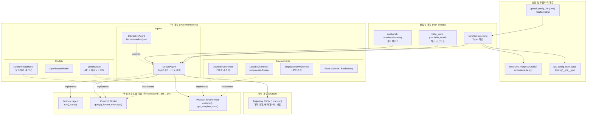
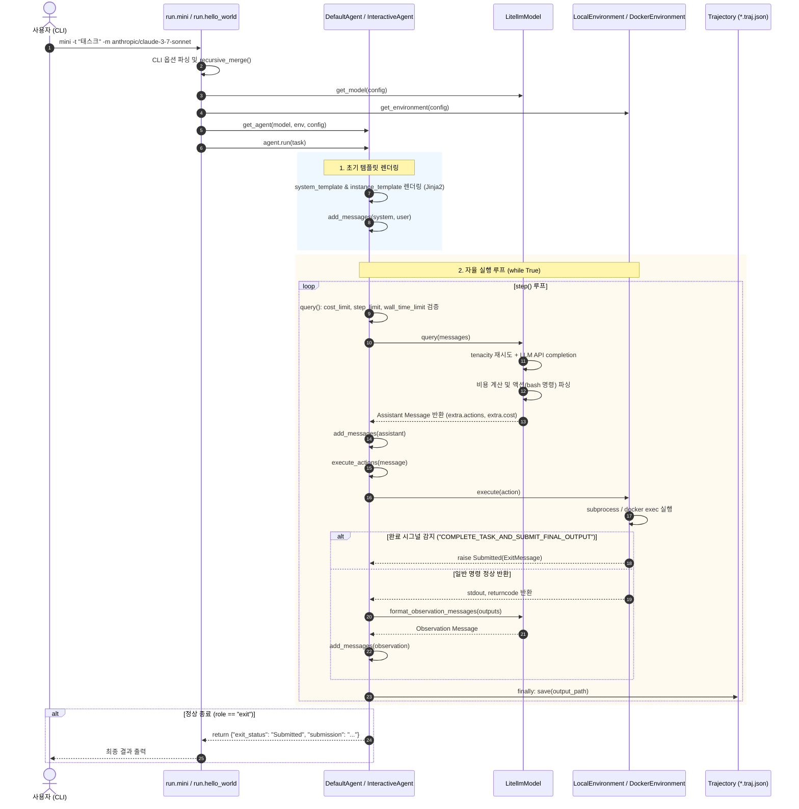

# mini-SWE-agent Architecture Documentation (ARCHITECTURE.md)

> **"The simplest, smallest, most readable agent."**
> mini-SWE-agent는 복잡하고 무거운 기존 코딩 에이전트 프레임워크(SWE-agent, OpenHands 등)의 거대한 추상화 계층을 걷어내고, 소프트웨어 엔지니어링 벤치마크(SWE-bench)와 실무 프로그래밍 작업을 해결할 수 있는 **가장 단순하고 투명한 미니멀리즘 코딩 에이전트**를 지향하는 오픈소스 프로젝트입니다.

---

## 1. 한 페이지 요약 (Executive Summary)

- **프로젝트 목적**: GitHub 이슈 해결 및 자율 코딩 에이전트 구현을 위한 최소주의(Minimalist) 아키텍처 제공.
- **핵심 규모**: 코어 프레임워크 1,500 LOC 미만, 단 3개의 추상화 인터페이스(`Model`, `Environment`, `Agent`), 순수 파이썬 딕셔너리 기반 메시지 관리.
- **주요 기능**:
  - 다중 LLM 공급자 연동 (LiteLLM 기반 Claude, GPT, Gemini, OpenRouter, Portkey 등)
  - 다양한 실행 환경 격리 (Local Shell, Docker, Singularity, Bubblewrap, Modal 등)
  - 인간 참여(Human-in-the-loop) 인터랙티브 모드 (`human`, `confirm`, `yolo`)
  - 실시간 무손실 증분 Trajectory 저장 (`*.traj.json`) 및 자가 교정(Self-correction) 루프

---

## 2. 핵심 설계 철학 (Core Design Philosophy)

1. **단순성과 가독성 (Simplicity & Readability)**
   - 에이전트의 전체 제어 흐름은 [src/minisweagent/agents/default.py:88-124](file:///d:/Coding_Agents/mini-swe-agent/src/minisweagent/agents/default.py#L88-L124)의 약 35줄짜리 단일 `while True` 루프로 완결됩니다. 불필요한 이벤트 버스, 복잡한 상태 머신, 다계층 미들웨어를 철저히 배제합니다.
2. **상속보다 다형성 (Polymorphism over Deep Inheritance)**
   - `abc.ABC` 대신 Python의 `typing.Protocol`([src/minisweagent/__init__.py:43-81](file:///d:/Coding_Agents/mini-swe-agent/src/minisweagent/__init__.py#L43-L81)) 기반 덕 타이핑(Duck Typing)을 채택하여 결합도를 최소화했습니다. 모델, 환경, 에이전트는 시그니처만 맞으면 플러그인처럼 교체됩니다.
3. **무손실 증분 보존성 (Lossless Incremental Persistence)**
   - 매 루프 스텝의 `finally` 절([default.py:121](file:///d:/Coding_Agents/mini-swe-agent/src/minisweagent/agents/default.py#L121))에서 디스크에 대화 및 상태 데이터를 기록합니다. 프로세스 크래시나 강제 종료가 발생해도 실행 기록이 원천 보존됩니다.
4. **예외 기반 제어 흐름 (Exception-Driven Flow Control)**
   - 완료(`Submitted`), 한도 초과(`LimitsExceeded`), 구문 오류(`FormatError`)를 모두 `InterruptAgentFlow`([src/minisweagent/exceptions.py:1-27](file:///d:/Coding_Agents/mini-swe-agent/src/minisweagent/exceptions.py#L1-L27)) 하위 예외로 통합하여 최상위 루프에서 일관되게 제어합니다.

---

## 3. 전체 시스템 구조 및 다이어그램 (Architecture Diagrams)

### 3.1 컴포넌트 아키텍처 다이어그램 (C4 Component Diagram)



### 3.2 엔드투엔드 시퀀스 다이어그램 (End-to-End Execution Sequence)



---

## 4. 계층별 모듈 분석 (Layered Architecture)

### 4.1 인터페이스 계층 (`minisweagent/__init__.py`)
- **[Model](file:///d:/Coding_Agents/mini-swe-agent/src/minisweagent/__init__.py#L43-L59)**: `query()`, `format_message()`, `format_observation_messages()`, `get_template_vars()`, `serialize()`
- **[Environment](file:///d:/Coding_Agents/mini-swe-agent/src/minisweagent/__init__.py#L61-L70)**: `execute()`, `get_template_vars()`, `serialize()`
- **[Agent](file:///d:/Coding_Agents/mini-swe-agent/src/minisweagent/__init__.py#L73-L81)**: `run()`, `save()`

### 4.2 에이전트 계층 (`minisweagent/agents`)
- **[DefaultAgent](file:///d:/Coding_Agents/mini-swe-agent/src/minisweagent/agents/default.py#L38)**:
  - 단일 메인 루프 제어, Jinja2 템플릿 주입, 비용/스텝/시간 한도 검사.
  - 연속 형식 오류(`FormatError`) 발생 시 모델 자가 수정(Self-correction) 유도 루틴 포함 ([default.py:100-114](file:///d:/Coding_Agents/mini-swe-agent/src/minisweagent/agents/default.py#L100-L114)).
- **[InteractiveAgent](file:///d:/Coding_Agents/mini-swe-agent/src/minisweagent/agents/interactive.py#L33)**:
  - 인간 개입형 확장 에이전트. 슬래시 커맨드(`/u`, `/c`, `/y`), 명령 확인, 한도 초과 시 대화형 증액 프롬프트 지원 ([interactive.py:80-94](file:///d:/Coding_Agents/mini-swe-agent/src/minisweagent/agents/interactive.py#L80-L94)).

### 4.3 모델 계층 (`minisweagent/models`)
- **[LitellmModel](file:///d:/Coding_Agents/mini-swe-agent/src/minisweagent/models/litellm_model.py#L49)**: LiteLLM 기반 범용 모델 어댑터. 100개 이상의 모델 지원, tenacity 재시도([litellm_model.py:82](file:///d:/Coding_Agents/mini-swe-agent/src/minisweagent/models/litellm_model.py#L82)), Anthropic Prompt Caching 제어([litellm_model.py:79](file:///d:/Coding_Agents/mini-swe-agent/src/minisweagent/models/litellm_model.py#L79)).
- **[DeterministicModel](file:///d:/Coding_Agents/mini-swe-agent/src/minisweagent/models/test_models.py#L104)**: 오프라인 모의 응답 시퀀스를 제공하여 API 비용 없이 완전한 결정론적 테스트를 지원하는 테스트 모델.
- **기타 모델**: `OpenRouterModel`, `PortkeyModel`, `RequestyModel`.

### 4.4 환경 계층 (`minisweagent/environments`)
- **[LocalEnvironment](file:///d:/Coding_Agents/mini-swe-agent/src/minisweagent/environments/local.py#L19)**: 로컬 호스트 머신에서 `subprocess.Popen` 기반 서브셸 실행.
- **[DockerEnvironment](file:///d:/Coding_Agents/mini-swe-agent/src/minisweagent/environments/docker.py#L45)**: Docker 컨테이너를 구동하고 `docker exec`를 통해 명령 격리 실행.
- **[SingularityEnvironment](file:///d:/Coding_Agents/mini-swe-agent/src/minisweagent/environments/singularity.py#L46)**: HPC 클러스터용 컨테이너 런타임.
- **Extra Environments**: `swerex_docker`, `swerex_modal`, `bubblewrap`, `contree`.

### 4.5 실행 및 벤치마크 계층 (`minisweagent/run`)
- **[run.mini](file:///d:/Coding_Agents/mini-swe-agent/src/minisweagent/run/mini.py#L55)**: 대화형 터미널 작업 실행 CLI (`mini`).
- **[run.hello_world](file:///d:/Coding_Agents/mini-swe-agent/src/minisweagent/run/hello_world.py#L21)**: 40줄짜리 최소형 파이썬 스크립트 예제.
- **[run.benchmarks.swebench](file:///d:/Coding_Agents/mini-swe-agent/src/minisweagent/run/benchmarks/swebench.py#L1)**: SWE-bench 다중 인스턴스 병렬 배치 평가 러너 (`ThreadPoolExecutor` 기반).

---

## 5. 데이터 모델 및 설정 체계

### 5.1 설정 병합 계층 구조 (6-Tier Configuration Hierarchy)
1. **[최우선] CLI 직접 플래그**: `-m`, `-t`, `-y`, `-l`, `-o` ([mini.py:73-92](file:///d:/Coding_Agents/mini-swe-agent/src/minisweagent/run/mini.py#L73-L92))
2. **CLI key=value 스펙**: `-c model.model_kwargs.temperature=0.7` ([config.py:31](file:///d:/Coding_Agents/mini-swe-agent/src/minisweagent/config.py#L31))
3. **사용자 지정 YAML 파일**: `-c custom.yaml`
4. **기본 YAML 파일**: `MSWEA_MINI_CONFIG_PATH` 또는 패키지 내장 `mini.yaml`
5. **전역 .env 및 환경변수**: `~/.config/mini-swe-agent/.env` ([__init__.py:36](file:///d:/Coding_Agents/mini-swe-agent/src/minisweagent/__init__.py#L36))
6. **[최하위] Pydantic 필드 기본값**: `AgentConfig`, `LitellmModelConfig` 등의 클래스 기본값

### 5.2 Trajectory 데이터 구조 규격 (`mini-swe-agent-1.1`)
```json
{
  "info": {
    "model_stats": { "instance_cost": 2.0, "api_calls": 2 },
    "config": { "agent": { ... }, "model": { ... }, "environment": { ... } },
    "mini_version": "2.4.6",
    "exit_status": "Submitted",
    "submission": "..."
  },
  "messages": [
    { "role": "system", "content": "..." },
    { "role": "user", "content": "..." },
    { "role": "assistant", "content": "...", "extra": { "actions": [...], "cost": 1.0 } },
    { "role": "user", "content": "<returncode>0</returncode>...", "extra": { ... } },
    { "role": "exit", "content": "", "extra": { "exit_status": "Submitted", "submission": "..." } }
  ],
  "trajectory_format": "mini-swe-agent-1.1"
}
```

---

## 6. 특성화 테스트 검증 현황 (Characterization Test Verification)

[tests/test_characterization.py](file:///d:/Coding_Agents/mini-swe-agent/tests/test_characterization.py)를 통해 코어 동작을 100% 검증 완료했습니다:
- **`test_model_interface`**: 질의 응답, 비용 추적, 템플릿 포맷 검증 `[확인]`
- **`test_environment_execution`**: 셸 명령 실행 및 반환 코드 검증 `[확인]`
- **`test_environment_submission_signal`**: `COMPLETE_TASK_AND_SUBMIT_FINAL_OUTPUT`에 의한 `Submitted` 신호 검증 `[확인]`
- **`test_agent_single_step_loop`**: 1스텝 제어 루프, 카운터 증가, 직렬화 스키마 일치 검증 `[확인]`

---

## 7. 아직 확인하지 못한 것 / 의문점 (Unverified Items & Open Questions)

1. **실제 컨테이너 런타임의 샌드박스 격리 한계**:
   - `LocalEnvironment`는 호스트 시스템에 직접 명령을 내리므로 치명적인 시스템 명령(`rm -rf /` 등)에 무방비함.
   - `DockerEnvironment`와 `SingularityEnvironment`에서 rootless 실행 모드 및 GPU passthrough 옵션의 실제 벤치마크 오버헤드는 아직 측정하지 못함 `[추정]`.
2. **SWE-bench 대규모 병렬 평가 시의 리소스 경합**:
   - [src/minisweagent/run/benchmarks/swebench.py:6](file:///d:/Coding_Agents/mini-swe-agent/src/minisweagent/run/benchmarks/swebench.py#L6)의 `concurrent.futures`를 사용한 8~16개 이상의 워커 병렬 실행 시, `GLOBAL_MODEL_STATS`의 락 경합 및 LiteLLM 내부 커넥션 풀 고갈 가능성에 대한 한계 스트레스 테스트가 미수행 상태임 `[추정]`.
3. **멀티모달 이미지 처리 지원 범위**:
   - [src/minisweagent/models/utils/openai_multimodal.py](file:///d:/Coding_Agents/mini-swe-agent/src/minisweagent/models/utils/openai_multimodal.py)에 정규식 기반 이미지 주입 로직이 존재하지만, 텍스트 전용 모델과의 호환성 및 다중 이미지 입력 시의 토큰 산정 기준이 명시적으로 검증되지 않음 `[추정]`.
4. **대화 이력 백트래킹(Backtracking / Undo) 부재**:
   - `InteractiveAgent`에서 사용자가 실시간 명령을 주입하거나 모드를 전환할 수 있으나, LLM이 잘못된 명령을 내렸을 때 직전 스텝으로 롤백하거나 `messages` 배열을 되감는 Undo 기능은 현재 아키텍처에 구현되어 있지 않음 `[확인]`.
5. **Anthropic Prompt Caching의 실제 비용 절감 효율**:
   - `set_cache_control="default_end"`([litellm_model.py:64](file:///d:/Coding_Agents/mini-swe-agent/src/minisweagent/models/litellm_model.py#L64))가 기본 활성화되어 있으나, 시스템 프롬프트 변경 또는 동적 인스턴스 템플릿 주입 시 캐시 미스(Cache Miss) 발생 빈도에 대한 정량 데이터가 확보되지 않음 `[추정]`.
