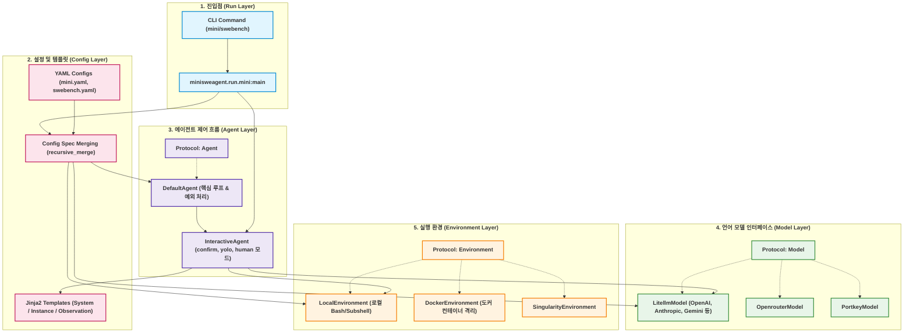
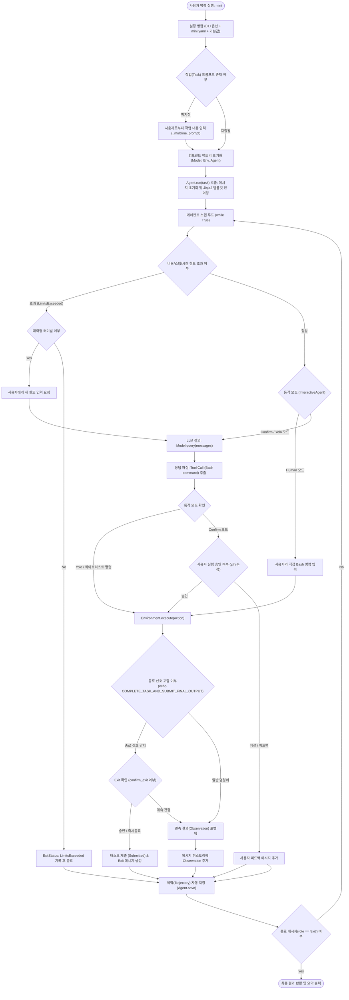
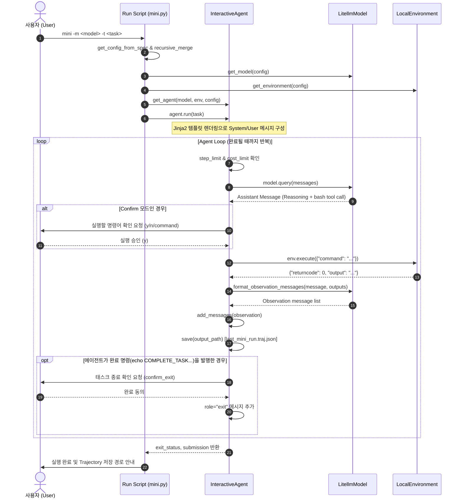

# mini-SWE-agent 동작 구조 및 워크플로우 (Workflow)

이 문서는 [mini-SWE-agent](file:///d:/Coding_Agents/mini-swe-agent/README.md)의 시스템 동작 원리, 핵심 컴포넌트 아키텍처, 그리고 실행 제어 흐름(Workflow)을 상세히 설명합니다.

---

## 1. 프로젝트 개요

**mini-SWE-agent**는 GitHub 이슈 및 소프트웨어 엔지니어링 문제를 자율적으로 해결하는 초경량 AI 코딩 에이전트입니다.
단순성, 최소주의, 다형성(Polymorphism)을 원칙으로 설계되어 있으며 다음 5개의 핵심 레이어로 구성됩니다:

1. **Run (진입점)**: CLI 명령(`mini`, `swebench` 등)을 파싱하고 환경과 에이전트를 초기화하여 시작합니다.
2. **Agent (에이전트 제어 흐름)**: 프롬프트 렌더링, LLM 질의, 도구 실행, 인터랙션 모드, 예외 처리 루프를 관리합니다.
3. **Model (LLM 인터페이스)**: LiteLLM, OpenRouter, Portkey 등을 통해 LLM에 질의하고 Tool Call 응답 및 관측(Observation) 메시지를 포맷팅합니다.
4. **Environment (실행 환경)**: 에이전트가 생성한 셸 명령어를 로컬(`Local`), 컨테이너(`Docker`), 샌드박스(`Singularity`) 등 격리된 환경에서 실행합니다.
5. **Config (설정 및 템플릿)**: 계층적 YAML 설정 병합, Jinja2 기반 템플릿 렌더링, 상태 직렬화(Trajectory)를 지원합니다.

---

## 2. 컴포넌트 아키텍처 (Mermaid)



---

## 3. 전체 실행 흐름도 (Execution Flowchart)



---

## 3.1 'swebench' 벤치마크 평가 워크플로우 및 사용법 (SWE-bench Batch Evaluation)

[swebench.py](file:///d:/Coding_Agents/mini-swe-agent/src/minisweagent/run/benchmarks/swebench.py)는 [SWE-bench](https://www.swebench.com/)의 GitHub 실제 이슈 인스턴스들을 일괄(배치, Batch)로 실행하고, 각 인스턴스별 해결 패치를 생성하여 정답률을 측정할 수 있도록 설계된 벤치마크 평가 엔진입니다.

### 1. 주요 특징 및 동작 원리
- **격리된 컨테이너 실행**: 각 SWE-bench 인스턴스 ID(예: `sympy__sympy-15599`)에 해당하는 도커 이미지(`docker.io/swebench/sweb.eval.x86_64.*`)를 동적으로 매핑하여 격리된 컨테이너 환경([DockerEnvironment](file:///d:/Coding_Agents/mini-swe-agent/src/minisweagent/environments/docker.py))에서 작업을 수행합니다.
- **멀티스레드 병렬 처리**: `concurrent.futures.ThreadPoolExecutor`를 활용하여 지정한 워커 수(`--workers`)만큼 동시에 여러 인스턴스를 병렬 처리합니다.
- **실시간 예측 파일 업데이트 (`preds.json`)**: 인스턴스 처리가 완료될 때마다 스레드 락(`_OUTPUT_FILE_LOCK`)을 사용하여 `preds.json`에 모델 패치(`model_patch`)를 즉시 추가하므로, 도중에 중단되어도 이미 완료된 인스턴스의 결과를 잃지 않습니다.
- **이어하기(Resume) 지원**: 기본적으로 `preds.json`에 이미 기록된 인스턴스는 자동으로 건너뛰어(Skip) 비용과 시간을 절약합니다 (`--redo-existing` 플래그로 덮어쓰기 가능).
- **진행 상황 시각화**: Rich의 `Live` 디스플레이와 [RunBatchProgressManager](file:///d:/Coding_Agents/mini-swe-agent/src/minisweagent/run/benchmarks/utils/batch_progress.py)를 통해 각 인스턴스의 상태(컨테이너 풀링, 실행 중, 완료, 오류 등)와 전체 진행률을 터미널에 실시간 렌더링합니다.

### 2. 실행 명령어

```bash
# 1) CLI 서브커맨드 사용
mini-extra swebench [옵션]

# 2) 파이썬 스크립트 직접 실행
python src/minisweagent/run/benchmarks/swebench.py [옵션]
```

도움말 확인:
```bash
mini-extra swebench --help
```

### 3. 주요 옵션 파라미터

| 분류 | 옵션 플래그 | 기본값 | 설명 |
| :--- | :--- | :--- | :--- |
| **기본 실행** | `-o`, `--output` | `""` | 결과물(`preds.json`, 궤적 파일, 로그 등)을 저장할 출력 디렉터리 (필수 지정 권장) |
| | `-m`, `--model` | [swebench.yaml](file:///d:/Coding_Agents/mini-swe-agent/src/minisweagent/config/benchmarks/swebench.yaml) 참조 | 사용할 LLM 모델 식별자 (예: `anthropic/claude-sonnet-4-5-20250929`, `gemini/gemini-2.5-flash`) |
| | `-w`, `--workers` | `1` | 병렬 실행할 워커 스레드 수 |
| | `-c`, `--config` | `swebench.yaml` | 벤치마크 전용 설정 파일 경로 (다중 전달 시 계층적 병합) |
| **데이터셋 선택** | `--subset` | `lite` | SWE-bench 서브셋 (`lite`, `verified`, `full`, `multimodal`, `multilingual`, `rebench` 등) 또는 로컬/HuggingFace 데이터셋 경로 |
| | `--split` | `dev` | 데이터 분할셋 (`dev`, `test`) |
| | `--slice` | `""` | 인스턴스 범위 슬라이스 (예: `0:5` → 처음 5개 인스턴스만 실행) |
| | `--filter` | `""` | 인스턴스 ID를 정규식으로 필터링 (예: `django__django.*`, `sympy__sympy-15599`) |
| | `--shuffle` | `False` | 인스턴스 순서를 무작위로 섞어 실행 |
| | `--redo-existing` | `False` | `preds.json`에 이미 존재하는 인스턴스를 무시하고 재실행 |
| **고급 설정** | `--environment-class` | `docker` | 샌드박스 실행 환경 (`docker`, HPC용 `singularity`, `contree`, `swerex_modal`) |
| | `--model-class` | `None` | 커스텀 모델 클래스 지정 시 사용 |

### 4. 단계별 상세 실행 라이프사이클 (Lifecycle)

1. **초기화 및 로그 핸들러 등록**:
   - 출력 디렉터리(`output_path`)를 생성하고 `minisweagent.log` 파일 핸들러를 등록합니다.
2. **데이터셋 로드 및 필터링 (`load_dataset`)**:
   - HuggingFace `datasets` 라이브러리로 대상 데이터셋(`DATASET_MAPPING[subset]`)과 스플릿을 로드합니다.
   - `--filter`, `--slice`, `--shuffle` 조건에 맞게 인스턴스 목록을 전처리합니다.
   - 기존 `preds.json`이 존재하고 `--redo-existing`이 거짓이면, 이미 완료된 인스턴스를 목록에서 제외합니다.
3. **설정 파일 병합 (`recursive_merge`)**:
   - 기본 [swebench.yaml](file:///d:/Coding_Agents/mini-swe-agent/src/minisweagent/config/benchmarks/swebench.yaml)과 사용자의 `-c` 설정, CLI 플래그(`--model`, `--environment-class`)를 병합합니다.
4. **워커 스레드풀 병렬 실행 (`ThreadPoolExecutor`)**:
   - 지정된 워커 수(`--workers`)에 맞춰 `executor.submit(process_instance, ...)`로 각 인스턴스 처리를 백그라운드에 투입합니다.
   - Rich의 `Live` 렌더링을 통해 각 작업의 진행률을 실시간 갱신합니다.
5. **개별 인스턴스 처리 루프 (`process_instance`)**:
   - **도커 이미지 확인/풀링**: `get_swebench_docker_image_name`을 통해 인스턴스에 맞는 도커 이미지를 결정하고 컨테이너를 구동합니다.
   - **에이전트 인스턴스화**: 진행률 추적 래퍼인 [ProgressTrackingAgent](file:///d:/Coding_Agents/mini-swe-agent/src/minisweagent/run/benchmarks/utils/common.py)를 생성합니다.
   - **문제 해결 루프 (`agent.run(task)`)**: 인스턴스의 `problem_statement`를 전달받아 소스 코드 탐색, 버그 재현 스크립트 작성, 코드 수정, `git diff` 패치 검증을 수행합니다.
   - **최종 제출**: 에이전트가 `echo COMPLETE_TASK_AND_SUBMIT_FINAL_OUTPUT && cat patch.txt` 명령을 수행하면 제출된 패치를 반환합니다.
6. **결과물 영구 저장 및 락 제어**:
   - 스레드 안전 락(`_OUTPUT_FILE_LOCK`) 상태에서 `preds.json`에 `{"<instance_id>": {"model_name_or_path": ..., "instance_id": ..., "model_patch": ...}}`를 기록합니다.
   - 인스턴스 디렉터리 내에 `<instance_id>.traj.json` 형태로 전체 실행 궤적(프롬프트, 모델 응답, 비용 등)을 저장합니다.

### 5. 결과물 구조

```text
<output_dir>/
├── preds.json                  # SWE-bench 평가 하네스에 제출하는 최종 패치 모음 JSON
├── minisweagent.log            # 전체 배치 실행 로그 파일
├── exit_statuses_<timestamp>.yaml # 각 인스턴스별 종료 상태 요약
└── <instance_id>/              # 인스턴스별 개별 결과 디렉터리
    └── <instance_id>.traj.json # 해당 인스턴스의 상세 사고 과정 및 실행 궤적
```

### 6. SWE-bench 벤치마크 평가(채점) 방법

`preds.json` 생성이 완료되면 다음 두 가지 방식 중 하나를 선택하여 해결률(Resolved Rate)을 채점할 수 있습니다:

1. **클라우드 무료 평가 ([sb-cli](https://www.swebench.com/sb-cli/)) (권장)**:
   ```bash
   sb-cli submit swe-bench_verified test --predictions_path <output_dir>/preds.json --run_id my-eval-run
   ```
   * 약 20분 내에 클라우드 상에서 도커 기반 테스트 스위트가 실행되고 최종 점수가 리포트됩니다.

2. **로컬 평가 ([SWE-bench Harness](https://github.com/SWE-bench/SWE-bench))**:
   ```bash
   python -m swebench.harness.run_evaluation \
       --dataset_name princeton-nlp/SWE-bench_Verified \
       --predictions_path <output_dir>/preds.json \
       --max_workers 4 \
       --run_id my-eval-run
   ```

### 7. 단일 인스턴스 디버깅 (`swebench-single`)

배치 모드로 대량 실행하기 전에 특정 1개 인스턴스만 인터랙티브하게 확인하며 디버깅하려면 [swebench_single.py](file:///d:/Coding_Agents/mini-swe-agent/src/minisweagent/run/benchmarks/swebench_single.py)를 사용할 수 있습니다:

```bash
mini-extra swebench-single \
    --subset verified \
    --split test \
    -m anthropic/claude-sonnet-4-5-20250929 \
    -i sympy__sympy-15599
```
* `-i / --instance`: 인스턴스 ID 또는 데이터셋 인덱스 번호(`0`, `1` 등) 지정 가능
* `--exit-immediately`: 작업 종료 시 확인 질문 없이 즉시 종료

---

## 4. 에이전트 실행 루프 시퀀스 다이어그램 (Sequence Diagram)

사용자(User), CLI 실행기(Mini Run), 에이전트(Agent), 언어 모델(Model), 실행 환경(Environment) 사이의 호출 순서입니다.



---

## 5. 상세 동작 메커니즘

### 5.1 설정 병합 메커니즘 (`recursive_merge`)
- 설정 우선순위:
  1. CLI 인자 플래그 (`--model`, `--agent-class`, `--yolo`, `--cost-limit` 등)
  2. 명시된 설정 파일 (`-c custom.yaml`)
  3. 기본 설정 파일 ([mini.yaml](file:///d:/Coding_Agents/mini-swe-agent/src/minisweagent/config/mini.yaml))
- [recursive_merge](file:///d:/Coding_Agents/mini-swe-agent/src/minisweagent/utils/serialize.py) 함수를 통해 깊은 딕셔너리 병합이 수행되며, 미설정값(`UNSET`)은 상위 값으로 채워집니다.

### 5.2 템플릿 렌더링 시스템
- [DefaultAgent](file:///d:/Coding_Agents/mini-swe-agent/src/minisweagent/agents/default.py)는 `get_template_vars()`를 통해 에이전트 상태, 환경 정보, 모델 정보, 작업 지시문을 취합합니다:
  - `{{task}}`: 사용자 해결 과제
  - `{{system}}`, `{{release}}`, `{{machine}}`: 실행 OS 환경 정보
  - `{{n_model_calls}}`, `{{model_cost}}`, `{{elapsed_seconds}}`: 동적 메트릭
- Jinja2의 `StrictUndefined`를 사용하여 템플릿 변수 누락 시 즉각 오류를 발생시켜 문제를 조기에 방지합니다.

### 5.3 3가지 사용자 상호작용 모드 (`InteractiveAgent`)
1. **confirm 모드 (기본값)**:
   - LLM이 제안한 도구 명령어를 사용자 터미널에 표시하고 실행 여부를 묻습니다 (`y`, `n`, 직접 수정 명령어 입력, `/yolo` 모드 전환 등).
2. **yolo 모드 (`-y / --yolo`)**:
   - 확인 절차 없이 LLM의 명령어를 즉각 실행합니다. (CI/CD 환경 또는 자율 실행에 적합)
3. **human 모드 (`/u`)**:
   - 사용자가 직접 셸 명령을 입력하고 실행 결과를 컨텍스트에 추가하여 LLM을 보조합니다.

### 5.4 명령어 실행 및 관측 피드백
- [LocalEnvironment](file:///d:/Coding_Agents/mini-swe-agent/src/minisweagent/environments/local.py):
  - 각 명령을 독립된 서브셸에서 실행(`subprocess.Popen`).
  - 환경변수(`PAGER=cat`, `TQDM_DISABLE=1` 등)를 주입하여 대화형 페이징으로 인한 행(hang) 현상을 방지합니다.
- [Model Observation Template](file:///d:/Coding_Agents/mini-swe-agent/src/minisweagent/config/mini.yaml):
  - 출력 길이가 너무 길 경우(10,000자 초과), 앞단 5,000자와 뒷단 5,000자를 발췌하고 중간을 생략(`elided_chars`)하여 컨텍스트 윈도우 낭비를 막습니다.

### 5.5 작업 완료 및 궤적(Trajectory) 저장
- 작업 종료: 에이전트가 `echo COMPLETE_TASK_AND_SUBMIT_FINAL_OUTPUT` 명령을 실행하면 에이전트가 완료 상태로 진입합니다.
- 궤적 저장: 매 스텝마다 `Agent.save()`가 호출되어 실행 과정 전체(메시지 기록, 비용, 사용 토큰 수, 환경 정보 등)를 JSON 형태로 저장합니다 (`~/.config/mini-swe-agent/last_mini_run.traj.json`).

---

## 6. 주요 파일 및 모듈 참조 링크

| 컴포넌트 | 파일 경로 | 설명 |
| :--- | :--- | :--- |
| **인터페이스/프로토콜** | [__init__.py](file:///d:/Coding_Agents/mini-swe-agent/src/minisweagent/__init__.py) | `Agent`, `Model`, `Environment` 기본 프로토콜 정의 |
| **CLI 진입점** | [mini.py](file:///d:/Coding_Agents/mini-swe-agent/src/minisweagent/run/mini.py) | Typer 기반 `mini` 실행 명령어 구현 |
| **기본 에이전트** | [default.py](file:///d:/Coding_Agents/mini-swe-agent/src/minisweagent/agents/default.py) | 에이전트 핵심 루프, 템플릿 렌더링, 제약조건 검사 |
| **대화형 에이전트** | [interactive.py](file:///d:/Coding_Agents/mini-swe-agent/src/minisweagent/agents/interactive.py) | confirm, yolo, human 모드 및 사용자 인터랙션 처리 |
| **LLM 모델 구현체** | [litellm_model.py](file:///d:/Coding_Agents/mini-swe-agent/src/minisweagent/models/litellm_model.py) | LiteLLM 기반 API 호출 및 Tool Call 파싱 |
| **로컬 환경** | [local.py](file:///d:/Coding_Agents/mini-swe-agent/src/minisweagent/environments/local.py) | 로컬 서브셸 명령어 실행 및 결과 반환 |
| **도커 환경** | [docker.py](file:///d:/Coding_Agents/mini-swe-agent/src/minisweagent/environments/docker.py) | 도커 컨테이너 격리 실행 환경 |
| **기본 설정 파일** | [mini.yaml](file:///d:/Coding_Agents/mini-swe-agent/src/minisweagent/config/mini.yaml) | 시스템 프롬프트, 도구 규칙, 관측 템플릿 설정 |
| **벤치마크 진입점** | [swebench.py](file:///d:/Coding_Agents/mini-swe-agent/src/minisweagent/run/benchmarks/swebench.py) | SWE-bench 일괄 평가(Batch Mode) CLI 및 병렬 실행 엔진 |
| **단일 디버그 진입점** | [swebench_single.py](file:///d:/Coding_Agents/mini-swe-agent/src/minisweagent/run/benchmarks/swebench_single.py) | SWE-bench 단일 인스턴스 인터랙티브 디버깅 실행기 |
| **벤치마크 설정 파일** | [swebench.yaml](file:///d:/Coding_Agents/mini-swe-agent/src/minisweagent/config/benchmarks/swebench.yaml) | SWE-bench 전용 시스템 프롬프트, Git 패치 제출 규칙 및 도커 환경 설정 |
