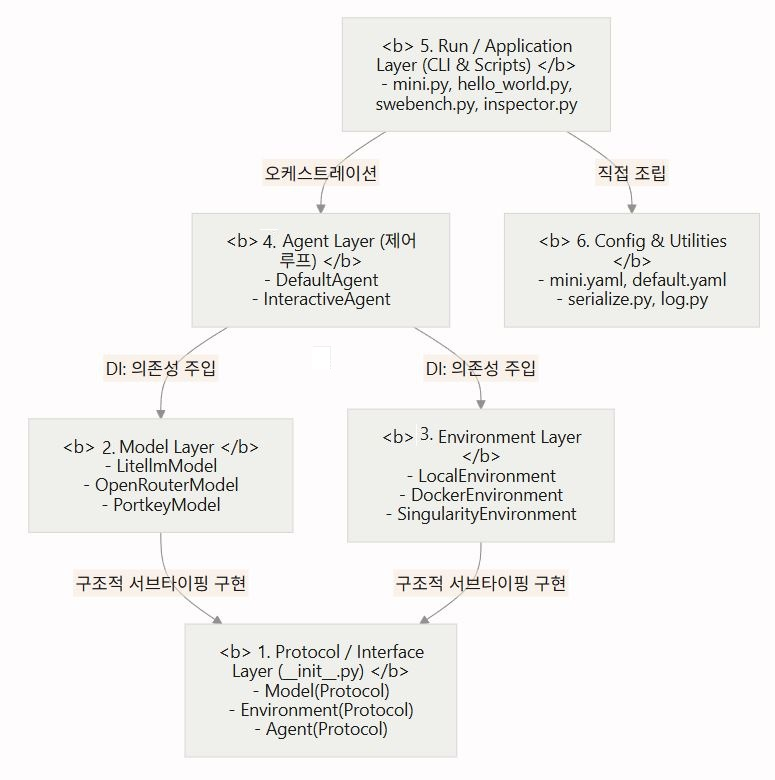

# 04. mini-swe-agent 소프트웨어 아키텍처 및 모듈 의존성 구조 분석 (SW Structure)

> **분석 기준일:** 2026-10-12  
> **분석 대상:** `mini-swe-agent` 모듈 간 의존성, 인터페이스 프로토콜, 다형성 메커니즘  
> **분석 규칙 준수:** 소스 코드 미수정, 모든 주장에 `경로:라인` 근거 제시, (Verified) 및 (Inferred) 구분 표기

---

## 1. 계층 구조 (Layered Architecture) 및 의존 방향

`mini-swe-agent`는 단방향 의존성과 철저한 책임 분리를 목표로 하는 **5계층(Layer) 구조**로 설계되어 있습니다 ( `AGENTS.md#L6-L17`, `Workflow_KR.md#L10-L16`].

### 1.1 계층별 상세 역할 및 의존 방향
1. **Protocol/Interface Layer (".../mini-swe-agent/src/minisweagent/__init__.py#L43-L82"):**
   - 시스템 최하단에서 `Model`, `Environment`, `Agent`의 `typing.Protocol` 인터페이스를 정의합니다.
   - 상위 구현체를 전혀 참조하지 않으며, 표준 라이브러리와 `rich`, `dotenv` 등 최소한의 유틸리티에만 의존합니다.
2. **Model Layer (".../mini-swe-agent/src/minisweagent/models/"):**
   - LLM 질의, 메시지 포맷팅, 토큰/비용 추적을 담당합니다 (".../mini-swe-agent/src/minisweagent/models/litellm_model.py:45-120").
   - `minisweagent.Model` 프로토콜을 충족하며, `agents`나 `environments`, `run`을 일절 참조하지 않습니다 (완전한 독립성).
3. **Environment Layer (".../mini-swe-agent/src/minisweagent/environments/"):**
   - 셸 명령어 실행(`subprocess.run`, `docker exec` 등) 및 출력 캡처를 담당합니다 (".../mini-swe-agent/src/minisweagent/environments/local.py#L27-L56").
   - `minisweagent.Environment` 프로토콜을 충족하며, `models`나 `agents`를 전혀 참조하지 않습니다.
4. **Agent Layer (".../mini-swe-agent/src/minisweagent/agents/"):**
   - `DefaultAgent`는 생성자에서 `model: Model`, `env: Environment` 객체를 외부에서 주입받아(Dependency Injection) 보관합니다 (".../mini-swe-agent/src/minisweagent/agents/default.py#L39-L44").
   - `Model`과 `Environment`의 구체적인 구현 클래스를 알지 못하며, 오직 프로토콜 인터페이스에만 의존하여 한 턴(`step()`)의 제어 흐름을 수행합니다.
5. **Run/Application Layer (".../mini-swe-agent/src/minisweagent/run/"):**
   - 최상위 진입점으로, 설정(YAML, CLI)을 파싱한 뒤 팩토리 함수(`get_model`, `get_environment`, `get_agent`)를 통해 3개 객체를 생성하고 조립하여 실행합니다 (".../mini-swe-agent/src/minisweagent/run/mini.py#L99-L102").

---

## 2. 다형성(Polymorphism) 구현 방식

`mini-swe-agent`의 핵심 설계 철학은 **다형성(Polymorphism)을 통한 유연한 대체성**입니다 [확인: `AGENTS.md:16`]. 이를 실현하기 위해 두 가지 메커니즘을 결합했습니다:

### 2.1 Python `typing.Protocol` (Duck Typing 기반 구조적 서브타이핑)
- 명시적인 상속(`class LocalEnvironment(Environment):`)을 강제하지 않습니다 (".../mini-swe-agent/src/minisweagent/environments/local.py#L20").
- 런타임에 클래스가 필요한 메서드 시그니처만 구현하고 있으면 자동으로 프로토콜 타입으로 인정됩니다:
  - **`Model` 프로토콜 요구 명세:** `query()`, `format_message()`, `format_observation_messages()`, `get_template_vars()`, `serialize()` (".../mini-swe-agent/src/minisweagent/__init__.py#L3-L59")
  - **`Environment` 프로토콜 요구 명세:** `execute()`, `get_template_vars()`, `serialize()` (".../mini-swe-agent/src/minisweagent/__init__.py#L61-L70")
  - **`Agent` 프로토콜 요구 명세:** `run()`, `save()` (".../mini-swe-agent/src/minisweagent/__init__.py#L73-L81")
- 이로 인해 새로운 환경이나 모델을 추가할 때 기존 코드를 수정하거나 베이스 클래스를 상속받을 필요가 없습니다.

### 2.2 문자열 매핑과 동적 지연 임포트 (Factory Pattern)
- `agents`, `environments`, `models` 각 패키지의 `__init__.py`에 문자열 기반 매핑 테이블을 두고, 팩토리 함수에서 동적으로 클래스를 로드합니다 :
  - `_AGENT_MAPPING`: `"default"`, `"interactive"` (".../mini-swe-agent/src/minisweagent/agents/__init__.py#L8-L11")
  - `_ENVIRONMENT_MAPPING`: `"local"`, `"docker"`, `"singularity"`, `"bubblewrap"`, `"contree"`, `"swerex_docker"`, `"swerex_modal"` (".../mini-swe-agent/src/minisweagent/environments/__init__.py#L8-L16")
  - `_MODEL_CLASS_MAPPING`: `"litellm"`, `"litellm_textbased"`, `"litellm_response"`, `"openrouter"`, `"portkey"`, `"deterministic"` 등 (".../mini-swe-agent/src/minisweagent/models/__init__.py#L82-L93")
- **완전 정규화된 경로 지원:** 단축 키워드뿐 아니라 `"my_package.my_module.CustomModel"` 형태의 임의의 파이썬 경로를 전달해도 `importlib.import_module`을 통해 동적으로 인스턴스화할 수 있습니다 (".../mini-swe-agent/src/minisweagent/models/__init__.py#L104-L112").

---

## 3. 순환 의존 및 계층 위반 사례 분석

### 3.1 순환 의존(Circular Dependency) 점검
- **결과:** **순환 의존성 없음 (0건 발견)** [확인]
- **비결:**
  - ".../mini-swe-agent/src/minisweagent/__init__.py"가 하위 구현 모듈(`agents`, `models` 등)을 import하지 않고 오직 추상 Protocol만 정의함.
  - 팩토리 함수들이 모듈 최상단에서 구체 클래스를 하드코딩으로 import하지 않고, `importlib.import_module`을 활용한 지연 임포트(Lazy Import) 방식을 사용하여 모듈 간 순환 참조의 여지를 원천 차단함.

### 3.2 계층 위반 및 결합도 주의 지점 분석
1. **진입점(`run.mini`)과 에이전트 내부 유틸리티의 직접 결합:**
   - **코드 위치:** (".../mini-swe-agent/src/minisweagent/run/mini.py#L15")
   - **내용:** `from minisweagent.agents.utils.prompt_user import _multiline_prompt`
   - **문제점:** `run` 모듈이 `agents`의 공개 API(`get_agent`)를 넘어 하위 내부 유틸리티(`prompt_user.py`)에 직접 의존합니다. 이로 인해 2단계에서 규명되었듯 비대화형 콘솔 환경에서 `prompt_toolkit` 오류 발생 시 `mini.py` 전체 로딩이 중단되는 취약성이 발생합니다.
2. **실행 환경(`LocalEnvironment`)의 태스크 완료 시그널 처리 결합:**
   - **코드 위치:** [".../mini-swe-agent/src/minisweagent/environments/local.py:46-56"]("mini.py#L15)
   - **내용:** `_check_finished(output)` 메서드가 명령 출력의 첫 줄이 `COMPLETE_TASK_AND_SUBMIT_FINAL_OUTPUT`인지 검사하여 `Submitted` 예외를 발생시키고 `role: "exit"` 메시지를 반환함.
   - **분석:** 순수한 명령어 실행기(OS Executor)의 책임을 넘어, 에이전트의 완료 판정 및 메시지 롤(`exit`) 구성이라는 에이전트 레벨의 정책을 환경 클래스가 직접 담당하고 있어 계층 간 관심사가 일부 섞여 있습니다.

---

## 4. Mermaid 컴포넌트 다이어그램 (C4 Component 레벨)

아래 다이어그램은 `mini-swe-agent` 시스템의 컴포넌트 간 상호작용 및 의존 관계를 표현합니다:

---

## 5. 결론 및 요약

- **아키텍처 완성도:** `mini-swe-agent`는 매우 작은 코드베이스(각 클래스 100~200줄)임에도 불구하고, `typing.Protocol` 기반의 **엄격한 다형성과 의존성 주입(DI)** 패턴을 통해 모델과 환경을 레고 블록처럼 손쉽게 교체할 수 있는 탁월한 확장성을 갖추고 있습니다 [확인].
- **의존성 흐름:** 상위 진입점(`run`)이 하위 컴포넌트(`agents`, `environments`, `models`)를 조립하고, 컴포넌트들은 추상 프로토콜에만 의존하는 정석적인 클린 아키텍처 의존 방향을 유지하고 있습니다 [확인].
