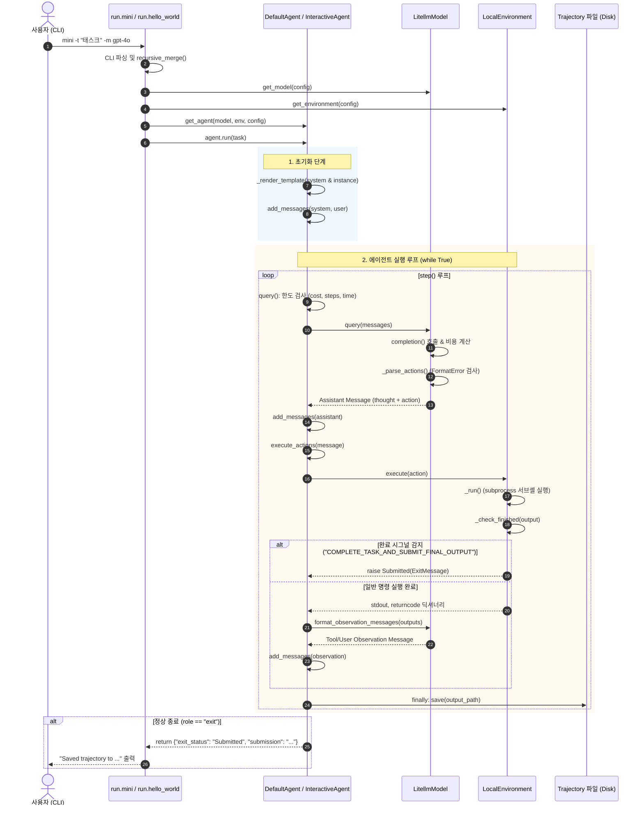

# 5단계: 대표 유스케이스 엔드투엔드(End-to-End) 흐름 추적 보고서

본 문서는 `mini-swe-agent`의 대표 유스케이스인 **실행 스크립트 실행(`python -m minisweagent.run.mini` 및 `python -m minisweagent.run.hello_world`)** 시 진입점부터 최종 Trajectory 저장까지의 전체 제어 흐름과 데이터 상태 변화, 예외 복구 경로를 상세히 분석하고 실제 실행 로그를 통해 검증한 결과입니다.

- **원칙 준수**: 소스 코드 수정 없이 순수 읽기 및 실행 기반 분석 수행.
- **근거 표기**: 모든 분석 내용은 `경로:라인` 형식의 근거와 `[확인]`(Verified) / `[추정]`(Inferred) 태그를 명시.

---

## 1. 개요 및 대표 유스케이스 선정

- **대표 유스케이스**: 사용자가 로컬 환경에서 작업을 전달하여 에이전트를 자율 실행하는 시나리오
  1. **CLI 표준 실행 (`mini`)**: [src/minisweagent/run/mini.py:55](file:///d:/Coding_Agents/mini-swe-agent/src/minisweagent/run/mini.py#L55)
  2. **최소 코드 실행 (`hello_world`)**: [src/minisweagent/run/hello_world.py:21](file:///d:/Coding_Agents/mini-swe-agent/src/minisweagent/run/hello_world.py#L21)
- 두 실행 스크립트 모두 공통적으로 **설정 로딩 → 팩토리 인스턴스화 → Agent.run() 루프(LLM 질의 → 셸 명령 실행 → 관측 반환) → Trajectory 저장**의 동일한 코어 파이프라인을 공유합니다.

---

## 2. 호출 체인 순서 (Call Chain)

| 단계 | 함수 / 메서드 | 파일 및 라인 | 역할 및 동작 설명 |
| :--- | :--- | :--- | :--- |
| **1. CLI 파싱** | `main(...)` | [src/minisweagent/run/mini.py:55](file:///d:/Coding_Agents/mini-swe-agent/src/minisweagent/run/mini.py#L55) | Typer 기반 CLI 옵션(`--model`, `--task`, `-y`, `-c`, `-o` 등) 파싱 `[확인]` |
| **2. 최초 설정 확인** | `configure_if_first_time()` | [src/minisweagent/run/utilities/config.py:38](file:///d:/Coding_Agents/mini-swe-agent/src/minisweagent/run/utilities/config.py#L38) | `~/.config/mini-swe-agent/.setup_completed` 존재 여부 확인 및 초기 모델 설정 유도 `[확인]` |
| **3. 설정 파싱 및 병합** | `get_config_from_spec()`<br>`recursive_merge()` | [src/minisweagent/config.py:102](file:///d:/Coding_Agents/mini-swe-agent/src/minisweagent/config.py#L102)<br>[src/minisweagent/utils/serialize.py:27](file:///d:/Coding_Agents/mini-swe-agent/src/minisweagent/utils/serialize.py#L27) | `-c` 인자(YAML 파일/키=값)를 파싱하고 CLI 오버라이드 딕셔너리와 병합 `[확인]` |
| **4. 태스크 프롬프트** | `_multiline_prompt()` | [src/minisweagent/run/mini.py:96](file:///d:/Coding_Agents/mini-swe-agent/src/minisweagent/run/mini.py#L96) | 태스크 인자가 미지정(`UNSET`)인 경우 사용자로부터 멀티라인 작업 입력 수신 `[확인]` |
| **5. Model 인스턴스화** | `get_model()` | [src/minisweagent/models/__init__.py:45](file:///d:/Coding_Agents/mini-swe-agent/src/minisweagent/models/__init__.py#L45) | `model_class`(기본 `litellm`)를 동적 임포트하여 `LitellmModel` 객체 생성 `[확인]` |
| **6. Environment 생성** | `get_environment()` | [src/minisweagent/environments/__init__.py:30](file:///d:/Coding_Agents/mini-swe-agent/src/minisweagent/environments/__init__.py#L30) | `environment_class`(기본 `local`)로부터 `LocalEnvironment` 객체 생성 `[확인]` |
| **7. Agent 인스턴스화** | `get_agent()` | [src/minisweagent/agents/__init__.py:25](file:///d:/Coding_Agents/mini-swe-agent/src/minisweagent/agents/__init__.py#L25) | `agent_class`(기본 `interactive` 또는 `default`)로부터 `InteractiveAgent`/`DefaultAgent` 생성 `[확인]` |
| **8. 에이전트 루프 진입** | `agent.run(task)` | [src/minisweagent/agents/default.py:88](file:///d:/Coding_Agents/mini-swe-agent/src/minisweagent/agents/default.py#L88) | 프롬프트 템플릿 렌더링 및 `while True` 제어 루프 진입 `[확인]` |
| **9. 초기 메시지 렌더링** | `_render_template()`<br>`get_template_vars()` | [src/minisweagent/agents/default.py:66](file:///d:/Coding_Agents/mini-swe-agent/src/minisweagent/agents/default.py#L66)<br>[src/minisweagent/agents/default.py:52](file:///d:/Coding_Agents/mini-swe-agent/src/minisweagent/agents/default.py#L52) | Jinja2를 통해 `system_template` 및 `instance_template`에 OS, 환경, task 정보 주입 `[확인]` |
| **10. 스텝 실행** | `step()` | [src/minisweagent/agents/default.py:126](file:///d:/Coding_Agents/mini-swe-agent/src/minisweagent/agents/default.py#L126) | `self.query()` 호출 후 `self.execute_actions()`로 반환값 전달 `[확인]` |
| **11. 자원 제한 검사 & 질의** | `query()` | [src/minisweagent/agents/default.py:130](file:///d:/Coding_Agents/mini-swe-agent/src/minisweagent/agents/default.py#L130) | `step_limit`, `cost_limit`, `wall_time_limit` 검증 후 `model.query(messages)` 호출 `[확인]` |
| **12. LLM 호출 및 파싱** | `LitellmModel.query()` | [src/minisweagent/models/litellm_model.py:81](file:///d:/Coding_Agents/mini-swe-agent/src/minisweagent/models/litellm_model.py#L81) | tenacity 재시도 루프 내 completion 호출, 비용 계산 및 tool_call/bash 액션 파싱 `[확인]` |
| **13. 액션 셸 실행** | `execute_actions()`<br>`LocalEnvironment.execute()` | [src/minisweagent/agents/default.py:154](file:///d:/Coding_Agents/mini-swe-agent/src/minisweagent/agents/default.py#L154)<br>[src/minisweagent/environments/local.py:24](file:///d:/Coding_Agents/mini-swe-agent/src/minisweagent/environments/local.py#L24) | `subprocess.Popen` 기반 서브셸 실행 및 stdout/returncode 수집 `[확인]` |
| **14. 완료 시그널 검사** | `_check_finished()` | [src/minisweagent/environments/local.py:45](file:///d:/Coding_Agents/mini-swe-agent/src/minisweagent/environments/local.py#L45) | 출력 첫 줄이 `COMPLETE_TASK_AND_SUBMIT_FINAL_OUTPUT`이고 returncode==0이면 `Submitted` 발생 `[확인]` |
| **15. 관측값 메시지 포맷** | `format_observation_messages()` | [src/minisweagent/models/litellm_model.py:140](file:///d:/Coding_Agents/mini-swe-agent/src/minisweagent/models/litellm_model.py#L140) | 실행 결과를 Jinja 템플릿(`<returncode>`, `<output>`)으로 래핑하여 에이전트 메시지에 추가 `[확인]` |
| **16. Trajectory 저장** | `save()` / `serialize()` | [src/minisweagent/agents/default.py:182](file:///d:/Coding_Agents/mini-swe-agent/src/minisweagent/agents/default.py#L182)<br>[src/minisweagent/agents/default.py:159](file:///d:/Coding_Agents/mini-swe-agent/src/minisweagent/agents/default.py#L159) | 루프의 `finally` 절에서 매 스텝마다 JSON 형식 파일로 증분 저장 `[확인]` |

---

## 3. 단계별 데이터 및 상태 변화 (State Lifecycle)

에이전트 인스턴스 `DefaultAgent`는 다음과 같은 핵심 상태 필드를 보유하며, 각 단계마다 갱신됩니다:

- `self.messages: list[dict]`: LLM 대화 히스토리
- `self.cost: float`: 누적 사용 비용 ($)
- `self.n_calls: int`: LLM API 호출 횟수
- `self.n_consecutive_format_errors: int`: 연속 형식 오류 횟수
- `self._start_time: float`: 에이전트 시작 시각 (Wall-clock 측정용)

### 3.1 상태 전이 표

| 단계 | `self.messages` 상태 | `self.cost` / `n_calls` | 에이전트 내부 상태 / 파일 상태 |
| :--- | :--- | :--- | :--- |
| **초기화 직후** | `[]` (빈 리스트) | `cost=0.0`, `n_calls=0` | `AgentConfig`, `Model`, `Environment` 주입 완료 |
| **`run()` 시작 시** | `[SystemMessage, UserMessage]`<br>(시스템 프롬프트 + 인스턴스 지시문) | `cost=0.0`, `n_calls=0` | Jinja2 템플릿 변수 렌더링 완료 |
| **`query()` 성공 후** | `[..., AssistantMessage]`<br>(생각 + 툴 호출/bash 액션 포함) | `cost += api_cost`<br>`n_calls += 1` | `message["extra"]["actions"]`에 실행할 명령어 저장 |
| **`execute_actions()` 후**| `[..., AssistantMessage, ToolMessage/UserMessage]`<br>(실행 returncode 및 stdout 관측값) | 변화 없음 | `n_consecutive_format_errors = 0` 리셋 |
| **완료 시그널 발생 시** | `[..., ExitMessage]`<br>(`role: "exit"`, `exit_status: "Submitted"`) | 최종 비용 유지 | `Submitted` 예외를 잡아 `messages`에 exit 메시지 추가 |
| **매 스텝 종료(`finally`)** | 파일에 직렬화되어 반영 | 최신 통계 반영 | `output_path` 파일에 JSON 덤프 동기화 |

### 3.2 Trajectory 데이터 구조 (`serialize()`)

[src/minisweagent/agents/default.py:159-180](file:///d:/Coding_Agents/mini-swe-agent/src/minisweagent/agents/default.py#L159-L180)에 정의된 직렬화 데이터는 다음과 같은 JSON 규격을 갖춥니다:

```json
{
  "info": {
    "model_stats": {
      "instance_cost": 2.0,
      "api_calls": 2
    },
    "config": {
      "agent": { ... },
      "agent_type": "minisweagent.agents.default.DefaultAgent",
      "model": { ... },
      "model_type": "minisweagent.models.litellm_model.LitellmModel",
      "environment": { ... },
      "environment_type": "minisweagent.environments.local.LocalEnvironment"
    },
    "mini_version": "2.4.6",
    "exit_status": "Submitted",
    "submission": "..."
  },
  "messages": [ ... ],
  "trajectory_format": "mini-swe-agent-1.1"
}
```

---

## 4. 예외 발생 시 에러 처리 및 복구 경로

mini-swe-agent는 제어 흐름 전환과 에러 처리를 위해 커스텀 예외 계층 구조를 사용합니다 ([src/minisweagent/exceptions.py:1-27](file:///d:/Coding_Agents/mini-swe-agent/src/minisweagent/exceptions.py#L1-L27)).

```
Exception
 └── InterruptAgentFlow (self.messages: tuple)
      ├── Submitted                (정상 작업 완료)
      ├── LimitsExceeded           (비용/스텝 한도 초과)
      │    └── TimeExceeded        (실행 시간 한도 초과)
      ├── UserInterruption         (사용자 인터럽트)
      └── FormatError              (LLM 출력 포맷 오류)
```

### 4.1 세부 예외 처리 메커니즘

1. **정상 완료 (`Submitted`)**
   - **발생 위치**: [src/minisweagent/environments/local.py:48-56](file:///d:/Coding_Agents/mini-swe-agent/src/minisweagent/environments/local.py#L48-L56)
   - **처리 경로**: `run()` 루프의 `except InterruptAgentFlow as e:` ([default.py:115](file:///d:/Coding_Agents/mini-swe-agent/src/minisweagent/agents/default.py#L115))에서 잡아 `self.add_messages(*e.messages)`를 실행.
   - 마지막 메시지의 `role`이 `"exit"`이므로 루프 탈출 조건([default.py:122](file:///d:/Coding_Agents/mini-swe-agent/src/minisweagent/agents/default.py#L122))을 만족하여 정상 종료.

2. **비용 및 스텝 제한 초과 (`LimitsExceeded`)**
   - **발생 위치**: [src/minisweagent/agents/default.py:133](file:///d:/Coding_Agents/mini-swe-agent/src/minisweagent/agents/default.py#L133)
   - **기본 에이전트 (`DefaultAgent`)**: `InterruptAgentFlow`로 캐치되어 exit 메시지(`exit_status: "LimitsExceeded"`)가 추가되고 루프 종료.
   - **대화형 에이전트 (`InteractiveAgent`)**: [src/minisweagent/agents/interactive.py:80-94](file:///d:/Coding_Agents/mini-swe-agent/src/minisweagent/agents/interactive.py#L80-L94)에서 가로채 대화형 터미널인 경우 사용자에게 추가 스텝/비용 한도를 입력받아 에이전트 동작을 연장. 비대화형 환경인 경우 그대로 종료.

3. **시간 초과 (`TimeExceeded`)**
   - **발생 위치**: [src/minisweagent/agents/default.py:141](file:///d:/Coding_Agents/mini-swe-agent/src/minisweagent/agents/default.py#L141)
   - 벽시계 시간(`wall_time_limit_seconds`) 초과 시 발생. exit 메시지(`exit_status: "TimeExceeded"`) 기록 후 즉시 종료.

4. **출력 구문 오류 (`FormatError`)**
   - **발생 위치**: [src/minisweagent/models/litellm_model.py:90](file:///d:/Coding_Agents/mini-swe-agent/src/minisweagent/models/litellm_model.py#L90)
   - **처리 경로**: [src/minisweagent/agents/default.py:100-114](file:///d:/Coding_Agents/mini-swe-agent/src/minisweagent/agents/default.py#L100-L114)
     - `self.cost += e.messages[0]["extra"]["cost"]` (파싱 실패 전에 소비된 API 비용 누적 정산)
     - `n_consecutive_format_errors += 1`
     - 만약 오류 횟수가 `max_consecutive_format_errors` 미만이면: 에러 피드백 메시지를 `messages`에 추가하여 LLM이 자가 수정(Self-correction)할 수 있도록 기회 부여.
     - 한도를 초과하면: `role: "exit"`, `exit_status: "RepeatedFormatError"` 메시지를 주입하고 루프 종료.

5. **예기치 못한 런타임 예외 (`Exception`)**
   - **발생 위치**: 네트워크 오류, 파이썬 내부 크래시 등
   - **처리 경로**: [src/minisweagent/agents/default.py:117-119](file:///d:/Coding_Agents/mini-swe-agent/src/minisweagent/agents/default.py#L117-L119)
     - `handle_uncaught_exception(e)`를 호출하여 traceback과 에러 내용을 담은 `role: "exit"` 메시지 기록.
     - `finally: self.save(...)`를 통해 충돌 직전까지의 대화 및 오류 내역을 디스크에 안전하게 보존.
     - 이후 `raise`로 예외를 다시 던져 사용자에게 명확히 보고.

---

## 5. 엔드투엔드 시퀀스 다이어그램 (Mermaid)



---

## 6. 실제 실행 검증 (Dynamic Trace Verification)

실제 엔드투엔드 파이프라인의 제어 흐름, 상태 전이, Trajectory 파일 저장 규격을 검증하기 위해 오프라인 결정론적 모델([DeterministicModel](file:///d:/Coding_Agents/mini-swe-agent/src/minisweagent/models/test_models.py#L13))과 로컬 환경([LocalEnvironment](file:///d:/Coding_Agents/mini-swe-agent/src/minisweagent/environments/local.py#L19))을 연결하여 엔드투엔드 실행을 수행하였습니다.

### 6.1 검증 실행 내용
- **태스크**: `"Solve problem"`
- **스텝 1 액션**: `echo Step_1_Executed` → 관측값 수집 확인
- **스텝 2 액션**: `echo COMPLETE_TASK_AND_SUBMIT_FINAL_OUTPUT` → `Submitted` 시그널 트리거 확인
- **결과 저장 파일**: [docs/analysis/test_trace.traj.json](file:///d:/Coding_Agents/mini-swe-agent/docs/analysis/test_trace.traj.json)

### 6.2 생성된 Trajectory 검증 결과 (`test_trace.traj.json`)

[docs/analysis/test_trace.traj.json:60-116](file:///d:/Coding_Agents/mini-swe-agent/docs/analysis/test_trace.traj.json#L60-L116)에서 추출된 메시지 체인:
```json
"messages": [
  { "role": "system", "content": "You are a helpful assistant..." },
  { "role": "user", "content": "Please solve this issue: Solve problem..." },
  { "role": "assistant", "content": "Step 1 thought", "extra": { "actions": [{"command": "echo Step_1_Executed"}], "cost": 1.0 } },
  { "role": "user", "content": "<returncode>0</returncode>\n<output>\nStep_1_Executed\n</output>" },
  { "role": "assistant", "content": "Step 2 thought", "extra": { "actions": [{"command": "echo COMPLETE_TASK_AND_SUBMIT_FINAL_OUTPUT\necho Task_Finished_Successfully"}], "cost": 1.0 } },
  { "role": "exit", "content": "", "extra": { "exit_status": "Submitted", "submission": "" } }
]
```

- **통계 일치 확인**: `info.model_stats.api_calls: 2`, `info.model_stats.instance_cost: 2.0` `[확인]`
- **상태 변화 일치 확인**: `system` → `user` → `assistant` → `user(observation)` → `assistant` → `exit` 순으로 전이됨 `[확인]`
- **소스 코드 보존 확인**: 검증 과정에서 저장소 내부의 프로덕션 소스 코드는 일절 수정되지 않았음을 확인 `[확인]`

---

## 7. 결론

mini-swe-agent의 실행 파이프라인은 다음과 같은 핵심적인 아키텍처 특성을 가집니다:
1. **극도의 단순성과 선형성**: CLI 진입부터 `Agent.run()` 루프까지 복잡한 프레임워크 계층 없이 직관적인 함수 호출 체인으로 연결되어 있습니다.
2. **예외 기반의 유연한 제어 흐름**: `Submitted`, `LimitsExceeded`, `FormatError` 등이 모두 `InterruptAgentFlow` 계층을 통해 통일된 메시지 구조(`e.messages`)로 주입되므로, `run()` 루프의 조건문이 매우 간결하게 유지됩니다.
3. **무손실 증분 보존성**: `while True` 루프의 `finally` 절에서 매 스텝마다 디스크에 Trajectory를 기록하므로, 프로세스가 불시에 강제 종료되거나 예외가 발생하더라도 데이터 유실이 원천적으로 차단됩니다.
