# 6단계: 데이터 모델, 설정 체계 및 확장 지점 분석 보고서

본 문서는 `mini-swe-agent`의 핵심 데이터 모델(엔티티)의 구조와 생명주기, 다단계 설정 로딩 순서와 우선순위, 3대 컴포넌트(Model, Environment, Agent)의 확장 메커니즘, 그리고 코드베이스 전반에 적용된 핵심 소프트웨어 디자인 패턴을 심층 분석한 결과입니다.

- **원칙 준수**: 소스 코드 수정 없이 순수 읽기 및 실행 기반 분석 수행.
- **근거 표기**: 모든 분석 내용은 `경로:라인` 형식의 근거와 `[확인]`(Verified) / `[추정]`(Inferred) 태그를 명시.

---

## 1. 핵심 데이터 구조 및 엔티티 생명주기 (Data Models & Lifecycle)

`mini-swe-agent`는 가독성과 단순성을 극대화하기 위해 ORM이나 복잡한 상태 머신 대신 **Pydantic BaseModel 기반의 불변 설정 객체**와 **표준 파이썬 딕셔너리(`dict`) 형태의 메시지/궤적(Trajectory)** 구조를 핵심 엔티티로 채택하고 있습니다.

### 1.1 핵심 데이터 구조 및 엔티티 정의

| 엔티티 / 클래스 | 파일 및 라인 | 기본 타입 | 핵심 필드 및 역할 |
| :--- | :--- | :--- | :--- |
| **`AgentConfig`** | [src/minisweagent/agents/default.py:19-36](file:///d:/Coding_Agents/mini-swe-agent/src/minisweagent/agents/default.py#L19-L36) | `pydantic.BaseModel` | `system_template` (시스템 프롬프트), `instance_template` (인스턴스 작업 템플릿), `step_limit` (최대 스텝), `cost_limit` (비용 상한 $), `wall_time_limit_seconds` (벽시계 시간 제한 초), `max_consecutive_format_errors` (연속 형식 에러 허용치, 기본 3), `output_path` (저장 경로) `[확인]` |
| **`InteractiveAgentConfig`** | [src/minisweagent/agents/interactive.py:24-31](file:///d:/Coding_Agents/mini-swe-agent/src/minisweagent/agents/interactive.py#L24-L31) | `AgentConfig` 상속 | `mode` (`"human"` \| `"confirm"` \| `"yolo"`, 기본 `"confirm"`), `whitelist_actions` (자동 승인 정규표현식 목록), `confirm_exit` (종료 전 사용자 재확인 여부) `[확인]` |
| **`LocalEnvironmentConfig`** | [src/minisweagent/environments/local.py:13-17](file:///d:/Coding_Agents/mini-swe-agent/src/minisweagent/environments/local.py#L13-L17) | `pydantic.BaseModel` | `cwd` (명령 실행 작업 디렉터리), `env` (추가 환경변수 매핑), `timeout` (명령 실행 제한 시간 초, 기본 30) `[확인]` |
| **`DockerEnvironmentConfig`** | [src/minisweagent/environments/docker.py:15-43](file:///d:/Coding_Agents/mini-swe-agent/src/minisweagent/environments/docker.py#L15-L43) | `pydantic.BaseModel` | `image` (컨테이너 이미지 태그), `cwd`, `env`, `forward_env` (호스트 환경변수 전달 목록), `timeout`, `executable` (기본 `"docker"`), `run_args` (기본 `["--rm"]`), `container_timeout` (기본 `"2h"`), `pull_timeout` (기본 120), `interpreter` (기본 `["bash", "-lc"]`) `[확인]` |
| **`LitellmModelConfig`** | [src/minisweagent/models/litellm_model.py:27-47](file:///d:/Coding_Agents/mini-swe-agent/src/minisweagent/models/litellm_model.py#L27-L47) | `pydantic.BaseModel` | `model_name` (모델 공급자/이름), `model_kwargs` (API 전달 인자), `litellm_model_registry` (비용 추적용 레지스트리 경로), `set_cache_control` (Anthropic 프롬프트 캐싱), `cost_tracking` (기본 `"default"`), `format_error_template`, `observation_template`, `multimodal_regex` `[확인]` |
| **`Message`** | [src/minisweagent/agents/default.py:42](file:///d:/Coding_Agents/mini-swe-agent/src/minisweagent/agents/default.py#L42) | `dict[str, Any]` | `role` (`"system"` \| `"user"` \| `"assistant"` \| `"tool"` \| `"exit"`), `content` (텍스트), `extra` (액션 목록, 비용, 타임스탬프, 종료 사유 등의 메타데이터) `[확인]` |
| **`Trajectory`** | [src/minisweagent/agents/default.py:159-180](file:///d:/Coding_Agents/mini-swe-agent/src/minisweagent/agents/default.py#L159-L180) | `dict[str, Any]` | 에이전트의 전체 실행 히스토리 및 결과 메타데이터. `info` (`model_stats`, `config`, `mini_version`, `exit_status`, `submission`), `messages`, `trajectory_format` (`"mini-swe-agent-1.1"`) `[확인]` |

### 1.2 엔티티 생명주기 (Lifecycle)

```
[CLI / YAML Config]
       │
       ▼ (1) 검증 및 인스턴스화
┌────────────────┐  ┌───────────────────────┐  ┌──────────────────────┐
│  AgentConfig   │  │   ModelConfig         │  │   EnvironmentConfig  │
└────────────────┘  └───────────────────────┘  └──────────────────────┘
       │                        │                         │
       ▼                        ▼                         ▼
┌─────────────────────────────────────────────────────────────────────┐
│ DefaultAgent (self.messages = [], self.cost = 0, self.n_calls = 0)  │
└─────────────────────────────────────────────────────────────────────┘
       │
       ├─► (2) 템플릿 렌더링: system_message, instance_message 생성 후 messages에 추가
       │
       ▼ (3) 제어 루프 (while True)
       │    ├─► query(): assistant_message 생성 (actions, cost 포함)
       │    ├─► execute(): bash 실행 후 observation_message 생성
       │    └─► finally: self.save() -> Trajectory 직렬화 및 JSON 디스크 저장 (무손실 증분 보존)
       │
       ▼ (4) 종료 조건 충족 (Submitted / LimitsExceeded / FormatError)
       │    └─► exit_message (role: "exit", exit_status, submission) 주입
       ▼
[Trajectory JSON 파일 완성] (docs/analysis/*.traj.json)
```

1. **설정 생성 (Instantiation)**:
   - CLI 파싱 시 `get_config_from_spec()`과 `recursive_merge()`를 거친 원시 딕셔너리가 각 컴포넌트 생성자(`DefaultAgent`, `LitellmModel`, `LocalEnvironment`)에 전달됩니다.
   - 각 클래스 내부에서 `config_class(**kwargs)`를 호출하여 타입 유효성 검증과 기본값 채우기를 수행합니다 ([default.py:41](file:///d:/Coding_Agents/mini-swe-agent/src/minisweagent/agents/default.py#L41)).
2. **메시지 전이 (Message Evolution)**:
   - **System/Instance 단계**: `Agent.run(task)` 호출 즉시 Jinja2 템플릿 엔진([default.py:67](file:///d:/Coding_Agents/mini-swe-agent/src/minisweagent/agents/default.py#L67))을 통해 OS 정보(`uname`), 환경 변수, task 문자열을 치환하여 `system`, `user` 메시지 생성.
   - **Inference 단계**: LLM 질의 전 `_prepare_messages_for_api()`([litellm_model.py:76-79](file:///d:/Coding_Agents/mini-swe-agent/src/minisweagent/models/litellm_model.py#L76-L79))에서 내부 메타데이터인 `extra` 키를 제거하여 순수 API 규격 메시지로 정제 후 전송.
   - **Assistant 단계**: LLM 응답에서 툴 호출 또는 정규식으로 추출된 bash 명령을 `extra.actions`로 보존.
   - **Observation 단계**: 환경 실행 후 stdout, returncode를 `format_observation_messages()`로 래핑하여 메시지 히스토리에 누적.
   - **Exit 단계**: 정상 완료(`Submitted`)나 한도 초과(`LimitsExceeded`) 시 `role: "exit"`을 가진 마지막 메시지가 추가되며 에이전트 루프가 종료됨.
3. **궤적 보존 (Trajectory Persistence)**:
   - 매 스텝 루프의 `finally` 절([default.py:120-121](file:///d:/Coding_Agents/mini-swe-agent/src/minisweagent/agents/default.py#L120-L121))에서 `self.save()`가 호출됩니다.
   - `Agent.serialize()`, `Model.serialize()`, `Environment.serialize()`의 결과가 `recursive_merge`로 취합되어 유실 없이 파일(`*.traj.json`)에 원자적으로 갱신됩니다.

---

## 2. 설정 로딩 순서와 우선순위 (Configuration Hierarchy)

`mini-swe-agent`는 유연한 실험과 재현성을 보장하기 위해 6계층의 설정 오버라이드 메커니즘을 지원합니다.

### 2.1 설정 해석 및 병합 순서


### 2.2 계층별 상세 역할과 코드 근거

| 우선순위 | 계층 | 위치 / 코드 근거 | 설명 및 동작 방식 |
| :---: | :--- | :--- | :--- |
| **6 (최고)** | **CLI 직접 플래그** | [src/minisweagent/run/mini.py:73-92](file:///d:/Coding_Agents/mini-swe-agent/src/minisweagent/run/mini.py#L73-L92) | `-m/--model`, `-t/--task`, `-y/--yolo`, `-l/--cost-limit`, `-o/--output` 등. 미지정된 플래그는 `UNSET` 센티넬로 표시되어 하위 설정을 덮어쓰지 않음 `[확인]` |
| **5** | **CLI key=value 인라인 스펙** | [src/minisweagent/config.py:31-53](file:///d:/Coding_Agents/mini-swe-agent/src/minisweagent/config.py#L31-L53) | `-c key=value` 형태(예: `-c model.model_kwargs.temperature=0.7`). 점(`.`) 표기법을 중첩 딕셔너리로 자동 변환하며 JSON 파싱 지원 `[확인]` |
| **4** | **사용자 지정 YAML 설정** | [src/minisweagent/run/mini.py:72](file:///d:/Coding_Agents/mini-swe-agent/src/minisweagent/run/mini.py#L72) | `-c custom.yaml`. 복수의 `-c` 옵션이 주어지면 명령줄에 명시된 순서대로 누적 병합(뒤에 오는 설정이 앞선 설정을 오버라이드) `[확인]` |
| **3** | **기본 설정 YAML 파일** | [src/minisweagent/run/mini.py:22](file:///d:/Coding_Agents/mini-swe-agent/src/minisweagent/run/mini.py#L22) | 환경변수 `MSWEA_MINI_CONFIG_PATH` 또는 패키지 내장 `mini.yaml` ([src/minisweagent/config/mini.yaml](file:///d:/Coding_Agents/mini-swe-agent/src/minisweagent/config/mini.yaml)) `[확인]` |
| **2** | **전역 .env 및 환경변수** | [src/minisweagent/__init__.py:26-36](file:///d:/Coding_Agents/mini-swe-agent/src/minisweagent/__init__.py#L26-L36) | `dotenv.load_dotenv(global_config_file)`를 통해 `~/.config/mini-swe-agent/.env` 파일 로드. `MSWEA_MODEL_NAME`, API 키 등이 환경변수로 주입됨 `[확인]` |
| **1 (최저)** | **Pydantic 필드 기본값** | 각 컴포넌트의 `*Config` 클래스 | 예: `step_limit: int = 0`, `cost_limit: float = 3.0`, `timeout: int = 30` 등 코드에 하드코딩된 폴백 기본값 `[확인]` |

### 2.3 설정 탐색 경로 규칙 (`get_config_path`)

[src/minisweagent/config.py:17-28](file:///d:/Coding_Agents/mini-swe-agent/src/minisweagent/config.py#L17-L28)에 따르면, `-c <spec>`으로 전달된 파일 이름은 아래 순서대로 디렉터리를 탐색하여 최초로 발견되는 파일을 채택합니다:
1. `Path(config_spec)` (현재 작업 디렉터리 기준 상대/절대 경로)
2. `Path(os.getenv("MSWEA_CONFIG_DIR", ".")) / config_spec`
3. `builtin_config_dir / config_spec` (내장 설정 폴더 `minisweagent/config/`)
4. `builtin_config_dir / "extra" / config_spec`
5. `builtin_config_dir / "benchmarks" / config_spec`

---

## 3. 확장 지점 (Extension Points & Plugin Mechanisms)

`mini-swe-agent`는 컴포넌트 추가를 위해 핵심 코드를 수정할 필요가 없도록 **완전한 플러그인형 동적 디스패치 구조**를 갖추고 있습니다.

### 3.1 새로운 Model 어댑터 확장

- **요구사항**: `minisweagent.Model` 프로토콜([src/minisweagent/__init__.py:43-59](file:///d:/Coding_Agents/mini-swe-agent/src/minisweagent/__init__.py#L43-L59)) 충족
  - `query(self, messages: list[dict], **kwargs) -> dict`
  - `format_message(self, **kwargs) -> dict`
  - `format_observation_messages(self, message: dict, outputs: list[dict], template_vars: dict | None) -> list[dict]`
  - `get_template_vars(self, **kwargs) -> dict[str, Any]`
  - `serialize(self) -> dict`
- **확장 방식**:
  1. **내장 단축어 등록**: [src/minisweagent/models/__init__.py:82-93](file:///d:/Coding_Agents/mini-swe-agent/src/minisweagent/models/__init__.py#L82-L93) `_MODEL_CLASS_MAPPING` 딕셔너리에 추가 (예: `litellm`, `openrouter`, `portkey`, `requesty`, `deterministic`).
  2. **외부 커스텀 클래스 지정 (권장)**: CLI에서 `--model-class my_package.custom_model.MyModel` 또는 YAML에서 `model.model_class: "my_package.MyModel"`로 지정하면 [src/minisweagent/models/__init__.py:104-112](file:///d:/Coding_Agents/mini-swe-agent/src/minisweagent/models/__init__.py#L104-L112)의 동적 임포트(`importlib.import_module`)를 통해 즉시 로드되어 사용 가능 `[확인]`.

### 3.2 새로운 Environment 확장

- **요구사항**: `minisweagent.Environment` 프로토콜([src/minisweagent/__init__.py:61-70](file:///d:/Coding_Agents/mini-swe-agent/src/minisweagent/__init__.py#L61-L70)) 충족
  - `execute(self, action: dict, cwd: str = "") -> dict[str, Any]` (반환값: `{"output": str, "returncode": int, "exception_info": str}`)
  - `get_template_vars(self, **kwargs) -> dict[str, Any]`
  - `serialize(self) -> dict`
- **기본 제공 환경**:
  - `local`: 로컬 셸 직접 실행 ([src/minisweagent/environments/local.py:19](file:///d:/Coding_Agents/mini-swe-agent/src/minisweagent/environments/local.py#L19))
  - `docker`: Docker 컨테이너 격리 실행 ([src/minisweagent/environments/docker.py:45](file:///d:/Coding_Agents/mini-swe-agent/src/minisweagent/environments/docker.py#L45))
  - `singularity`: HPC Singularity/Apptainer 컨테이너 실행 ([src/minisweagent/environments/singularity.py:46](file:///d:/Coding_Agents/mini-swe-agent/src/minisweagent/environments/singularity.py#L46))
  - `extra`: `swerex_docker`, `swerex_modal`, `bubblewrap`, `contree` ([src/minisweagent/environments/extra/](file:///d:/Coding_Agents/mini-swe-agent/src/minisweagent/environments/extra)) `[확인]`
- **확장 방식**:
  - CLI에서 `--environment-class custom_env.MyContainerEnv`로 완전한 모듈 경로를 전달하면 [src/minisweagent/environments/__init__.py:19-27](file:///d:/Coding_Agents/mini-swe-agent/src/minisweagent/environments/__init__.py#L19-L27)에서 동적으로 로드 `[확인]`.

### 3.3 커스텀 Agent 서브클래싱

- **요구사항**: `minisweagent.Agent` 프로토콜([src/minisweagent/__init__.py:73-81](file:///d:/Coding_Agents/mini-swe-agent/src/minisweagent/__init__.py#L73-L81)) 및 `DefaultAgent` 상속
  - `run(self, task: str, **kwargs) -> dict`
  - `save(self, path: Path | None, *extra_dicts) -> dict`
- **확장 사례**: `InteractiveAgent` ([src/minisweagent/agents/interactive.py:33](file:///d:/Coding_Agents/mini-swe-agent/src/minisweagent/agents/interactive.py#L33))
  - `DefaultAgent`를 상속하여 `query()` 메서드를 오버라이드.
  - 사용자가 직접 명령을 타이핑하는 `human` 모드, 모델 제안 명령을 확인하는 `confirm` 모드, 무확인 자율 실행 `yolo` 모드, 슬래시 커맨드(`/u`, `/c`, `/y`) 인터랙션 추가.
- **확장 방식**:
  - CLI에서 `--agent-class my_agent.CustomAgent`로 지정 가능 `[확인]`.

---

## 4. 코드에서 확인되는 핵심 소프트웨어 설계 패턴

`mini-swe-agent`의 소스 코드 전반에는 단순성을 유지하면서도 뛰어난 확장성과 유지보수성을 제공하는 6가지 디자인 패턴이 일관되게 적용되어 있습니다.

### 4.1 Protocol 기반 Strategy 패턴 (Duck Typing)
- **위치**: [src/minisweagent/__init__.py:43-81](file:///d:/Coding_Agents/mini-swe-agent/src/minisweagent/__init__.py#L43-L81)
- **내용**: `Model`, `Environment`, `Agent`를 ABC(추상 기본 클래스) 대신 Python 3.8+ `typing.Protocol`로 정의.
- **효과**: 컴포넌트 간 강한 상속 결합을 배제하고 구조적 서브타이핑(Structural Subtyping)을 구현. 테스트용 Mock이나 외부 라이브러리 클래스도 시그니처만 일치하면 그대로 주입 가능 `[확인]`.

### 4.2 Factory 패턴 및 Dotted Dynamic Import
- **위치**:
  - [src/minisweagent/models/__init__.py:45-66](file:///d:/Coding_Agents/mini-swe-agent/src/minisweagent/models/__init__.py#L45-L66) (`get_model`)
  - [src/minisweagent/environments/__init__.py:30-34](file:///d:/Coding_Agents/mini-swe-agent/src/minisweagent/environments/__init__.py#L30-L34) (`get_environment`)
  - [src/minisweagent/agents/__init__.py:25-29](file:///d:/Coding_Agents/mini-swe-agent/src/minisweagent/agents/__init__.py#L25-L29) (`get_agent`)
- **내용**: 문자열 단축키(`"litellm"`, `"local"`, `"interactive"`) 매핑뿐만 아니라 `importlib.import_module`을 사용한 완전한 모듈 경로 파싱을 지원.
- **효과**: 프레임워크 코드를 단 한 줄도 고치지 않고 서드파티 모듈을 플러그인처럼 로드할 수 있는 개방-폐쇄 원칙(OCP) 달성 `[확인]`.

### 4.3 Pydantic 기반 Config Object 패턴
- **위치**: `AgentConfig`([default.py:19](file:///d:/Coding_Agents/mini-swe-agent/src/minisweagent/agents/default.py#L19)), `LocalEnvironmentConfig`([local.py:13](file:///d:/Coding_Agents/mini-swe-agent/src/minisweagent/environments/local.py#L13)), `LitellmModelConfig`([litellm_model.py:27](file:///d:/Coding_Agents/mini-swe-agent/src/minisweagent/models/litellm_model.py#L27))
- **내용**: 설정 파라미터를 일반 딕셔너리로 다루지 않고 Pydantic의 `BaseModel`로 래핑하여 타입 힌트, 기본값 관리, 유효성 검증, `model_dump()` 직렬화 수행.
- **효과**: 런타임 설정 에러를 컴포넌트 생성 시점에 즉각 감지하며 IDE 자동 완성을 완벽히 지원 `[확인]`.

### 4.4 Template Method 패턴
- **위치**: [src/minisweagent/agents/default.py:88-158](file:///d:/Coding_Agents/mini-swe-agent/src/minisweagent/agents/default.py#L88-L158)
- **내용**: `DefaultAgent.run()`이 `while True` 루프, 예외 처리, `save()` 호출이라는 알고리즘의 전체 뼈대를 통제하고, 내부의 세부 실행은 `step()` → `query()`, `execute_actions()`로 위임.
- **효과**: `InteractiveAgent`([interactive.py:58-95](file:///d:/Coding_Agents/mini-swe-agent/src/minisweagent/agents/interactive.py#L58-L95))는 전체 루프 구조를 복사할 필요 없이 오직 `query()` 메서드만 재정의하여 사용자 인터랙션 로직을 깔끔하게 주입 `[확인]`.

### 4.5 Sentinel 객체 기반 Recursive Merge 패턴
- **위치**: [src/minisweagent/utils/serialize.py:3-29](file:///d:/Coding_Agents/mini-swe-agent/src/minisweagent/utils/serialize.py#L3-L29)
- **내용**: 고유 싱글턴 센티넬인 `UNSET = object()`를 정의하고, `recursive_merge`에서 `value is UNSET`인 필드는 병합 시 무시.
- **효과**: CLI 파서에서 지정하지 않은 옵션(`None` 등)이 YAML 설정 파일에 정의된 유효한 기본값을 덮어써서 지워버리는 문제를 우아하게 해결 `[확인]`.

### 4.6 Exception-Driven Flow Control (Signal / Interruption 패턴)
- **위치**: [src/minisweagent/exceptions.py:1-27](file:///d:/Coding_Agents/mini-swe-agent/src/minisweagent/exceptions.py#L1-L27)
- **내용**: 정상 완료(`Submitted`), 비용/스텝 초과(`LimitsExceeded`), 구문 에러(`FormatError`)를 모두 `InterruptAgentFlow`의 하위 예외로 취급하고 `e.messages`를 지니도록 설계.
- **효과**: 환경 실행기 깊은 곳([LocalEnvironment._check_finished:50](file:///d:/Coding_Agents/mini-swe-agent/src/minisweagent/environments/local.py#L50))에서 발생한 완료 신호가 중간 계층의 리턴값 검사 없이 단번에 최상위 `run()` 루프로 전달되어 간결한 제어 흐름 완성 `[확인]`.

---

## 5. 요약 및 시사점

mini-swe-agent의 데이터 및 설정 아키텍처는 **"최소한의 코드, 최대한의 가독성, 그리고 완전한 다형성"**이라는 프로젝트의 철학을 철저히 반영하고 있습니다:
1. **데이터 규격의 표준화**: 대화 이력과 직렬화 결과물을 표준 파이썬 딕셔너리로 유지하여 추가적인 변환 계층 없이 JSON/YAML과 자연스럽게 호환됩니다.
2. **명확한 설정 우선순위**: 코드 기본값 < 환경변수 < YAML 파일 < CLI 스펙 < CLI 플래그로 이어지는 6단계 계층 구조가 `recursive_merge`와 `UNSET` 센티넬을 통해 빈틈없이 동작합니다.
3. **무결점 확장성**: `typing.Protocol`과 `importlib` 기반 팩토리를 통해 코어 라이브러리를 포크하거나 패치하지 않고도 새로운 LLM 공급자, 컨테이너 런타임, 에이전트 루프를 외부 패키지에서 즉시 플러그인 형태로 주입할 수 있습니다.
