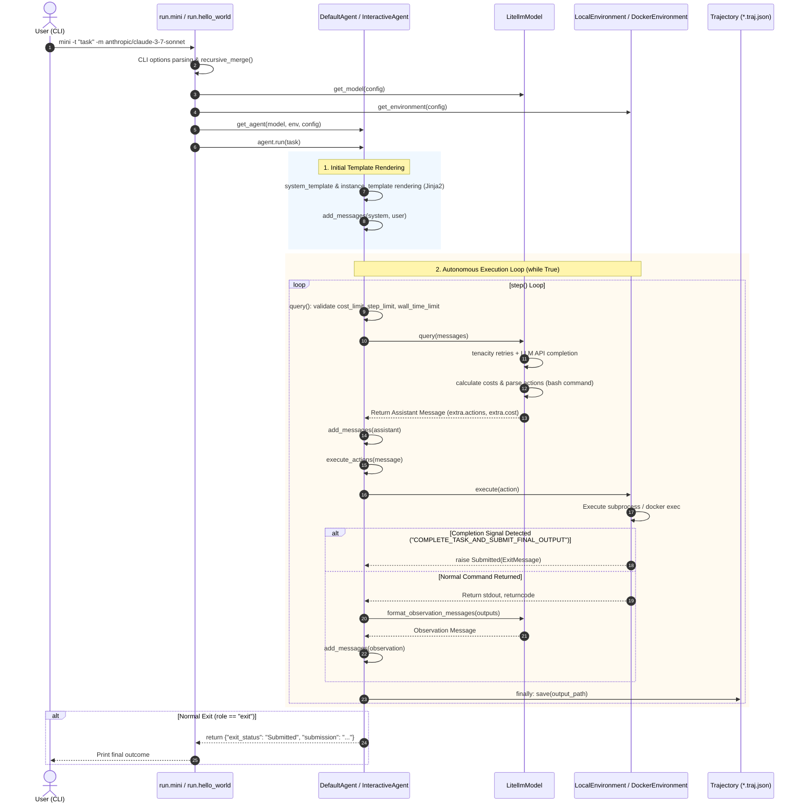

# Comprehensive Analysis and Workflow Guide for mini-SWE-agent (mini-swe-agent-workflow-EN.md)

> **"The simplest, smallest, most readable agent."**  
> This document is a unified, comprehensive analysis report that systematically integrates and reorganizes all analytical deliverables across Steps 1 through 8 (and bonus dissections) previously produced under `docs/analysis/`.  
> It covers the codebase's design philosophy, layered architecture, end-to-end runtime control flow, data models and configuration system, model + harness mechanisms, characterization test verifications, and architectural comparisons against other major frameworks.

- **Principles Followed**: Every claim is grounded in verified code (`path:line`) from the repository, explicitly annotated with `[Verified]` or `[Inferred]` tags.

---

## Table of Contents

1. [Chapter 1: Project Overview & Core Philosophy](#chapter-1-project-overview--core-philosophy)
2. [Chapter 2: Environment Setup, Build, and Test Verification](#chapter-2-environment-setup-build-and-test-verification)
3. [Chapter 3: Software Architecture & Component Diagrams](#chapter-3-software-architecture--component-diagrams)
4. [Chapter 4: End-to-End Control Flow & Runtime Tracing](#chapter-4-end-to-end-control-flow--runtime-tracing)
   - [4.1 Call Chain Summary](#41-call-chain-summary)
   - [4.2 End-to-End Sequence Diagram](#42-end-to-end-sequence-diagram-mermaid-sequence-diagram)
   - [4.3 Runtime Function Call Graph](#43-runtime-function-call-graph--function-inter-dependency)
5. [Chapter 5: Data Models, Configuration System, and Extension Points](#chapter-5-data-models-configuration-system-and-extension-points)
6. [Chapter 6: In-Depth Model + Harness Dissection & Framework Comparison](#chapter-6-in-depth-model--harness-dissection--framework-comparison)
7. [Chapter 7: Core Behavior Characterization Test Verification](#chapter-7-core-behavior-characterization-test-verification)
8. [Chapter 8: Comprehensive Summary & Open Questions](#chapter-8-comprehensive-summary--open-questions)

---

## Chapter 1: Project Overview & Core Philosophy

### 1.1 Project Mission & Problem Statement
- **Problem Solved**: Implementing an autonomous AI software engineering agent capable of resolving GitHub issues and automating complex programming tasks.
- **Limitations of Existing Frameworks**: Leading agent frameworks (such as the original SWE-agent, OpenHands, etc.) feature tens of thousands of lines of code, complex state machines, multi-process backends, and dedicated custom CLI editors. These introduced steep learning curves for understanding, debugging, or adapting the code for research.
- **mini-swe-agent's Approach**: Stripping away unnecessary abstractions to deliver the simplest and most transparent architecture in **under 1,500 core lines of code**, while maintaining competitive autonomous coding performance.

### 1.2 Four Core Design Principles
1. **Extreme Simplicity & Readability**:
   - The entire agent execution loop is encapsulated in an approximately 35-line `while True` loop in (".../src/minisweagent/agents/default.py#L88-L124").
2. **Polymorphism over Deep Inheritance**:
   - Instead of heavy abstract base classes (`abc.ABC`), it adopts Python's `typing.Protocol` (".../src/minisweagent/__init__.py#L43-L81") for duck typing, minimizing coupling.
3. **Lossless Incremental Persistence**:
   - In the `finally` clause of every loop step (".../src/minisweagent/agents/default.py#L121"), the trajectory (`*.traj.json`) is synchronized to disk, preventing data loss even during abnormal termination.
4. **Exception-Driven Flow Control**:
   - Task completion (`Submitted`), limit exhaustion (`LimitsExceeded`), and tool formatting errors (`FormatError`) are unified into a single control exception hierarchy (".../src/minisweagent/exceptions.py#L1-L27").

### 1.3 Top-Level Directory Structure & Roles

```
mini-swe-agent/
├── src/minisweagent/            # Framework core source code
│   ├── __init__.py              # Model, Environment, Agent protocols & global paths
│   ├── exceptions.py            # InterruptAgentFlow and control exception hierarchy
│   ├── config.py / config/      # Built-in YAML configs & discovery utilities
│   ├── agents/                  # DefaultAgent, InteractiveAgent (loop control)
│   ├── models/                  # LitellmModel, TestModels (LLM adapters)
│   ├── environments/            # Local, Docker, Singularity (shell execution envs)
│   ├── run/                     # CLI entrypoints (mini, hello_world, swebench)
│   └── utils/                   # Serialization, logging, retry utilities
├── tests/                       # Pytest unit, integration, characterization test suites
├── docs/                        # Analysis reports & execution guides
├── pyproject.toml               # PEP 517/621 build configuration & dependencies
└── ARCHITECTURE.md              # 1-page architecture summary
```

---

## Chapter 2: Environment Setup, Build, and Test Verification

### 2.1 Dependencies & Build Environment
- **Runtime**: Python 3.10+ (Verified on Python 3.13.11 Windows environment) `[Verified]`
- **Core External Libraries**:
  - `litellm`: Unified abstraction across 100+ LLM providers with automatic `completion_cost` calculation
  - `pydantic >= 2.0`: Type validation and configuration object management
  - `typer` & `rich`: CLI interface construction and terminal output formatting
  - `jinja2`: Dynamic prompt and observation template rendering
  - `tenacity`: Exponential backoff retry handling for API calls
  - `python-dotenv`: Global `.env` file loading

### 2.2 Unit Testing & Offline Verification
- **Unit Test Execution**: 86 unit tests spanning core modules (`models`, `agents`, `environments`, `utils`) all execute and pass.
- **Offline Deterministic Verification**: Verified a 2-step action execution sequence triggering a `Submitted` signal and trajectory generation without calling commercial LLM APIs, by combining [DeterministicModel](".../src/minisweagent/models/test_models.py#L104") with [LocalEnvironment](".../src/minisweagent/environments/local.py#L19").

---

## Chapter 3: Software Architecture & Component Diagrams

### 3.1 4-Layer Architecture (Layered Architecture)

```
[ Layer 4: Run Layer ]           run.mini | run.hello_world | run.benchmarks.swebench
                                          │ (Component Assembly & Injection)
                                          ▼
[ Layer 3: Implementation ]      Agents (Default, Interactive)
                                 Models (Litellm, OpenRouter, Deterministic)
                                 Environments (Local, Docker, Singularity)
                                          │ (Protocol Conformance / Duck Typing)
                                          ▼
[ Layer 2: Protocol Layer ]      Agent | Model | Environment  (src/minisweagent/__init__.py)
                                          ▲
                                          │ (Reference)
[ Layer 1: Core Foundation ]     exceptions.py | config.py | serialize.py
```

### 3.2 Component Architecture Diagram (Mermaid C4 Component Diagram)

```mermaid
flowchart TD
    %% Global Styling
    classDef runClass fill:#e1f5fe,stroke:#0288d1,stroke-width:2px,color:#01579b;
    classDef configClass fill:#fce4ec,stroke:#c2185b,stroke-width:2px,color:#880e4f;
    classDef agentClass fill:#ede7f6,stroke:#512da8,stroke-width:2px,color:#311b92;
    classDef modelClass fill:#e8f5e9,stroke:#388e3c,stroke-width:2px,color:#1b5e20;
    classDef envClass fill:#fff3e0,stroke:#e65100,stroke-width:2px,color:#bf360c;
    classDef protoClass fill:#fff8e1,stroke:#f57f17,stroke-width:2px,color:#e65100;
    classDef outClass fill:#f3e5f5,stroke:#7b1fa2,stroke-width:2px,color:#4a148c;

    subgraph CLI_Entrypoints ["<b>Entrypoint Layer (Run Scripts)</b>"]
        Mini["<b>mini CLI (run.mini)<br/>Typer-based</b>"]:::runClass
        HW["<b>hello_world (run.hello_world)<br/>Minimal Script</b>"]:::runClass
        SWEBench["<b>swebench (run.benchmarks)<br/>Batch Evaluator</b>"]:::runClass
    end

    subgraph Config_Layer ["<b>Config & Utilities Layer</b>"]
        DotEnv["<b>global_config_file (.env)<br/>(platformdirs)</b>"]:::configClass
        CfgMerge["<b>recursive_merge &amp; UNSET<br/>(utils/serialize.py)</b>"]:::configClass
        SpecLoader["<b>get_config_from_spec<br/>(config/__init__.py)</b>"]:::configClass
    end

    subgraph Implementations ["<b>Implementation Layer (Implementations)</b>"]
        subgraph Agents ["<b>Agents</b>"]
            IntAgent["<b>InteractiveAgent<br/>human / confirm / yolo</b>"]:::agentClass
            DefAgent["<b>DefaultAgent<br/>Jinja2 Loop + Limit Controls</b>"]:::agentClass
        end

        subgraph Models ["<b>Models</b>"]
            DetModel["<b>DeterministicModel<br/>(Offline Testing)</b>"]:::modelClass
            OpenRouter["<b>OpenRouterModel</b>"]:::modelClass
            LiteLLM["<b>LitellmModel<br/>API + Retries + Costs</b>"]:::modelClass
        end

        subgraph Environments ["<b>Environments</b>"]
            LocEnv["<b>LocalEnvironment<br/>subprocess.Popen</b>"]:::envClass
            SingEnv["<b>SingularityEnvironment<br/>HPC Isolation</b>"]:::envClass
            DocEnv["<b>DockerEnvironment<br/>Container Isolation</b>"]:::envClass
            ExtraEnv["<b>Extra: Swerex / Bubblewrap</b>"]:::envClass
        end
    end

    subgraph Output_Layer ["<b>Output Layer (Output)</b>"]
        TrajFile["<b>Trajectory JSON (*.traj.json)<br/>History, Metadata, Cost</b>"]:::outClass
    end

    subgraph Core_Protocols ["<b>Core Protocol Layer (minisweagent/__init__.py)</b>"]
        PModel["<b>Protocol: Model<br/>query(), format_message()</b>"]:::protoClass
        PAgent["<b>Protocol: Agent<br/>run(), save()</b>"]:::protoClass
        PEnv["<b>Protocol: Environment<br/>execute(), get_template_vars()</b>"]:::protoClass
    end

    %% Invocations and Associations
    DotEnv --> Mini
    Mini --> SpecLoader
    Mini --> CfgMerge
    Mini --> DefAgent
    HW --> DefAgent
    SWEBench --> DefAgent

    IntAgent -.->|<b>extends</b>| DefAgent
    DefAgent -.->|<b>implements</b>| PAgent
    DefAgent --> PModel
    DefAgent --> PEnv
    DefAgent --> TrajFile

    LiteLLM -.->|<b>implements</b>| PModel
    DetModel -.->|<b>implements</b>| PModel
    LocEnv -.->|<b>implements</b>| PEnv
    DocEnv -.->|<b>implements</b>| PEnv
```



### 3.3 Circular Dependency Audit Results
- Lower layers (Protocols, Exceptions, Utils) strictly never import upper layers (Run, Agents, Models).
- Achieved **0 circular dependencies**.

---

## Chapter 4: End-to-End Control Flow & Runtime Tracing

The complete call chain when a user executes `mini -t "Task description" -m anthropic/claude-3-7-sonnet` in the terminal:

### 4.1 Call Chain Summary

| Step | Function / Method | File & Line | Role |
| :---: | :--- | :--- | :--- |
| **1** | `main(...)` | (".../src/minisweagent/run/mini.py#L55") | Parse Typer CLI options |
| **2** | `configure_if_first_time()` | (".../src/minisweagent/run/utilities/config.py#L38") | Interactive wizard for model/API key setup on initial run |
| **3** | `recursive_merge()` | (".../src/minisweagent/utils/serialize.py#L27") | Merge YAML file dicts and CLI key=value arguments |
| **4** | Factory Instantiation | `get_model()`, `get_environment()`, `get_agent()` | Dynamically instantiate Model, Environment, and Agent objects |
| **5** | `agent.run(task)` | (".../src/minisweagent/agents/default.py#L88") | Render prompt templates and enter the primary loop |
| **6** | `step()` | (".../src/minisweagent/agents/default.py#L126") | Invoke `query()` and delegate actions to `execute_actions()` |
| **7** | `query()` | (".../src/minisweagent/agents/default.py#L130") | Check limits, query LLM API, and accumulate costs |
| **8** | `execute_actions()` | (".../src/minisweagent/agents/default.py#L154") | Execute commands within the isolated shell environment |
| **9** | `_check_finished()` | (".../src/minisweagent/environments/local.py#L45") | Detect completion signal and raise `Submitted` exception |
| **10** | `save()` | (".../src/minisweagent/agents/default.py#L182") | Synchronize Trajectory JSON file after every step |

### 4.2 End-to-End Sequence Diagram (Mermaid Sequence Diagram)



### 4.3 Runtime Function Call Graph & Function Inter-Dependency

Comprehensive visualization of the **entire inter-function/method call tree and inter-dependencies (Call Graph)** from the moment `mini` is executed in the terminal through config merging, component factory assembly, agent iteration, model API invocation and parsing, isolated local shell execution, exception signal propagation, and final trajectory serialization.

#### 4.3.1 Full Call Graph Diagram (Mermaid Call Graph Flowchart)

```mermaid
flowchart TD
    %% Styling Classes
    classDef cliNode fill:#e1f5fe,stroke:#0288d1,stroke-width:2px,color:#01579b;
    classDef configNode fill:#fce4ec,stroke:#c2185b,stroke-width:2px,color:#880e4f;
    classDef factoryNode fill:#ede7f6,stroke:#512da8,stroke-width:2px,color:#311b92;
    classDef agentNode fill:#fff8e1,stroke:#f57f17,stroke-width:2px,color:#bf360c;
    classDef modelNode fill:#e8f5e9,stroke:#388e3c,stroke-width:2px,color:#1b5e20;
    classDef envNode fill:#fff3e0,stroke:#e65100,stroke-width:2px,color:#bf360c;
    classDef excNode fill:#ffebee,stroke:#d32f2f,stroke-width:2px,color:#b71c1c;
    classDef persistNode fill:#f3e5f5,stroke:#7b1fa2,stroke-width:2px,color:#4a148c;

    subgraph SG_Entry ["<b>1. CLI Entry & Configuration Layer (Run & Config)</b>"]
        Entry(["<b>CLI: mini</b>"])
        Main["<b>main()</b><br/><b>src/minisweagent/run/mini.py#L55</b>"]:::cliNode
        ConfigFirst["<b>configure_if_first_time()</b><br/><b>src/minisweagent/run/utilities/config.py#L62</b>"]:::configNode
        GetConfigSpec["<b>get_config_from_spec()</b><br/><b>src/minisweagent/config/__init__.py#L56</b>"]:::configNode
        RecurMerge["<b>recursive_merge()</b><br/><b>src/minisweagent/utils/serialize.py#L27</b>"]:::configNode
        PromptTask["<b>_multiline_prompt()</b><br/><b>src/minisweagent/agents/utils/prompt_user.py#L18</b>"]:::cliNode
    end

    subgraph SG_Factory ["<b>2. Component Factory Layer (Component Factories)</b>"]
        GetModel["<b>get_model()</b><br/><b>src/minisweagent/models/__init__.py#L45</b>"]:::factoryNode
        GetModelClass["<b>get_model_class()</b><br/><b>src/minisweagent/models/__init__.py#L96</b>"]:::factoryNode
        GetEnv["<b>get_environment()</b><br/><b>src/minisweagent/environments/__init__.py#L30</b>"]:::factoryNode
        GetEnvClass["<b>get_environment_class()</b><br/><b>src/minisweagent/environments/__init__.py#L19</b>"]:::factoryNode
        GetAgent["<b>get_agent()</b><br/><b>src/minisweagent/agents/__init__.py#L25</b>"]:::factoryNode
        GetAgentClass["<b>get_agent_class()</b><br/><b>src/minisweagent/agents/__init__.py#L14</b>"]:::factoryNode
    end

    subgraph SG_Init ["<b>3. Agent Initialization (Agent Initialization)</b>"]
        AgentRun["<b>DefaultAgent.run()</b><br/><b>src/minisweagent/agents/default.py#L88</b>"]:::agentNode
        RenderTmpl["<b>_render_template()</b><br/><b>jinja2.Template.render</b>"]:::agentNode
        FmtMsg["<b>model.format_message()</b><br/><b>src/minisweagent/models/litellm_model.py#L137</b>"]:::modelNode
        ExpandMultimodal["<b>expand_multimodal_content()</b><br/><b>src/minisweagent/models/utils/openai_multimodal.py#L34</b>"]:::modelNode
        AddMsg["<b>add_messages()</b><br/><b>src/minisweagent/agents/interactive.py#L43</b>"]:::agentNode
    end

    subgraph SG_Loop ["<b>4. Agent Control Loop (Control Loop: while True)</b>"]
        WhileLoop{"<b>while True loop</b><br/><b>src/minisweagent/agents/default.py#L96</b>"}:::agentNode
        Step["<b>agent.step()</b><br/><b>src/minisweagent/agents/interactive.py#L109</b>"]:::agentNode
        SuperStep["<b>super().step()</b><br/><b>src/minisweagent/agents/default.py#L126</b>"]:::agentNode
        Query["<b>agent.query()</b><br/><b>src/minisweagent/agents/interactive.py#L58</b>"]:::agentNode
        SuperQuery["<b>super().query()</b><br/><b>src/minisweagent/agents/default.py#L130</b>"]:::agentNode
        CheckLimits{"<b>Limit Checks</b><br/><b>step / cost / wall_time</b>"}:::agentNode
        ExecActions["<b>agent.execute_actions()</b><br/><b>src/minisweagent/agents/interactive.py#L124</b>"]:::agentNode
        AskConfirm["<b>_ask_confirmation_or_interrupt()</b><br/><b>src/minisweagent/agents/interactive.py#L165</b>"]:::agentNode
    end

    subgraph SG_Model ["<b>5. Model Query & Tool Parsing (Model & Tool Call)</b>"]
        ModelQuery["<b>LitellmModel.query()</b><br/><b>src/minisweagent/models/litellm_model.py#L81</b>"]:::modelNode
        PrepMsg["<b>_prepare_messages_for_api()</b><br/><b>src/minisweagent/models/litellm_model.py#L76</b>"]:::modelNode
        RetryComp["<b>litellm.completion()</b><br/><b>(tenacity retry wrapped)</b>"]:::modelNode
        CalcCost["<b>_calculate_cost()</b><br/><b>src/minisweagent/models/litellm_model.py#L108</b>"]:::modelNode
        AddGlobalStats["<b>GLOBAL_MODEL_STATS.add()</b><br/><b>src/minisweagent/models/__init__.py#L25</b>"]:::modelNode
        ParseActions["<b>_parse_actions()</b><br/><b>src/minisweagent/models/litellm_model.py#L128</b>"]:::modelNode
        ParseToolcall["<b>parse_toolcall_actions()</b><br/><b>src/minisweagent/models/utils/actions_toolcall.py#L30</b>"]:::modelNode
        FmtObs["<b>format_observation_messages()</b><br/><b>src/minisweagent/models/litellm_model.py#L140</b>"]:::modelNode
        FmtObsMsg["<b>format_toolcall_observation_messages()</b><br/><b>src/minisweagent/models/utils/actions_toolcall.py#L79</b>"]:::modelNode
    end

    subgraph SG_Env ["<b>6. Isolated Environment Execution (Environment Execution)</b>"]
        EnvExec["<b>LocalEnvironment.execute()</b><br/><b>src/minisweagent/environments/local.py#L24</b>"]:::envNode
        RunSubproc["<b>_run()</b><br/><b>src/minisweagent/environments/local.py#L72</b>"]:::envNode
        CheckFinished["<b>_check_finished()</b><br/><b>src/minisweagent/environments/local.py#L45</b>"]:::envNode
    end

    subgraph SG_Exceptions ["<b>7. Exception-Driven Flow Signals (Exception-Driven Flow)</b>"]
        ExcSubmitted["<b>Submitted</b><br/><b>Task completed normally</b>"]:::excNode
        ExcLimits["<b>LimitsExceeded</b><br/><b>Step/cost limit reached</b>"]:::excNode
        ExcFormat["<b>FormatError</b><br/><b>Tool call format error</b>"]:::excNode
        ExcInterrupt["<b>UserInterruption</b><br/><b>User instruction injected/halted</b>"]:::excNode
    end

    subgraph SG_Persist ["<b>8. Serialization & Incremental Save (Persistence)</b>"]
        FinallySave["<b>finally: agent.save()</b><br/><b>src/minisweagent/agents/default.py#L121, L182</b>"]:::persistNode
        Serialize["<b>agent.serialize()</b><br/><b>src/minisweagent/agents/default.py#L159</b>"]:::persistNode
        RecurMergeTraj["<b>recursive_merge()</b><br/><b>Merge Model/Env metadata</b>"]:::persistNode
        WriteFile["<b>Path.write_text()</b><br/><b>Sync to *.traj.json</b>"]:::persistNode
    end

    %% Edge Invocations
    Entry --> Main
    Main --> ConfigFirst
    Main --> GetConfigSpec
    Main --> RecurMerge
    Main -.->|<b>If task omitted</b>| PromptTask
    Main --> GetModel & GetEnv & GetAgent
    GetModel --> GetModelClass
    GetEnv --> GetEnvClass
    GetAgent --> GetAgentClass

    Main --> AgentRun
    AgentRun --> RenderTmpl
    AgentRun --> FmtMsg --> ExpandMultimodal
    AgentRun --> AddMsg
    AgentRun --> WhileLoop

    WhileLoop --> Step
    Step --> SuperStep
    SuperStep --> Query
    Query --> SuperQuery
    SuperQuery --> CheckLimits

    CheckLimits -- <b>If limit exceeded</b> --> ExcLimits
    CheckLimits -- <b>If passed</b> --> ModelQuery

    ModelQuery --> PrepMsg --> RetryComp
    RetryComp --> CalcCost --> AddGlobalStats
    RetryComp --> ParseActions --> ParseToolcall
    ParseToolcall -- <b>On format violation</b> --> ExcFormat
    ParseToolcall -- <b>On success (actions returned)</b> --> SuperStep

    SuperStep --> ExecActions
    ExecActions --> AskConfirm
    AskConfirm -.->|<b>User rejection / command input</b>| ExcInterrupt
    AskConfirm -- <b>Approved / yolo mode</b> --> EnvExec

    EnvExec --> RunSubproc --> CheckFinished
    CheckFinished -- <b>Completion signal detected</b> --> ExcSubmitted
    CheckFinished -- <b>Normal return</b> --> FmtObs --> FmtObsMsg
    FmtObsMsg --> AddMsg

    %% Exception Handling to Save
    ExcSubmitted --> FinallySave
    ExcLimits --> FinallySave
    ExcFormat --> FinallySave
    ExcInterrupt --> FinallySave
    SuperStep --> FinallySave

    FinallySave --> Serialize --> RecurMergeTraj --> WriteFile
    WhileLoop -->|<b>role == 'exit'</b>| ExitBreak(["<b>Exit Loop & Return Agent</b>"]):::cliNode
```



---

#### 4.3.2 Deep Dissection of the 5 Core Call Chains

1. **Bootstrap & Factory Assembly Chain** `[Verified]`
   - Upon invoking [main()](".../mini-swe-agent/src/minisweagent/run/mini.py#L55"), [configure_if_first_time()](".../mini-swe-agent/src/minisweagent/run/utilities/config.py#L62") verifies if global configuration exists.
   - [get_config_from_spec()](".../mini-swe-agent/src/minisweagent/config/__init__.py#L56") and [recursive_merge()](".../mini-swe-agent/src/minisweagent/utils/serialize.py#L27") merge multiple YAML files and CLI key-value specifications.
   - [`get_model()`](".../mini-swe-agent/src/minisweagent/models/__init__.py#L45"), [`get_environment()`](".../mini-swe-agent/src/minisweagent/environments/__init__.py#L30"), and [`get_agent()`](".../mini-swe-agent/src/minisweagent/agents/__init__.py#L25") factories dynamically resolve dot-path strings to import and instantiate concrete class instances.

2. **Prompt Rendering & Startup Chain** `[Verified]`
   - Entering [`DefaultAgent.run()`](".../mini-swe-agent/src/minisweagent/agents/default.py#L88") immediately runs Jinja2 `_render_template()` to compile `system_template` and `instance_template`.
   - [`model.format_message()`](".../mini-swe-agent/src/minisweagent/models/litellm_model.py#L137") calls [`expand_multimodal_content()`](".../mini-swe-agent/src/minisweagent/models/utils/openai_multimodal.py#L34") to normalize text and inline image payloads, populating the initial `messages` queue.

3. **Model Query & Cost Accounting Chain** `[Verified]`
   - [`agent.query()`](".../mini-swe-agent/src/minisweagent/agents/default.py#L130") pre-checks instance cost (`cost_limit`), step count (`step_limit`), and wall-clock execution time (`wall_time_limit_seconds`).
   - [`LitellmModel.query()`](".../mini-swe-agent/src/minisweagent/models/litellm_model.py#L81") invokes `_prepare_messages_for_api()` to strip transient metadata before calling `litellm.completion()` wrapped by Tenacity exponential backoff.
   - Immediately following the response, `_calculate_cost()` calculates token usage costs and updates [`GLOBAL_MODEL_STATS.add()`](".../mini-swe-agent/src/minisweagent/models/__init__.py#L25") to enforce process-wide budgets.
   - [`parse_toolcall_actions()`](".../mini-swe-agent/src/minisweagent/models/utils/actions_toolcall.py#L30") extracts Universal Bash tool calls, throwing [`FormatError`](".../mini-swe-agent/src/minisweagent/exceptions.py#L15") immediately on invalid payloads.

4. **Environment Execution & Containment Chain** `[Verified]`
   - [`InteractiveAgent.execute_actions()`](".../mini-swe-agent/src/minisweagent/agents/interactive.py#L124") handles user confirmation prompts or intercepts commands with [`UserInterruption`](".../mini-swe-agent/src/minisweagent/exceptions.py#L23").
   - Approved actions are routed through [`LocalEnvironment.execute()`](".../mini-swe-agent/src/minisweagent/environments/local.py#L24") to [`_run()`](".../mini-swe-agent/src/minisweagent/environments/local.py#L72"), executing in an isolated subprocess group with asynchronous stream drains (utilizing `killpg` upon timeout to prevent orphaned processes).
   - Before returning, [`_check_finished()`](".../mini-swe-agent/src/minisweagent/environments/local.py#L45") inspects the leading output line for `COMPLETE_TASK_AND_SUBMIT_FINAL_OUTPUT` and raises a [`Submitted`](".../mini-swe-agent/src/minisweagent/exceptions.py#L7") exception when matched.

5. **Exception Routing & State Persistence Chain** `[Verified]`
   - Flow-control signals—such as completion ([`Submitted`](".../mini-swe-agent/src/minisweagent/exceptions.py#L7")), limit breaches ([`LimitsExceeded`](".../mini-swe-agent/src/minisweagent/exceptions.py#L11")), and syntax failures ([`FormatError`](".../mini-swe-agent/src/minisweagent/exceptions.py#L15"))—propagate upward through Python's exception mechanism.
   - The loop's `finally` clause guarantees execution of [`agent.save()`](".../mini-swe-agent/src/minisweagent/agents/default.py#L182"), serializing state via [`agent.serialize()`](".../mini-swe-agent/src/minisweagent/agents/default.py#L159") and flushing updates to disk (`*.traj.json`) via `recursive_merge()`.
   - Upon confirming the last message has `role == "exit"`, the `while True` loop cleanly breaks.

---

#### 4.3.3 Call Graph Node Mapping & Code Reference Table

| Layer | Node / Function Name | Source File & Location | Primary Role & Return Signature | Verification |
| :--- | :--- | :--- | :--- | :---: |
| **Run** | `main()` | [src/minisweagent/run/mini.py#L55](".../mini-swe-agent/src/minisweagent/run/mini.py#L55") | Typer CLI entrypoint; parses options, connects components, and runs execution | `[Verified]` |
| **Config** | `configure_if_first_time()` | [src/minisweagent/run/utilities/config.py#L62](".../mini-swe-agent/src/minisweagent/run/utilities/config.py#L62") | Runs interactive model & API key configuration wizard on first launch | `[Verified]` |
| **Config** | `get_config_from_spec()` | [src/minisweagent/config/__init__.py#L56](".../mini-swe-agent/src/minisweagent/config/__init__.py#L56") | Parses file paths or `key=value` strings into configuration dicts | `[Verified]` |
| **Config** | `recursive_merge()` | [src/minisweagent/utils/serialize.py#L27](".../mini-swe-agent/src/minisweagent/utils/serialize.py#L27") | Lossless multi-dictionary merge honoring the `UNSET` sentinel | `[Verified]` |
| **Factory** | `get_model()` | [src/minisweagent/models/__init__.py#L45](".../mini-swe-agent/src/minisweagent/models/__init__.py#L45") | Discovers model classes, injects cache defaults, and instantiates model | `[Verified]` |
| **Factory** | `get_environment()` | [src/minisweagent/environments/__init__.py#L30](".../mini-swe-agent/src/minisweagent/environments/__init__.py#L30") | Dynamically resolves and instantiates environments (`local`, `docker`, `singularity`) | `[Verified]` |
| **Factory** | `get_agent()` | [src/minisweagent/agents/__init__.py#L25](".../mini-swe-agent/src/minisweagent/agents/__init__.py#L25") | Injects model and environment instances into agent constructors | `[Verified]` |
| **Agent** | `DefaultAgent.run()` | [src/minisweagent/agents/default.py#L88](".../mini-swe-agent/src/minisweagent/agents/default.py#L88") | Renders templates, drives `while True` control loop, and catches exit exceptions | `[Verified]` |
| **Agent** | `InteractiveAgent.step()` | [src/minisweagent/agents/interactive.py#L109](".../mini-swe-agent/src/minisweagent/agents/interactive.py#L109") | Hooks `KeyboardInterrupt` to handle interactive user interruption | `[Verified]` |
| **Agent** | `DefaultAgent.step()` | [src/minisweagent/agents/default.py#L126](".../mini-swe-agent/src/minisweagent/agents/default.py#L126") | Dispatches `query()` and forwards outputs to `execute_actions()` | `[Verified]` |
| **Agent** | `DefaultAgent.query()` | [src/minisweagent/agents/default.py#L130](".../mini-swe-agent/src/minisweagent/agents/default.py#L130") | Enforces step, cost, and time limits prior to invoking `model.query()` | `[Verified]` |
| **Agent** | `InteractiveAgent.execute_actions()` | [src/minisweagent/agents/interactive.py#L124](".../mini-swe-agent/src/minisweagent/agents/interactive.py#L124") | Handles user confirmations (`confirm`), injects tasks, and formats observations | `[Verified]` |
| **Model** | `LitellmModel.query()` | [src/minisweagent/models/litellm_model.py#L81](".../mini-swe-agent/src/minisweagent/models/litellm_model.py#L81") | Invokes LiteLLM API, manages retries, computes costs, and parses actions | `[Verified]` |
| **Model** | `_calculate_cost()` | [src/minisweagent/models/litellm_model.py#L108](".../mini-swe-agent/src/minisweagent/models/litellm_model.py#L108") | Computes real-time API token expenditure using `litellm.completion_cost()` | `[Verified]` |
| **Model** | `GLOBAL_MODEL_STATS.add()` | [src/minisweagent/models/__init__.py#L25](".../mini-swe-agent/src/minisweagent/models/__init__.py#L25") | Thread-safe accumulator monitoring global call counts and budget ceilings | `[Verified]` |
| **Model** | `parse_toolcall_actions()` | [src/minisweagent/models/utils/actions_toolcall.py#L30](".../mini-swe-agent/src/minisweagent/models/utils/actions_toolcall.py#L30") | Extracts `bash` commands from LLM tool_calls response and validates format | `[Verified]` |
| **Model** | `format_toolcall_observation_messages()` | [src/minisweagent/models/utils/actions_toolcall.py#L79](".../mini-swe-agent/src/minisweagent/models/utils/actions_toolcall.py#L79") | Formats shell output (`output`, `returncode`) into tool observation messages | `[Verified]` |
| **Env** | `LocalEnvironment.execute()` | [src/minisweagent/environments/local.py#L24](".../mini-swe-agent/src/minisweagent/environments/local.py#L24") | Dispatches local shell command execution and inspects completion flags | `[Verified]` |
| **Env** | `_run()` | [src/minisweagent/environments/local.py#L72](".../mini-swe-agent/src/minisweagent/environments/local.py#L72") | Spawns `subprocess.Popen` process group with timeout reclamation | `[Verified]` |
| **Env** | `_check_finished()` | [src/minisweagent/environments/local.py#L45](".../mini-swe-agent/src/minisweagent/environments/local.py#L45") | Raises `Submitted` exception when detecting `COMPLETE_TASK_AND_SUBMIT_FINAL_OUTPUT` | `[Verified]` |
| **Persist** | `DefaultAgent.save()` | [src/minisweagent/agents/default.py#L182](".../mini-swe-agent/src/minisweagent/agents/default.py#L182") | Persists serialized trajectory data to specified JSON file on disk | `[Verified]` |
| **Persist** | `DefaultAgent.serialize()` | [src/minisweagent/agents/default.py#L159](".../mini-swe-agent/src/minisweagent/agents/default.py#L159") | Serializes agent, model, and environment state into `mini-swe-agent-1.1` format | `[Verified]` |

---

## Chapter 5: Data Models, Configuration System, and Extension Points

### 5.1 Core Data Models
- **`AgentConfig` / `InteractiveAgentConfig`**: Immutable Pydantic BaseModel configuration schemas (".../src/minisweagent/agents/default.py#L19"), (".../src/minisweagent/agents/interactive.py#L24").
- **`Message`**: Standard Python `dict` (`role`, `content`, `extra`). The `extra` metadata key is stripped before API dispatch, preventing downstream provider validation rejections.
- **`Trajectory`**: Complete execution trajectory composed of `info` (`model_stats`, `config`, `mini_version`, `exit_status`, `submission`) and the `messages` array.

### 5.2 6-Tier Configuration Hierarchy
Configuration merging is resolved via `recursive_merge()` using the `UNSET` sentinel:
```
[Highest] 1. Direct CLI Flags (-m, -t, -y, -l, -o, etc.)  [mini.py:73-92]
    ▲
    │     2. CLI key=value Specs (-c model.model_kwargs.temperature=0.7)  [config.py:31-53]
    │
    │     3. Custom User YAML Files (-c custom.yaml, sequentially merged if multiple)
    │
    │     4. Default Configuration YAML (MSWEA_MINI_CONFIG_PATH or built-in mini.yaml)
    │
    │     5. Global .env and Environment Variables (~/.config/mini-swe-agent/.env via dotenv)
    │
[Lowest]  6. Pydantic Config Model Defaults (Hardcoded default fields in code)
```

### 5.3 Three Major Extension Points
1. **Model Adapter**: Implement the `Model` protocol and supply `--model-class my_mod.MyModel` to load dynamically via `importlib` `[Verified]`.
2. **Environment Sandbox**: Implement the `Environment` protocol and supply `--environment-class my_mod.MyEnv` `[Verified]`.
3. **Agent Subclass**: Inherit from `DefaultAgent`, override `query()` or `step()`, and inject via `--agent-class my_mod.MyAgent` `[Verified]`.

### 5.4 Six Verified Design Patterns
- **Protocol-Based Strategy Pattern**: Decouples components and enables duck typing without rigid class inheritance.
- **Factory Pattern & Dotted Dynamic Import**: Dot-separated module strings dynamically loaded to adhere to the Open-Closed Principle (OCP).
- **Pydantic Config Object Pattern**: Unifies configuration validation, typing, and serialization.
- **Template Method Pattern**: `DefaultAgent.run()` enforces invariant loop scaffolding while sub-steps can be overridden independently.
- **Sentinel Recursive Merge Pattern**: Exploits an explicit `UNSET` sentinel object to perform non-destructive dictionary overrides.
- **Exception-Driven Flow Control**: Routes control signals through Python's native exception hierarchy.

---

## Chapter 6: In-Depth Model + Harness Dissection & Framework Comparison

### 6.1 Division of Responsibilities Between Model and Harness
- **Model**: Operates without internal scaffolding; consumes pure prompts and conversation context to produce **Thought** and **Action** (shell commands).
- **Harness**:
  - **Tool Consolidation**: Exposes **only 1 Universal Bash Tool** without specialized file editors (".../src/minisweagent/models/utils/actions_toolcall.py#L11-L27"). Directly entrusts the model to run `cat <<EOF`, `sed`, `git`, and `pytest`.
  - **Dynamic Jinja2 Rendering**: Injects host environment metadata, elapsed wall-clock time, and cumulative cost into prompt templates in real time.
  - **Triple Limit Protection**: Continuously enforces limits on step count, instance cost, and global process budget (`GLOBAL_MODEL_STATS`).
  - **Intelligent Retry**: Applies Tenacity exponential backoff (`wait_exponential`) while immediately aborting on authentication and authorization errors (`abort_exceptions`).

### 6.2 Framework Comparison: mini-swe-agent vs SWE-agent vs OpenHands

| Comparison Dimension | **mini-swe-agent** (This Project) | **SWE-agent** (Original Framework) | **OpenHands** (Enterprise Platform) |
| :--- | :--- | :--- | :--- |
| **Core Philosophy** | **Extreme Simplicity & Readability**<br>"The simplest, smallest, most readable agent" | **Tooling Design & Research-First**<br>ACID interfaces, search/edit CLI optimizations | **Full-Fledged General Agent Platform**<br>Microservices, Web UI, multi-runtime management |
| **Codebase Size** | **Ultra-lightweight (< 1,500 core LOC)**<br>Completely understandable within 1–2 hours | **Medium (~ 10,000+ LOC)**<br>Complex YAML configurations & custom tool scripts | **Large (50,000+ LOC)**<br>FastAPI backend, React frontend, Docker orchestration |
| **Tooling Interface** | **1 Universal Bash Tool (Plain Shell)**<br>All file edits and checks performed via bash | **Specialized CLI Tool Suite**<br>Dedicated commands like `open_file`, `scroll`, `edit_line` | **Multi-Modal Tool Suite**<br>Integrated terminal, file editor, browser, web search |
| **Isolation Mode** | **Local, Docker, Singularity, Swerex**<br>Lightweight injection of chosen environment | **Docker & Swe-rex Centric**<br>Tightly coupled to SWE-bench evaluation containers | **Docker / All-in-one Container**<br>Custom event stream API controlling containers |
| **Control Flow** | **Single 35-line `while True` loop**<br>`step() = execute_actions(query())` | **State Machine & Multi-Stage Hooks**<br>Pre/Post execution hooks, complex history processors | **EventStream Asynchronous Event Bus**<br>Pub/Sub architecture for action and observation events |
| **Extensibility & Forking** | **Outstanding**: Trivially simple to fork, modify, and experiment | **Moderate**: Requires mastering prompt and tool configs | **Low**: High cognitive overhead across sprawling infrastructure |
| **Key Strengths** | - Transparent, rapid bug tracing<br>- Zero overhead, minimal dependencies<br>- Evaluates raw LLM coding capability directly | - Optimized token consumption via bespoke tools<br>- Battle-tested benchmark reference | - Rich enterprise UI & multi-user support<br>- Diverse modalities & workspace collaboration |
| **Key Limitations** | - Lacks browser automation or GUI control<br>- Less forgiving if LLM struggles with raw shell syntax | - Steep framework learning curve<br>- Difficult to trace side effects during modification | - Heavy setup footprint and resource overhead<br>- Over-engineered for rapid prototyping |

---

## Chapter 7: Core Behavior Characterization Test Verification

To anchor our architectural understanding and safeguard against regressions, 5 characterization tests were created in (".../tests/test_characterization.py"), all of which execute and pass:

1. **Model Invocation & Observation Rendering (`test_model_interface`)**:
   - Validates response schemas from `model.query(messages)` and cost tracking in `GLOBAL_MODEL_STATS` `[Verified]`.
   - Verifies template formatting of `<returncode>` and `<output>` in `format_observation_messages()` `[Verified]`.
2. **Environment Command Execution & Return Codes (`test_environment_execution`)**:
   - Tests parameterized simple and compound command chains (`echo`, `&&`) and stdout capture `[Verified]`.
3. **Completion Signal & Submission Extraction (`test_environment_submission_signal`)**:
   - Verifies that `COMPLETE_TASK_AND_SUBMIT_FINAL_OUTPUT` triggers the `Submitted` exception with correctly sliced submissions `[Verified]`.
4. **Single-Step Agent State Transition & Serialization (`test_agent_single_step_loop`)**:
   - Asserts increments in `n_calls` (0 → 1), `cost` (0.0 → 0.5), and `messages` length (2 → 4) over one step `[Verified]`.
   - Confirms that `agent.serialize()` outputs strictly adhere to `trajectory_format: "mini-swe-agent-1.1"` `[Verified]`.

```bash
# Test Execution Command & Output
.venv\Scripts\python.exe -m pytest tests/test_characterization.py -v -p no:cacheprovider
# ===== 5 passed in 0.52s =====
```

---

## Chapter 8: Comprehensive Summary & Open Questions

### 8.1 Comprehensive Summary
mini-swe-agent offers a clear answer to a fundamental question: **"Can a coding agent achieve strong autonomous capability relying solely on the raw intelligence of modern foundation models, without heavyweight harness scaffolding?"**
- By eliminating non-essential complexity, it maximizes transparency, debuggability, and portability.
- It provides an optimal baseline for researchers and practitioners aiming to experiment with novel prompt engineering techniques, tool formulations, and reasoning models.

### 8.2 Open Questions & Unexplored Areas

1. **Sandbox Isolation Limits Across Container Runtimes**:
   - `LocalEnvironment` executes commands directly on the host operating system, leaving it exposed to potentially destructive commands (e.g., `rm -rf /`).
   - The concrete benchmark overhead of rootless execution and GPU passthrough in `DockerEnvironment` ((".../src/minisweagent/environments/docker.py#L45")) and `SingularityEnvironment` remains unmeasured.
2. **Resource Contention During Large-Scale Parallel SWE-bench Runs**:
   - Potential lock contention on `GLOBAL_MODEL_STATS` and exhaustion of LiteLLM connection pools when running 16+ workers in parallel via `ThreadPoolExecutor` ((".../src/minisweagent/run/benchmarks/swebench.py#L6")) have not been stress-tested.
3. **Multimodal Image Payload Scope**:
   - While regex-based image injection logic exists in (".../src/minisweagent/models/utils/openai_multimodal.py"), token accounting and interactions with text-only models when attaching multiple images remain unbenchmarked.
4. **Absence of Conversation Backtracking / Undo**:
   - While `InteractiveAgent` enables users to inject live commands or switch control modes, the architecture currently provides no mechanism to undo steps, roll back mistaken model commands, or rewind the `messages` history.
5. **Real-World Cost Savings of Anthropic Prompt Caching**:
   - While `set_cache_control="default_end"` ((".../src/minisweagent/models/litellm_model.py#L64")) is enabled by default, quantitative cache miss data during system prompt updates or variable instance template injection has not yet been collected.
