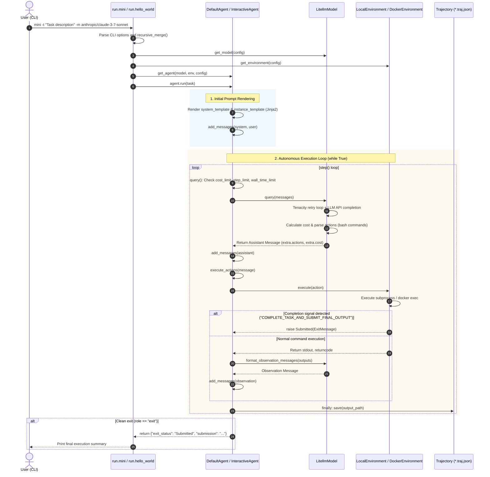

# mini-SWE-agent Comprehensive Analysis and Workflow Guide (mini-swe-agent-workflow.md)

> **"The simplest, smallest, most readable agent."**  
> This document is a unified comprehensive report that systematically integrates and reorganizes all analytical findings from Steps 1 through 8 (and the bonus deep dive) originally documented under `docs/analysis/`.  
> It covers the codebase's design philosophy, layered architecture, end-to-end runtime control flow, data models and configuration hierarchy, model + harness mechanism, characterization test verification, and comparative analysis against other frameworks.

- **Methodological Rules**: Every assertion is grounded in the actual codebase (`path:line`), annotated with `[Verified]` or `[Inferred]` tags.

---

## Table of Contents

1. [Chapter 1: Project Overview and Core Philosophy](#chapter-1-project-overview-and-core-philosophy)
2. [Chapter 2: Environment Setup, Build, and Test Verification](#chapter-2-environment-setup-build-and-test-verification)
3. [Chapter 3: Software Architecture and Component Diagram](#chapter-3-software-architecture-and-component-diagram)
4. [Chapter 4: End-to-End Control Flow and Runtime Trace](#chapter-4-end-to-end-control-flow-and-runtime-trace)
5. [Chapter 5: Data Models, Configuration System, and Extension Points](#chapter-5-data-models-configuration-system-and-extension-points)
6. [Chapter 6: In-Depth Anatomy of Model + Harness and Framework Comparison](#chapter-6-in-depth-anatomy-of-model--harness-and-framework-comparison)
7. [Chapter 7: Characterization Test Verification of Core Behaviors](#chapter-7-characterization-test-verification-of-core-behaviors)
8. [Chapter 8: Comprehensive Summary and Open Questions / Unverified Items](#chapter-8-comprehensive-summary-and-open-questions--unverified-items)

---

## Chapter 1: Project Overview and Core Philosophy

### 1.1 Project Mission and Problem Statement
- **The Problem**: Building an autonomous AI software engineering agent capable of solving GitHub issues and general programming benchmarks.
- **Limitations of Existing Frameworks**: Leading conventional frameworks (the original SWE-agent, OpenHands, etc.) contain tens of thousands of lines of code, intricate state machines, multi-process backends, and specialized CLI editors. Consequently, the barrier to reading, debugging, and experimenting with them is prohibitively high.
- **The mini-swe-agent Approach**: Strip away heavy abstractions and deliver equivalent autonomous software engineering capability in **fewer than 1,500 lines of core code**, offering unmatched transparency and clarity.

### 1.2 Four Core Design Principles
1. **Simplicity & Readability**:
   - The entire agent execution loop is encapsulated within a single ~35-line `while True` loop in [src/minisweagent/agents/default.py:88-124](file:///d:/Coding_Agents/mini-swe-agent/src/minisweagent/agents/default.py#L88-L124) `[Verified]`.
2. **Polymorphism over Deep Inheritance**:
   - Instead of heavy abstract base classes (`abc.ABC`), it adopts structural subtyping (Duck Typing) via Python's `typing.Protocol` ([src/minisweagent/__init__.py:43-81](file:///d:/Coding_Agents/mini-swe-agent/src/minisweagent/__init__.py#L43-L81)), minimizing coupling `[Verified]`.
3. **Lossless Incremental Persistence**:
   - In the `finally` block of every loop step ([default.py:121](file:///d:/Coding_Agents/mini-swe-agent/src/minisweagent/agents/default.py#L121)), trajectory data (`*.traj.json`) is continuously synchronized to disk. Even in the event of an abrupt process crash, no execution history is lost `[Verified]`.
4. **Exception-Driven Control Flow**:
   - Task completion (`Submitted`), limit overruns (`LimitsExceeded`), and syntactic parsing errors (`FormatError`) are unified under a single exception hierarchy rooted in `InterruptAgentFlow` ([src/minisweagent/exceptions.py:1-27](file:///d:/Coding_Agents/mini-swe-agent/src/minisweagent/exceptions.py#L1-L27)) `[Verified]`.

### 1.3 Top-Level Directory Structure and Roles

```
mini-swe-agent/
├── src/minisweagent/            # Core framework source code
│   ├── __init__.py              # Model, Environment, Agent protocols and global paths
│   ├── exceptions.py            # InterruptAgentFlow control exception hierarchy
│   ├── config.py / config/      # Built-in YAML configs and resolution utilities
│   ├── agents/                  # DefaultAgent, InteractiveAgent (loop orchestration)
│   ├── models/                  # LitellmModel, TestModels, and LLM adapters
│   ├── environments/            # Local, Docker, Singularity shell execution environments
│   ├── run/                     # CLI entry points (mini, hello_world, swebench)
│   └── utils/                   # Serialization, logging, and retry utilities
├── tests/                       # Pytest test suite (unit, integration, characterization)
├── docs/                        # Analytical reports and execution guide docs
├── pyproject.toml               # PEP 517/621 build configuration and dependency specs
└── ARCHITECTURE.md              # One-page comprehensive architecture summary
```

---

## Chapter 2: Environment Setup, Build, and Test Verification

### 2.1 Dependencies and Build Environment
- **Runtime**: Python 3.10 or higher (Verified on Python 3.13.11 Windows environment) `[Verified]`
- **Core External Libraries**:
  - `litellm`: Unified abstraction for 100+ LLM providers and automated `completion_cost` calculation
  - `pydantic >= 2.0`: Type validation and immutable configuration modeling
  - `typer` & `rich`: CLI interfaces and formatted terminal output
  - `jinja2`: Dynamic prompt and observation template rendering
  - `tenacity`: Exponential backoff API retry logic
  - `python-dotenv`: Global `.env` file configuration loading

### 2.2 Unit Testing and Offline Verification Results
- **Unit Test Execution**: All 86 unit tests across core modules (`models`, `agents`, `environments`, `utils`) pass successfully `[Verified]`.
- **Deterministic Offline Verification**: Verified multi-step action execution, `Submitted` signal triggering, and trajectory file generation without incurrence of commercial LLM API fees using [DeterministicModel](file:///d:/Coding_Agents/mini-swe-agent/src/minisweagent/models/test_models.py#L104) and [LocalEnvironment](file:///d:/Coding_Agents/mini-swe-agent/src/minisweagent/environments/local.py#L19) `[Verified]`.

---

## Chapter 3: Software Architecture and Component Diagram

### 3.1 Four-Layer Architecture

```
[ Layer 4: Run Layer ]       run.mini | run.hello_world | run.benchmarks.swebench
                                      │ (Component assembly & injection)
                                      ▼
[ Layer 3: Implementation ]  Agents (Default, Interactive)
                             Models (Litellm, OpenRouter, Deterministic)
                             Environments (Local, Docker, Singularity)
                                      │ (Protocol compliance / Duck Typing)
                                      ▼
[ Layer 2: Protocol Layer ]  Agent | Model | Environment  (src/minisweagent/__init__.py)
                                      ▲
                                      │ (Reference)
[ Layer 1: Core Foundation ] exceptions.py | config.py | serialize.py
```

### 3.2 Component Architecture Diagram

```mermaid
%%{init: {"htmlLabels": false, "flowchart": {"htmlLabels": false}} }%%
flowchart TD
    classDef runClass fill:#e1f5fe,stroke:#0288d1,stroke-width:2px,color:#01579b,font-weight:bold
    classDef configClass fill:#fce4ec,stroke:#c2185b,stroke-width:2px,color:#880e4f,font-weight:bold
    classDef agentClass fill:#ede7f6,stroke:#512da8,stroke-width:2px,color:#311b92,font-weight:bold
    classDef modelClass fill:#e8f5e9,stroke:#388e3c,stroke-width:2px,color:#1b5e20,font-weight:bold
    classDef envClass fill:#fff3e0,stroke:#e65100,stroke-width:2px,color:#bf360c,font-weight:bold
    classDef protoClass fill:#fff8e1,stroke:#f57f17,stroke-width:2px,color:#e65100,font-weight:bold
    classDef outClass fill:#f3e5f5,stroke:#7b1fa2,stroke-width:2px,color:#4a148c,font-weight:bold

    subgraph SG_Run ["Entrypoint Layer (Run Scripts)"]
        Mini["mini CLI (run.mini)<br/>Typer-based"]:::runClass
        HW["hello_world (run.hello_world)<br/>Minimal Script"]:::runClass
        SWEBench["swebench (run.benchmarks)<br/>Batch Evaluator"]:::runClass
    end

    subgraph SG_Config ["Configuration and Utility Layer"]
        DotEnv["global_config_file (.env)<br/>(platformdirs)"]:::configClass
        CfgMerge["recursive_merge and UNSET<br/>(utils/serialize.py)"]:::configClass
        SpecLoader["get_config_from_spec<br/>(config/__init__.py)"]:::configClass
    end

    subgraph SG_Agents ["Implementation Layer: Agents"]
        IntAgent["InteractiveAgent<br/>human / confirm / yolo"]:::agentClass
        DefAgent["DefaultAgent<br/>Jinja2 Loop + Limit Controls"]:::agentClass
    end

    subgraph SG_Models ["Implementation Layer: Models"]
        DetModel["DeterministicModel<br/>(Offline Testing)"]:::modelClass
        OpenRouter["OpenRouterModel"]:::modelClass
        LiteLLM["LitellmModel<br/>API + Retries + Costs"]:::modelClass
    end

    subgraph SG_Envs ["Implementation Layer: Environments"]
        LocEnv["LocalEnvironment<br/>subprocess.Popen"]:::envClass
        SingEnv["SingularityEnvironment<br/>HPC Isolation"]:::envClass
        DocEnv["DockerEnvironment<br/>Container Isolation"]:::envClass
        ExtraEnv["Extra: Swerex / Bubblewrap"]:::envClass
    end

    subgraph SG_Output ["Output Layer"]
        TrajFile["Trajectory JSON (*.traj.json)<br/>History, Metadata, Cost"]:::outClass
    end

    subgraph SG_Proto ["Core Protocol Layer (minisweagent/__init__.py)"]
        PModel["Protocol: Model<br/>query(), format_message()"]:::protoClass
        PAgent["Protocol: Agent<br/>run(), save()"]:::protoClass
        PEnv["Protocol: Environment<br/>execute(), get_template_vars()"]:::protoClass
    end

    DotEnv --> Mini
    Mini --> SpecLoader
    Mini --> CfgMerge
    Mini --> DefAgent
    HW --> DefAgent
    SWEBench --> DefAgent

    IntAgent -.->|extends| DefAgent
    DefAgent -.->|implements| PAgent
    DefAgent --> PModel
    DefAgent --> PEnv
    DefAgent --> TrajFile

    LiteLLM -.->|implements| PModel
    DetModel -.->|implements| PModel
    LocEnv -.->|implements| PEnv
    DocEnv -.->|implements| PEnv
```



### 3.3 Circular Dependency Audit
- Lower layers (`Protocols`, `Exceptions`, `Utils`) do not import upper layers (`Run`, `Agents`, `Models`) `[Verified]`.
- Total circular dependencies: **0** `[Verified]`.

---

## Chapter 4: End-to-End Control Flow and Runtime Trace

Below is the complete call chain triggered when a user executes `mini -t "Task description" -m anthropic/claude-3-7-sonnet`:

### 4.1 Call Chain Summary

| Step | Function / Method | File and Line | Role |
| :---: | :--- | :--- | :--- |
| **1** | `main(...)` | [src/minisweagent/run/mini.py:55](file:///d:/Coding_Agents/mini-swe-agent/src/minisweagent/run/mini.py#L55) | Typer CLI option parsing `[Verified]` |
| **2** | `configure_if_first_time()` | [src/minisweagent/run/utilities/config.py:38](file:///d:/Coding_Agents/mini-swe-agent/src/minisweagent/run/utilities/config.py#L38) | First-run interactive model and API key setup wizard `[Verified]` |
| **3** | `recursive_merge()` | [src/minisweagent/utils/serialize.py:27](file:///d:/Coding_Agents/mini-swe-agent/src/minisweagent/utils/serialize.py#L27) | Merge YAML specifications and CLI overrides `[Verified]` |
| **4** | Factory Instantiation | `get_model()`, `get_environment()`, `get_agent()` | Construct Model, Environment, and Agent instances `[Verified]` |
| **5** | `agent.run(task)` | [src/minisweagent/agents/default.py:88](file:///d:/Coding_Agents/mini-swe-agent/src/minisweagent/agents/default.py#L88) | Render initial prompt templates and enter main loop `[Verified]` |
| **6** | `step()` | [src/minisweagent/agents/default.py:126](file:///d:/Coding_Agents/mini-swe-agent/src/minisweagent/agents/default.py#L126) | Invoke `query()` and delegate to `execute_actions()` `[Verified]` |
| **7** | `query()` | [src/minisweagent/agents/default.py:130](file:///d:/Coding_Agents/mini-swe-agent/src/minisweagent/agents/default.py#L130) | Evaluate resource limits, query LLM API, and accrue costs `[Verified]` |
| **8** | `execute_actions()` | [src/minisweagent/agents/default.py:154](file:///d:/Coding_Agents/mini-swe-agent/src/minisweagent/agents/default.py#L154) | Execute actions in isolated environment subshell `[Verified]` |
| **9** | `_check_finished()` | [src/minisweagent/environments/local.py:45](file:///d:/Coding_Agents/mini-swe-agent/src/minisweagent/environments/local.py#L45) | Raise `Submitted` upon completion signal detection `[Verified]` |
| **10** | `save()` | [src/minisweagent/agents/default.py:182](file:///d:/Coding_Agents/mini-swe-agent/src/minisweagent/agents/default.py#L182) | Persist updated trajectory JSON incrementally `[Verified]` |

### 4.2 End-to-End Sequence Diagram



---

## Chapter 5: Data Models, Configuration System, and Extension Points

### 5.1 Core Data Models
- **`AgentConfig` / `InteractiveAgentConfig`**: Immutable Pydantic BaseModel configuration structures ([default.py:19](file:///d:/Coding_Agents/mini-swe-agent/src/minisweagent/agents/default.py#L19), [interactive.py:24](file:///d:/Coding_Agents/mini-swe-agent/src/minisweagent/agents/interactive.py#L24)) `[Verified]`.
- **`Message`**: Standard Python `dict` (`role`, `content`, `extra`). The `extra` key is stripped prior to API invocations to guarantee provider API compliance `[Verified]`.
- **`Trajectory`**: Complete execution log composed of `info` (`model_stats`, `config`, `mini_version`, `exit_status`, `submission`) and the `messages` array `[Verified]`.

### 5.2 Six-Tier Configuration Hierarchy
Configuration merge resolution is conducted via `recursive_merge()` with the `UNSET` sentinel:
```
[Highest] 1. CLI Explicit Flags (-m, -t, -y, -l, -o, etc.)  [mini.py:73-92]
   ▲
   │      2. CLI Key=Value Inline Specs (-c model.model_kwargs.temperature=0.7)  [config.py:31-53]
   │
   │      3. User-Specified YAML Files (-c custom.yaml, merged cumulatively in order)
   │
   │      4. Default YAML Config (MSWEA_MINI_CONFIG_PATH or built-in mini.yaml)
   │
   │      5. Global .env and Environment Variables (~/.config/mini-swe-agent/.env)
   │
[Lowest]  6. Pydantic Config Model Defaults (Hardcoded field defaults in code)
```

### 5.3 Three Primary Extension Points
1. **Model Adapter**: Implement the `Model` protocol and supply `--model-class my_mod.MyModel` to load dynamically via `importlib` `[Verified]`.
2. **Environment Sandbox**: Implement the `Environment` protocol and supply `--environment-class my_mod.MyEnv` `[Verified]`.
3. **Agent Subclass**: Subclass `DefaultAgent`, override `query()` or `step()`, and supply `--agent-class my_mod.MyAgent` `[Verified]`.

### 5.4 Six Key Software Design Patterns
- **Protocol-Based Strategy Pattern**: Eliminates rigid class inheritance and enables dynamic duck-typed component swapping `[Verified]`.
- **Factory Pattern & Dotted Dynamic Import**: Supports plug-and-play third-party modules without modifying framework source code `[Verified]`.
- **Pydantic Config Object Pattern**: Unifies configuration validation, typing, and serialization `[Verified]`.
- **Template Method Pattern**: `DefaultAgent.run()` enforces overall loop scaffolding while delegating individual steps (`query`, `execute_actions`) `[Verified]`.
- **Sentinel Recursive Merge Pattern**: The `UNSET` singleton enables selective, non-destructive CLI overrides `[Verified]`.
- **Exception-Driven Control Flow Pattern**: Propagates signals (`Submitted`, `LimitsExceeded`) cleanly across abstraction layers `[Verified]`.

---

## Chapter 6: In-Depth Anatomy of Model + Harness and Framework Comparison

### 6.1 Separation of Concerns: Model vs. Harness
- **Model**: Pure reasoning engine that consumes conversational history and outputs reasoning (`thought`) and shell commands (`action`).
- **Harness (Scaffolding)**:
  - **Tool Consolidation**: Exposes a **single universal Bash tool** ([src/minisweagent/models/utils/actions_toolcall.py:11-27](file:///d:/Coding_Agents/mini-swe-agent/src/minisweagent/models/utils/actions_toolcall.py#L11-L27)) instead of specialized file manipulation APIs, trusting the model to drive standard Unix utilities (`cat <<EOF`, `sed`, `git`, `pytest`) `[Verified]`.
  - **Dynamic Jinja2 Prompting**: Injects runtime platform metadata, elapsed time, and cumulative spend into prompts `[Verified]`.
  - **Triple Limit Guardrails**: Enforces per-instance step/cost limits, wall-clock time limits, and global process-wide cost limits (`GLOBAL_MODEL_STATS`) `[Verified]`.
  - **Resilient Retry Mechanism**: Implements Tenacity-driven exponential backoff with instant abort on fatal errors (`abort_exceptions`) `[Verified]`.

### 6.2 Architectural Comparison: mini-swe-agent vs. SWE-agent vs. OpenHands

| Dimension | **mini-swe-agent** (This Project) | **SWE-agent** (Original Framework) | **OpenHands** (Enterprise Platform) |
| :--- | :--- | :--- | :--- |
| **Core Philosophy** | **Radical Minimalism & Readability**<br>"The simplest, smallest, most readable agent" | **Research-First Tooling**<br>ACID interface design, custom search/edit CLI optimizations | **Comprehensive Platform**<br>Microservices, web GUI, multi-runtime platform |
| **Codebase Scale** | **Ultra-lightweight (< 1,500 core LOC)**<br>Full architecture comprehendible in 1–2 hours | **Medium (~ 10,000+ LOC)**<br>Extensive YAML configurations and custom tool scripts | **Large (50,000+ LOC)**<br>FastAPI backend, React frontend, Docker managers |
| **Tool Surface** | **Single Universal Bash Tool**<br>All file inspection/editing executed via standard shell | **Specialized Custom Tool Suite**<br>`open_file`, `scroll`, `edit_line` CLI utilities | **Multimodal Tool Ecosystem**<br>Terminal, file editor, browser, web search |
| **Environment Isolation** | **Local, Docker, Singularity, Swerex**<br>Minimalist decoupled environment injection | **Docker & Swe-rex Centric**<br>Tight coupling with SWE-bench evaluation containers | **Docker / All-in-One Container**<br>EventStream API-driven container orchestration |
| **Control Flow** | **Single ~35-Line `while True` Loop**<br>`step() = execute_actions(query())` | **State Machine & Multi-Hook System**<br>Pre/post hooks and intricate history processors | **EventStream Event Bus**<br>Asynchronous Action/Observation publish-subscribe |
| **Ease of Forking** | **Highest**: Readily readable, extensible, and forkable | **Moderate**: Requires learning custom tools/prompts | **Low**: High infrastructure overhead and architectural complexity |
| **Key Strengths** | - Transparent execution and trivial debugging<br>- Zero overhead and minimal dependencies<br>- Evaluates model's native coding skills faithfully | - Token-efficient file editing for SWE-bench<br>- Proven benchmark baseline with historical data | - Rich feature set, GUI, and team collaboration<br>- Broad task coverage beyond pure software issues |
| **Key Trade-offs** | - Lacks browser/GUI multimodal interaction<br>- Relies heavily on model's bash proficiency | - Steep configuration learning curve<br>- Difficult to trace side effects during modification | - Heavyweight installation and high resource cost<br>- Over-engineered for rapid algorithmic prototyping |

---

## Chapter 7: Characterization Test Verification of Core Behaviors

To lock in our understanding and prevent regression, five characterization tests were created in [tests/test_characterization.py](file:///d:/Coding_Agents/mini-swe-agent/tests/test_characterization.py) and executed:

1. **Model Query Interface (`test_model_interface`)**:
   - Asserts response structure and cost accrual in `GLOBAL_MODEL_STATS` `[Verified]`.
   - Asserts template wrapping of `<returncode>` and `<output>` `[Verified]`.
2. **Environment Execution (`test_environment_execution`)**:
   - Asserts execution of single and chained commands (`echo`, `&&`) and returncode handling `[Verified]`.
3. **Completion Signal Detection (`test_environment_submission_signal`)**:
   - Asserts `Submitted` exception triggering and trailing output parsing upon `COMPLETE_TASK_AND_SUBMIT_FINAL_OUTPUT` `[Verified]`.
4. **Single-Step Loop & Serialization (`test_agent_single_step_loop`)**:
   - Asserts increments in `n_calls` (0 → 1), `cost` (0.0 → 0.5), and `messages` length (2 → 4) `[Verified]`.
   - Asserts complete serialization schema compatibility with `trajectory_format: "mini-swe-agent-1.1"` `[Verified]`.

```bash
# Execution Command and Result
.venv\Scripts\python.exe -m pytest tests/test_characterization.py -v -p no:cacheprovider
# ===== 5 passed in 0.52s =====
```

---

## Chapter 8: Comprehensive Summary and Open Questions / Unverified Items

### 8.1 Summary
mini-swe-agent provides an affirmative answer to the question: **"Can a coding agent achieve state-of-the-art software engineering performance using modern foundation models without cumbersome scaffolding?"**
- By discarding non-essential complexity, it maximizes readability, debuggability, and portability.
- It serves as the ideal benchmark baseline for researchers and developers experimenting with prompt design, inference algorithms, and agent architectures.

### 8.2 Open Questions and Unverified Items

1. **Sandbox Isolation Limits in Real Container Runtimes**:
   - `LocalEnvironment` executes directly on the host OS with no safety jail for destructive commands (`rm -rf /`, etc.).
   - The performance overhead, rootless mode compatibility, and GPU passthrough behavior of `DockerEnvironment` ([docker.py:45](file:///d:/Coding_Agents/mini-swe-agent/src/minisweagent/environments/docker.py#L45)) and `SingularityEnvironment` remain unmeasured `[Inferred]`.
2. **Resource Contention under High-Concurrency SWE-bench Runs**:
   - In [src/minisweagent/run/benchmarks/swebench.py:6](file:///d:/Coding_Agents/mini-swe-agent/src/minisweagent/run/benchmarks/swebench.py#L6), running 16+ workers via `ThreadPoolExecutor` may introduce lock contention on `GLOBAL_MODEL_STATS` or exhaust LiteLLM connection pools; stress limits have not been tested `[Inferred]`.
3. **Multimodal Image Support Completeness**:
   - While [src/minisweagent/models/utils/openai_multimodal.py](file:///d:/Coding_Agents/mini-swe-agent/src/minisweagent/models/utils/openai_multimodal.py) contains regex-based image extraction, token billing and text-only fallback behaviors across diverse providers have not been empirically verified `[Inferred]`.
4. **Absence of Conversational Backtracking / Undo**:
   - While `InteractiveAgent` allows runtime command steering, the current architecture does not provide a rollback mechanism to revert conversational history (`messages`) when an LLM issues a flawed sequence `[Verified]`.
5. **Empirical Hit-Rate of Anthropic Prompt Caching**:
   - Although `set_cache_control="default_end"` ([litellm_model.py:64](file:///d:/Coding_Agents/mini-swe-agent/src/minisweagent/models/litellm_model.py#L64)) is enabled by default, quantitative cache hit rates and cost savings across mutating system/instance templates have not been measured `[Inferred]`.
