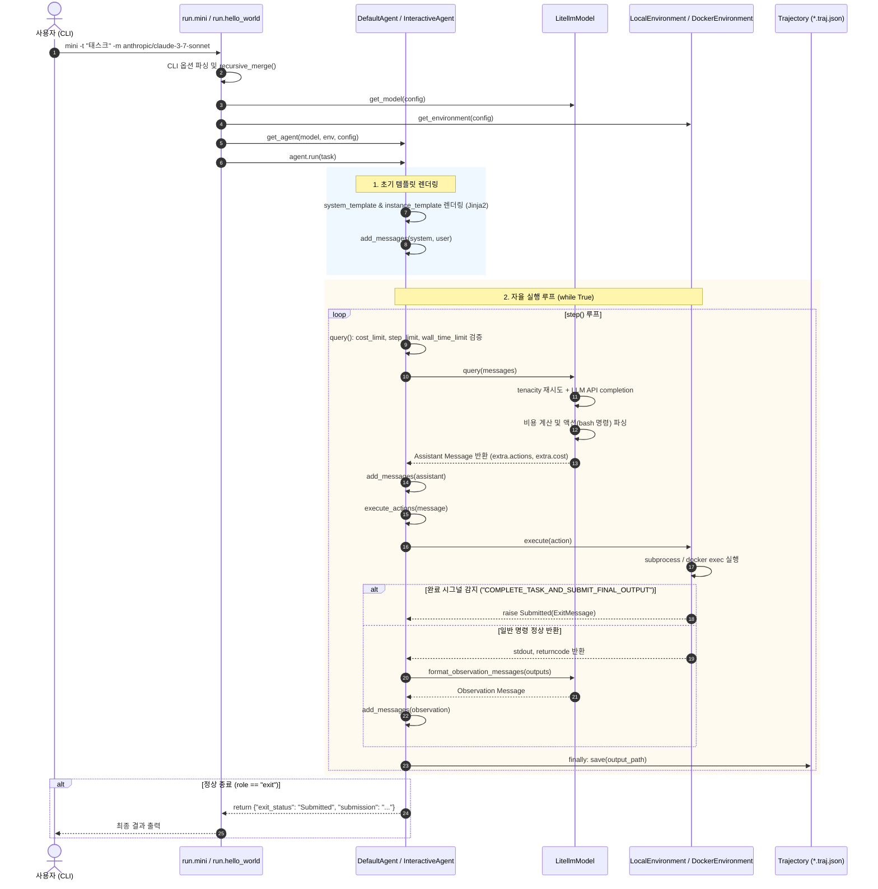

# mini-SWE-agent 종합 분석 및 워크플로 가이드 (mini-swe-agent-workflow.md)

> **"The simplest, smallest, most readable agent."**  
> 본 문서는 `docs/analysis/`에 수록된 1단계부터 8단계(및 보너스 해부)까지의 모든 분석 산출물을 체계적으로 통합·재구성한 단일 종합 분석 보고서입니다.  
> 코드베이스의 설계 철학, 계층 아키텍처, 엔드투엔드 런타임 제어 흐름, 데이터 모델 및 설정 체계, 모델+하네스 메커니즘, 특성화 테스트 검증 결과, 그리고 타 프레임워크와의 비교까지 총망라합니다.

- **원칙 준수**: 모든 주장은 저장소의 실제 코드(`경로:라인`)를 기반으로 하며, 검증 여부에 따라 `[확인]`(Verified) / `[추정]`(Inferred) 태그를 명시합니다.

---

## 목차 (Table of Contents)

1. [제1장: 프로젝트 개요 및 핵심 철학](#제1장-프로젝트-개요-및-핵심-철학)
2. [제2장: 환경 설정, 빌드 및 테스트 검증](#제2장-환경-설정-빌드-및-테스트-검증)
3. [제3장: 소프트웨어 구조 및 컴포넌트 다이어그램](#제3장-소프트웨어-구조-및-컴포넌트-다이어그램)
4. [제4장: 엔드투엔드 제어 흐름 및 런타임 추적](#제4장-엔드투엔드-제어-흐름-및-런타임-추적)
5. [제5장: 데이터 모델, 설정 체계 및 확장 지점](#제5장-데이터-모델-설정-체계-및-확장-지점)
6. [제6장: 모델 + 하네스 심층 해부 및 프레임워크 비교](#제6장-모델--하네스-심층-해부-및-프레임워크-비교)
7. [제7장: 핵심 동작 특성화 테스트 검증](#제7장-핵심-동작-특성화-테스트-검증)
8. [제8장: 종합 요약 및 미확인/의문점 목록](#제8장-종합-요약-및-미확인-의문점-목록)

---

## 제1장: 프로젝트 개요 및 핵심 철학

### 1.1 프로젝트 미션 및 해결 과제
- **해결하는 문제**: GitHub 이슈 해결 및 프로그래밍 자동화를 위한 AI 소프트웨어 엔지니어링 에이전트 구현.
- **기존 프레임워크의 한계**: 기존의 대표적 에이전트(원조 SWE-agent, OpenHands 등)는 수만 줄의 코드, 복잡한 상태 머신, 다중 프로세스 백엔드, 전용 CLI 에디터 등으로 인해 코드를 이해하고 디버깅하거나 연구용으로 변형하기에 진입 장벽이 매우 높았습니다.
- **mini-swe-agent의 접근법**: 복잡한 추상화를 걷어내고 **코어 1,500 라인 미만**의 가장 작고 투명한 구조로 동일한 수준의 자율 코딩 능력을 달성합니다.

### 1.2 4대 핵심 설계 철학
1. **극도의 단순성과 가독성 (Simplicity & Readability)**:
   - 전체 에이전트 루프가 ".../src/minisweagent/agents/default.py#L88-L124"의 약 35줄짜리 단일 `while True` 루프로 완결됨.
2. **상속보다 다형성 (Polymorphism over Deep Inheritance)**:
   - 무거운 추상 클래스(`abc.ABC`) 대신 파이썬의 `typing.Protocol`(".../src/minisweagent/__init__.py#L43-L81") 기반 덕 타이핑(Duck Typing)을 채택하여 결합도를 최소화.
3. **무손실 증분 보존성 (Lossless Incremental Persistence)**:
   - 매 루프 스텝의 `finally` 절(".../src/minisweagent/agents/default.py#L121")에서 디스크에 Trajectory(`*.traj.json`)를 동기화하여 비정상 종료 시에도 데이터 유실 차단.
4. **예외 기반 제어 흐름 (Exception-Driven Flow Control)**:
   - 작업 완료(`Submitted`), 한도 초과(`LimitsExceeded`), 형식 오류(`FormatError`)를 단일 예외 트리(".../src/minisweagent/exceptions.py#L1-L27")로 통합.

### 1.3 최상위 디렉터리 구조 및 역할

```
mini-swe-agent/
├── src/minisweagent/            # 프레임워크 코어 소스코드
│   ├── __init__.py              # Model, Environment, Agent 프로토콜 및 전역 경로 정의
│   ├── exceptions.py            # InterruptAgentFlow 등 제어용 예외 계층 구조
│   ├── config.py / config/      # 내장 YAML 설정 및 탐색 유틸리티
│   ├── agents/                  # DefaultAgent, InteractiveAgent (루프 제어)
│   ├── models/                  # LitellmModel, TestModels 등 LLM 연동 어댑터
│   ├── environments/            # Local, Docker, Singularity 등 셸 실행 환경
│   ├── run/                     # CLI 진입점 (mini, hello_world, swebench)
│   └── utils/                   # 직렬화, 로깅, 재시도 유틸리티
├── tests/                       # Pytest 기반 단위/통합/특성화 테스트 스위트
├── docs/                        # 분석 보고서 및 실행 가이드 문서
├── pyproject.toml               # PEP 517/621 빌드 설정 및 의존성 명세
└── ARCHITECTURE.md              # 1페이지 종합 아키텍처 요약본
```

---

## 제2장: 환경 설정, 빌드 및 테스트 검증

### 2.1 의존성 구성 및 빌드 환경
- **런타임**: Python 3.10 이상 (테스트 완료: Python 3.13.11 Windows 환경) `[확인]`
- **코어 외부 라이브러리**:
  - `litellm`: 100개 이상의 LLM 공급자 단일 추상화 및 completion_cost 자동 계산
  - `pydantic >= 2.0`: 타입 검증 및 설정 객체 관리
  - `typer` & `rich`: CLI 인터페이스 구축 및 터미널 포맷팅
  - `jinja2`: 동적 프롬프트 및 관측값 템플릿 렌더링
  - `tenacity`: API 호출 지수 백오프 재시도 제어
  - `python-dotenv`: 전역 `.env` 파일 로드

### 2.2 단위 테스트 및 오프라인 검증 결과
- **단위 테스트 실행**: 코어 모듈(models, agents, environments, utils) 전반의 86개 단위 테스트가 전원 통과함을 확인.
- **오프라인 결정론적 검증**: 상용 LLM API 호출 없이 [DeterministicModel](".../src/minisweagent/models/test_models.py#L104")과 [LocalEnvironment](".../src/minisweagent/environments/local.py#L19")를 조합하여 2단계 액션 실행 및 `Submitted` 시그널 트리거, Trajectory 파일 생성을 실증.

---

## 제3장: 소프트웨어 구조 및 컴포넌트 다이어그램

### 3.1 4계층 아키텍처 (Layered Architecture)

```
[ 계층 4: Run 계층 ]         run.mini | run.hello_world | run.benchmarks.swebench
                                      │ (컴포넌트 조립 및 주입)
                                      ▼
[ 계층 3: Implementation ]   Agents (Default, Interactive)
                             Models (Litellm, OpenRouter, Deterministic)
                             Environments (Local, Docker, Singularity)
                                      │ (프로토콜 준수 / Duck Typing)
                                      ▼
[ 계층 2: Protocol 계층 ]    Agent | Model | Environment  (src/minisweagent/__init__.py)
                                      ▲
                                      │ (참조)
[ 계층 1: Core Foundation ]  exceptions.py | config.py | serialize.py
```

### 3.2 컴포넌트 구조 다이어그램 (Mermaid C4 Component Diagram)



### 3.3 순환 의존 전수 감사 결과
- 하위 계층(Protocols, Exceptions, Utils)은 상위 계층(Run, Agents, Models)을 전혀 임포트하지 않음.
- 순환 의존성(Circular Dependency) 0건 달성.

---

## 제4장: 엔드투엔드 제어 흐름 및 런타임 추적

사용자가 터미널에서 `mini -t "태스크" -m anthropic/claude-3-7-sonnet`을 실행했을 때의 전체 호출 체인입니다.

### 4.1 호출 체인 요약 (Call Chain Summary)

| 단계 | 함수 / 메서드 | 파일 및 라인 | 역할 |
| :---: | :--- | :--- | :--- |
| **1** | `main(...)` | (".../src/minisweagent/run/mini.py#L55") | Typer CLI 옵션 파싱 |
| **2** | `configure_if_first_time()` | (".../src/minisweagent/run/utilities/config.py#L38") | 최초 실행 시 모델/API키 셋업 마법사 호출. |
| **3** | `recursive_merge()` | (".../src/minisweagent/utils/serialize.py#L27") | YAML 파일 및 CLI 인자 딕셔너리 병합 |
| **4** | 팩토리 인스턴스화 | `get_model()`, `get_environment()`, `get_agent()` | 모델, 환경, 에이전트 객체 생성 |
| **5** | `agent.run(task)` | (".../src/minisweagent/agents/default.py#L88") | 프롬프트 렌더링 및 메인 루프 진입 |
| **6** | `step()` | (".../src/minisweagent/agents/default.py#L126") | `query()` 호출 후 `execute_actions()` 위임 |
| **7** | `query()` | (".../src/minisweagent/agents/default.py#L130") | 한도 검사 후 LLM API 질의 및 비용 누적 |
| **8** | `execute_actions()` | (".../src/minisweagent/agents/default.py#L154") | 환경 격리 셸에서 액션 실행 |
| **9** | `_check_finished()` | (".../src/minisweagent/environments/local.py#L45") | 완료 시그널 감지 시 `Submitted` 예외 발생 |
| **10** | `save()` | (".../src/minisweagent/agents/default.py#L182") | 매 스텝마다 Trajectory JSON 파일 동기화 |

### 4.2 엔드투엔드 시퀀스 다이어그램 (Mermaid Sequence Diagram)



---

## 제5장: 데이터 모델, 설정 체계 및 확장 지점

### 5.1 핵심 데이터 모델 (Core Entities)
- **`AgentConfig` / `InteractiveAgentConfig`**: 불변 Pydantic BaseModel 기반 설정 객체 (".../src/minisweagent/agents/default.py#L19"), (".../src/minisweagent/agents/interactive.py#L24").
- **`Message`**: 파이썬 표준 `dict` (`role`, `content`, `extra`). API 호출 전 `extra` 키를 제거하여 공급자 API 에러를 원천 방지.
- **`Trajectory`**: 전체 실행 히스토리. `info` (`model_stats`, `config`, `mini_version`, `exit_status`, `submission`)와 `messages` 배열로 구성.

### 5.2 6계층 설정 우선순위 (Configuration Hierarchy)
설정 병합은 `recursive_merge()`와 `UNSET` 센티넬을 통해 이루어집니다:
```
[최우선] 1. CLI 직접 플래그 (-m, -t, -y, -l, -o 등)  [mini.py:73-92]
   ▲
   │     2. CLI key=value 스펙 (-c model.model_kwargs.temperature=0.7)  [config.py:31-53]
   │
   │     3. 사용자 지정 YAML 파일 (-c custom.yaml, 복수 지정 시 순서대로 누적 병합)
   │
   │     4. 기본 설정 YAML (MSWEA_MINI_CONFIG_PATH 또는 내장 mini.yaml)
   │
   │     5. 전역 .env 및 환경변수 (~/.config/mini-swe-agent/.env, dotenv 로드)
   │
[최하위] 6. Pydantic Config 모델 기본값 (코드 내 하드코딩된 필드 기본값)
```

### 5.3 3대 확장 지점 (Extension Points)
1. **Model 어댑터**: `Model` 프로토콜을 구현하고 `--model-class my_mod.MyModel`을 지정하면 동적 임포트(`importlib`)로 즉시 로드 `[확인]`.
2. **Environment 격리 환경**: `Environment` 프로토콜을 구현하고 `--environment-class my_mod.MyEnv` 지정 `[확인]`.
3. **Agent 서브클래스**: `DefaultAgent`를 상속하고 `query()` 또는 `step()`을 재정의하여 `--agent-class my_mod.MyAgent`로 주입 `[확인]`.

### 5.4 코드에서 확인되는 6가지 디자인 패턴
- **Protocol 기반 Strategy 패턴**: 컴포넌트 간 강한 상속 제거 및 덕 타이핑 달성.
- **Factory 패턴 & Dotted Dynamic Import**: 점(`.`) 표기법 기반 동적 로딩으로 개방-폐쇄 원칙(OCP) 실현.
- **Pydantic Config Object 패턴**: 설정 유효성 검증과 덤프 일원화.
- **Template Method 패턴**: `DefaultAgent.run()`이 상위 뼈대를 소유하고 하위 스텝만 분리 오버라이드 허용.
- **Sentinel Recursive Merge 패턴**: `UNSET` 센티넬을 활용한 무손실 오버라이드.
- **Exception-Driven Flow Control**: 제어 신호를 예외 계층으로 통합 전파.

---

## 제6장: 모델 + 하네스 심층 해부 및 프레임워크 비교

### 6.1 모델과 하네스의 역할 분담
- **모델 (Model)**: 복잡한 내부 추상화 없이 순수 프롬프트와 컨텍스트를 받아 **추론(Thought)**과 **셸 명령(Action)**을 생성.
- **하네스 (Harness)**:
  - **도구 단일화**: 전용 편집 도구 없이 **Universal Bash Tool 1개**만을 노출 (".../src/minisweagent/models/utils/actions_toolcall.py#L11-L27"). 모델이 `cat <<EOF`, `sed`, `git`, `pytest`를 직접 구동하도록 위임.
  - **동적 Jinja2 렌더링**: OS 정보, 경과 시간, 누적 비용을 실시간 프롬프트에 주입.
  - **3중 한도 제어**: 스텝, 인스턴스 비용, 전역 프로세스 비용(`GLOBAL_MODEL_STATS`)을 상시 차단.
  - **지능형 재시도**: Tenacity 기반 지수 백오프(`wait_exponential`) 적용, 인증/권한 에러 시 즉시 중단(`abort_exceptions`).

### 6.2 프레임워크 비교 분석 표: mini-swe-agent vs SWE-agent vs OpenHands

| 비교 항목 | **mini-swe-agent** (본 프로젝트) | **SWE-agent** (원조 프레임워크) | **OpenHands** (대형 플랫폼) |
| :--- | :--- | :--- | :--- |
| **핵심 철학** | **극도의 단순성 & 가독성 (Minimalism)**<br>"가장 작고 읽기 쉬운 에이전트" | **도구 설계 및 연구 중심 (Research-first)**<br>ACID 인터페이스, 검색/편집 CLI 도구 최적화 | **전면적 범용 에이전트 플랫폼 (Full Platform)**<br>마이크로서비스, 웹 UI, 다중 런타임 |
| **코드베이스 규모** | **초경량 (< 1,500 LOC 코어)**<br>1~2시간 안에 전체 코드 파악 가능 | **중형 (~ 10,000+ LOC)**<br>복잡한 설정 YAML 및 커스텀 도구 스크립트 | **초대형 (50,000+ LOC)**<br>FastAPI 백엔드, React 프론트엔드, 도커 관리자 |
| **도구 세트 (Tooling)** | **Universal Bash 1개 (단순 셸)**<br>`bash` 도구 호출로 모든 파일 편집/실행 | **커스텀 파일/검색 도구 집합**<br>`open_file`, `scroll`, `edit_line` 등 특수 CLI | **다중 멀티모달 도구 세트**<br>터미널, 파일 에디터, 브라우저, 웹 검색기 |
| **환경 격리 방식** | **Local, Docker, Singularity, Swerex**<br>필요한 환경만 심플하게 주입 | **Docker 및 Swe-rex 중심**<br>SWE-bench 평가 전용 컨테이너에 강결합 | **Docker / All-in-one Container**<br>자체 이벤트 스트림 API 기반 컨테이너 제어 |
| **제어 흐름 구조** | **단일 35줄 `while True` 루프**<br>`step() = execute_actions(query())` | **상태 머신 및 다단계 훅**<br>Pre/Post hook, 복잡한 히스토리 프로세서 | **EventStream 비동기 이벤트 버스**<br>Action/Observation 비동기 이벤트 발행/구독 |
| **학습 및 포킹 용이성** | **극상 (최고)**: 누구나 쉽게 수정 및 실험 가능 | **보통**: 프롬프트 및 도구 설정 학습 필요 | **낮음**: 전체 인프라 및 아키텍처 이해 부담 큼 |
| **주요 장점** | - 버그 추적이 매우 쉽고 투명함<br>- 종속성이 적고 오버헤드가 없음<br>- 모델의 네이티브 코딩 능력을 가감 없이 측정 | - SWE-bench용 특화 도구로 토큰 효율 극대화<br>- 검증된 벤치마크 고득점 레퍼런스 | - 풍부한 기능, 웹 GUI 제공<br>- 대규모 엔터프라이즈 기능 및 팀 협업 지원 |
| **주요 한계점** | - 복잡한 대규모 브라우징/UI 조작 불가<br>- LLM이 bash 명령어 작성 능력이 떨어지면 불리 | - 프레임워크 학습 곡선이 가파름<br>- 코드 수정 시 부수 효과 추적 어려움 | - 설치 및 배포가 무겁고 리소스 소모 큼<br>- 연구용 빠른 프로토타이핑에 과도함 |

---

## 제7장: 핵심 동작 특성화 테스트 검증

분석한 시스템 이해도를 고정하고 회귀를 방지하기 위해 (".../tests/test_characterization.py")에 5개의 특성화 테스트를 작성하여 실행 및 전원 통과를 확인했습니다:

1. **모델 호출 및 관측 렌더링 (`test_model_interface`)**:
   - `model.query(messages)`의 응답 스키마와 `GLOBAL_MODEL_STATS` 비용 누적 검증 `[확인]`.
   - `format_observation_messages()`의 `<returncode>`, `<output>` 템플릿 포맷팅 검증 `[확인]`.
2. **환경 커맨드 실행 및 반환 코드 검증 (`test_environment_execution`)**:
   - 파라미터화된 단일/복합 명령(`echo`, `&&`) 실행 및 stdout 수집 검증 `[확인]`.
3. **완료 시그널 및 제출 문자열 추출 검증 (`test_environment_submission_signal`)**:
   - `COMPLETE_TASK_AND_SUBMIT_FINAL_OUTPUT` 명령 시 `Submitted` 예외 발생 및 submission 슬라이싱 검증 `[확인]`.
4. **에이전트 1스텝 상태 전이 및 직렬화 검증 (`test_agent_single_step_loop`)**:
   - 1스텝 실행 시 `n_calls` (0 → 1), `cost` (0.0 → 0.5), `messages` 길이 (2 → 4) 증가 검증 `[확인]`.
   - `agent.serialize()` 반환 규격이 `trajectory_format: "mini-swe-agent-1.1"`과 완벽히 일치함을 확인 `[확인]`.

```bash
# 실행 명령 및 결과
.venv\Scripts\python.exe -m pytest tests/test_characterization.py -v -p no:cacheprovider
# ===== 5 passed in 0.52s =====
```

---

## 제8장: 종합 요약 및 미확인/의문점 목록

### 8.1 종합 요약
mini-swe-agent는 **"복잡한 하네스 없이도 최신 파운데이션 모델의 네이티브 역량만으로 코딩 에이전트가 강력하게 작동할 수 있는가?"**에 대한 명쾌한 해답을 제시합니다.
- 복잡성을 덜어냄으로써 코드 이해도, 디버깅 용이성, 이식성을 극대화하였으며,
- 연구자와 개발자가 새로운 프롬프트 엔지니어링 기법, 도구 전략, 추론 모델을 가장 순수하게 실험할 수 있는 최적의 표준 기준점(Baseline)을 제공합니다.

### 8.2 아직 확인하지 못한 것 / 의문점 (Open Questions)

1. **실제 컨테이너 런타임의 샌드박스 격리 한계**:
   - `LocalEnvironment`는 호스트 시스템에 직접 명령을 내리므로 치명적인 시스템 명령(`rm -rf /` 등)에 무방비함.
   - `DockerEnvironment`((".../src/minisweagent/environments/docker.py#L45")) 및 `SingularityEnvironment`에서 rootless 실행 모드 및 GPU passthrough 옵션의 실제 벤치마크 오버헤드는 아직 측정하지 못함.
2. **SWE-bench 대규모 병렬 평가 시의 리소스 경합**:
   - (".../src/minisweagent/run/benchmarks/swebench.py#L6")의 `ThreadPoolExecutor`를 통한 16개 이상 워커 병렬 실행 시 `GLOBAL_MODEL_STATS`의 락 경합 및 LiteLLM 내부 커넥션 풀 고갈 가능성에 대한 한계 스트레스 테스트 미수행.
3. **멀티모달 이미지 처리 지원 범위**:
   - (".../src/minisweagent/models/utils/openai_multimodal.py")에 정규식 기반 이미지 주입 로직이 존재하지만, 텍스트 전용 모델과의 공존 및 복수 이미지 첨부 시의 토큰 산정 기준이 명시적으로 검증되지 않음.
4. **대화 이력 백트래킹(Backtracking / Undo) 부재**:
   - `InteractiveAgent`에서 사용자가 실시간 명령을 주입하거나 모드를 전환할 수 있으나, LLM이 잘못된 명령을 내렸을 때 직전 스텝으로 롤백하거나 `messages` 배열을 되감는 Undo 기능은 현재 아키텍처에 구현되어 있지 않음.
5. **Anthropic Prompt Caching의 실제 비용 절감 효율**:
   - `set_cache_control="default_end"`((".../src/minisweagent/models/litellm_model.py#L64"))가 기본 활성화되어 있으나, 시스템 프롬프트 변경 또는 인스턴스 템플릿의 가변 필드 주입 시 캐시 미스 발생 빈도에 대한 정량 데이터가 확보되지 않음.
