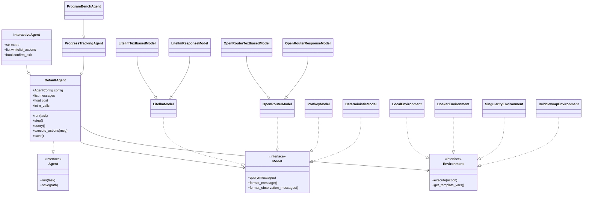
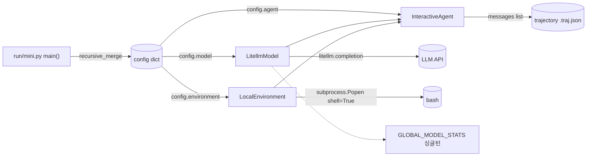
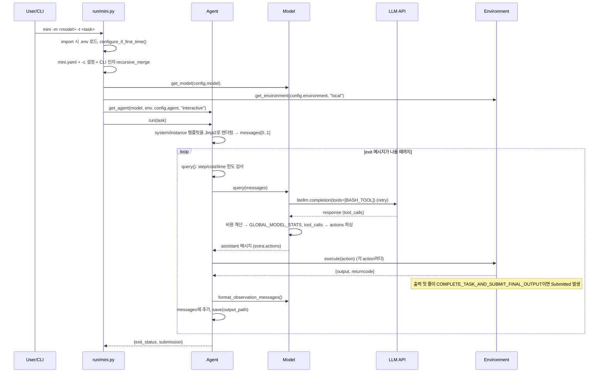

# SWE-agent/mini-swe-agent SW 구조 설명 (정적 / 동적 / 동작)

> 대상: `SWE-agent/mini-swe-agent` v2.4.6 기반

---

## 1. 정적 구조 (Static Structure)

### 1.1 계층 / 패키지 구조

```
src/minisweagent/
├── __init__.py        # 전역 설정(.env 로드), 버전, Protocol 정의 (Model / Environment / Agent)
├── exceptions.py      # 제어 흐름용 예외 계층
├── run/               # [Run 계층] CLI 진입점 (Typer)
│   ├── mini.py              # `mini` 명령 (대화형, 로컬)
│   ├── hello_world.py       # 최소 예제
│   ├── benchmarks/          # swebench(배치/병렬), swebench_single, programbench
│   └── utilities/           # mini-extra: config 설정, inspector(TUI 궤적 뷰어)
├── agents/            # [Agent 계층] 제어 루프
│   ├── default.py           # DefaultAgent (핵심 루프, 약 190줄)
│   └── interactive.py       # InteractiveAgent (human/confirm/yolo 모드)
├── models/            # [Model 계층] LLM 어댑터
│   ├── litellm_model.py     # 기본 모델 (tool call 방식)
│   ├── *_textbased_model.py # 정규식으로 ```bash 블록 파싱 (v1 방식)
│   ├── *_response_model.py  # OpenAI /responses API
│   ├── openrouter / portkey / requesty / test_models / extra/roulette
│   └── utils/               # actions_toolcall, actions_text, retry, cache_control, multimodal
├── environments/      # [Environment 계층] 명령 실행 백엔드
│   ├── local.py / docker.py / singularity.py
│   └── extra/               # bubblewrap, contree, swerex_docker, swerex_modal
├── config/            # [Config] YAML 설정 + Jinja2 프롬프트 템플릿 (mini.yaml, default.yaml, benchmarks/*.yaml)
└── utils/             # serialize.recursive_merge, UNSET, log
```

의존 방향: `run → (agents, models, environments, config)`, `agents → Protocol(Model, Environment)`, 모델/환경은 서로 모른다. Agent는 구체 클래스가 아니라 **Protocol(덕 타이핑)** 에만 의존 → 의존성 역전(DIP).

### 1.2 핵심 인터페이스 (`minisweagent/__init__.py`)

| Protocol | 메서드 | 역할 |
|---|---|---|
| `Model` | `query(messages)`, `format_message()`, `format_observation_messages()`, `get_template_vars()`, `serialize()` | LLM 호출 + 응답 → actions 파싱 + 실행결과 → 메시지 변환 |
| `Environment` | `execute(action)`, `get_template_vars()`, `serialize()` | bash 명령 실행 후 `{output, returncode, exception_info}` 반환 |
| `Agent` | `run(task)`, `save(path)` | 루프 제어, 궤적(trajectory) 저장 |

### 1.3 클래스 다이어그램



### 1.4 팩토리 + 문자열 레지스트리 (확장 지점)

- `agents.get_agent()` → `_AGENT_MAPPING` (`default`, `interactive`)
- `models.get_model()` → `_MODEL_CLASS_MAPPING` (`litellm`, `openrouter`, `portkey`, …; 미지정 시 `LitellmModel`)
- `environments.get_environment()` → `_ENVIRONMENT_MAPPING` (`local`, `docker`, `singularity`, …)

각 매핑은 단축 이름 또는 **전체 import 경로** 문자열을 받아 `importlib`로 동적 로딩 → 새 클래스를 만들고 YAML에 `agent_class: my.module.MyAgent` 처럼 적으면 코드 수정 없이 교체 가능 (플러그인 구조).

### 1.5 설정 데이터 모델

- 각 컴포넌트는 **Pydantic Config 클래스**를 가짐: `AgentConfig`(system/instance_template, step_limit, cost_limit, wall_time_limit_seconds, max_consecutive_format_errors, output_path), `LitellmModelConfig`(model_name, model_kwargs, observation_template, format_error_template…), `LocalEnvironmentConfig`(cwd, env, timeout), `DockerEnvironmentConfig`(image, run_args, container_timeout…).
- YAML 최상위 키 `agent / model / environment / run`이 그대로 각 Config의 kwargs로 전달됨.

### 1.6 예외 계층 (제어 흐름 수단)

```
Exception
└── InterruptAgentFlow(*messages)      # 메시지를 들고 루프를 "중단"시키는 신호
    ├── Submitted                      # 작업 완료 (role=exit)
    ├── LimitsExceeded                 # step/cost 초과 (role=exit)
    │   └── TimeExceeded               # wall-clock 초과 (role=exit)
    ├── UserInterruption               # 사용자 개입/거절 (role=user → 루프 계속)
    └── FormatError                    # LLM 출력 형식 오류 (role=user → 루프 계속, 연속 N회면 종료)
```
예외가 들고 있는 메시지의 `role`이 `"exit"`이면 루프 종료, 아니면 메시지만 추가하고 계속 진행.

---

## 2. 동적 구조 (Runtime Object Structure)

### 2.1 실행 시 객체 관계 (`mini` 기준)



- **Agent가 Model과 Environment를 소유(합성)** 하고, 이 둘 사이를 중재.
- **상태는 Agent에만 존재**: `messages`(선형 히스토리 = 궤적 그 자체), `cost`, `n_calls`, `n_consecutive_format_errors`, `_start_time`.
- Model과 Environment는 사실상 **무상태(stateless)**. 특히 `LocalEnvironment.execute()`는 매번 새 `subprocess`를 띄움 → `cd`·환경변수 등이 다음 명령에 유지되지 않음 (설계 의도: 안정성, 샌드박스 교체 용이).
- 프로세스 전역 상태: `GLOBAL_MODEL_STATS`(스레드 락으로 보호, 전체 비용/호출 수 한도), 전역 `.env` 설정.
- `DockerEnvironment`는 예외적으로 생성 시 `docker run -d … sleep 2h`로 컨테이너를 띄워두고 `execute()`마다 `docker exec`.

### 2.2 메시지(데이터) 구조

`messages`는 OpenAI 포맷 dict 리스트이며, 각 메시지에 `extra` 필드로 메타데이터를 붙임 (API 전송 전 `_prepare_messages_for_api`에서 `extra` 제거).

```
[0] system     : system_template 렌더링 결과
[1] user       : instance_template 렌더링 결과 (task 포함)
[2] assistant  : LLM 응답 + extra{actions:[{command, tool_call_id}], cost, response, timestamp}
[3] tool       : observation_template 렌더링 (returncode, output) + extra{raw_output, returncode}
 ... (assistant ↔ tool 반복) ...
[N] exit       : extra{exit_status: Submitted|LimitsExceeded|..., submission}
```

### 2.3 배치 실행 시 동적 구조 (`swebench`)

`ThreadPoolExecutor(max_workers=workers)` → 인스턴스마다 `process_instance()`가 **독립된 Model + DockerEnvironment + ProgressTrackingAgent** 생성 → 결과는 `preds.json`(파일 락으로 동기화)과 `<id>/<id>.traj.json`에 저장. `RunBatchProgressManager`가 Rich 진행 표시를 담당.

---

## 3. 동작 구조 (Behavior / Control Flow)

### 3.1 전체 시퀀스 (`mini -t "..."`)



### 3.2 `DefaultAgent.run()` 루프 상세 (`agents/default.py`)

```
run(task):
  messages = [system, user(task)]
  while True:
    try:
      step()                      # = execute_actions(query())
      연속 형식오류 카운터 = 0
    except FormatError:          # 비용 반영, 카운터++, 오류 메시지를 user로 추가 → LLM이 재시도
      카운터 >= max(기본3) 이면 exit(RepeatedFormatError) 추가
    except InterruptAgentFlow:   # Submitted / LimitsExceeded / UserInterruption → 메시지 추가
    except Exception:            # 예상 못한 오류 → exit 메시지 추가 후 re-raise
    finally:
      save(output_path)          # 매 스텝마다 궤적 저장 (중간 종료돼도 기록 남음)
    if messages[-1].role == "exit": break
  return messages[-1].extra      # {exit_status, submission}
```

### 3.3 종료 조건

| 조건 | 발생 위치 | exit_status |
|---|---|---|
| LLM이 `echo COMPLETE_TASK_AND_SUBMIT_FINAL_OUTPUT` 실행 (returncode 0) | `Environment._check_finished` | `Submitted` (이후 출력 = submission/패치) |
| `n_calls >= step_limit` 또는 `cost >= cost_limit` | `Agent.query` | `LimitsExceeded` |
| 경과시간 >= `wall_time_limit_seconds` | `Agent.query` | `TimeExceeded` |
| 형식 오류 연속 N회 | `Agent.run` | `RepeatedFormatError` |
| 처리 안 된 예외 | `Agent.run` | 예외 클래스명 |

### 3.4 Action 파싱 2가지 방식

- **Tool call (v2 기본, `LitellmModel`)**: API에 `BASH_TOOL`(`bash(command)`) 하나만 등록 → `tool_calls`에서 `command` 추출, 결과는 `role=tool` 메시지로 반환. tool call이 없거나 다른 도구면 `FormatError`.
- **Text-based (`*_textbased_model`, `mini_textbased.yaml`)**: 응답 텍스트에서 정규식으로 ```` ```bash ... ``` ```` 블록을 **정확히 1개** 추출, 결과는 `role=user` 메시지.

### 3.5 InteractiveAgent 동작 (`mini` 기본 Agent)

DefaultAgent의 훅 메서드를 오버라이드(템플릿 메서드 패턴):
- `add_messages` → 콘솔에 메시지 출력
- `query` → `human` 모드면 LLM 대신 사용자가 명령 입력; 한도 초과 시 새 한도 입력 받기(TTY일 때만)
- `step` → `Ctrl+C` 시 사용자 코멘트를 `UserInterruption`으로 주입
- `execute_actions` → `confirm` 모드면 실행 전 확인(whitelist 정규식은 예외), 거절 시 사유를 LLM에 피드백; `Submitted` 시 `confirm_exit`이면 새 작업 입력 받아 계속 진행 가능
- 슬래시 명령: `/y`(yolo) `/c`(confirm) `/u`(human) `/m`(멀티라인) `/h`(도움말)

### 3.6 설정 병합 / 템플릿 렌더링

- `recursive_merge(*dicts)`: 뒤 dict가 우선, 중첩 dict는 재귀 병합, `UNSET` 값은 건너뜀 → CLI에서 지정하지 않은 옵션이 YAML 값을 덮어쓰지 않음. 우선순위: `mini.yaml` < `-c` 파일/`key=value` < CLI 옵션.
- `Agent.get_template_vars()`: AgentConfig + Environment 변수(OS 정보, 환경변수) + Model config + 런타임 통계(`n_model_calls`, `model_cost`, `elapsed_seconds`) + `task` 를 합쳐 Jinja2(`StrictUndefined`)로 system/instance/observation 템플릿 렌더링.

---

## 4. 설계 특징 요약

1. **최소주의**: 도구는 bash 하나, 핵심 루프 ~190줄.
2. **선형 히스토리**: messages = LLM 입력 = 저장 궤적 → 디버깅·파인튜닝 데이터로 그대로 사용.
3. **무상태 실행**: 명령마다 독립 subprocess → `subprocess`를 `docker exec` 등으로 바꾸기만 하면 샌드박스 전환.
4. **Protocol + 문자열 레지스트리 팩토리**: Agent/Model/Environment를 설정만으로 교체·확장.
5. **예외 기반 제어 흐름**: 종료·중단·재시도를 `InterruptAgentFlow` 하위 예외 + 메시지 `role`로 일원화.
6. **매 스텝 저장**: `finally`에서 `save()` → 비정상 종료에도 궤적 보존.
