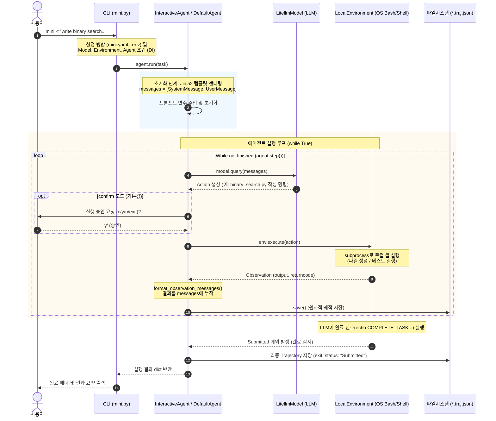

---

### 상세 동작 단계 (Step-by-Step Workflow)

#### 1단계: 진입점 및 객체 조립 (Bootstrap & Dependency Injection)
1. **CLI 옵션 파싱 (`mini.py:55`)** `[확인]`
   - (".../mini-swe-agent/src/minisweagent/run/mini.py#L55")의 `main()` 함수가 호출되어 `--task` (`-t`) 인자로 `"write binary search algorithm with a testing example"` 문자열을 수신합니다.
2. **설정 계층 병합 (`config.py:102`)** `[확인]`
   - 내장 설정(".../mini-swe-agent/src/minisweagent/config/mini.yaml")과 전역 `.env` 파일(API 키, 모델명)을 로드하여 `recursive_merge()`로 병합합니다.
3. **3대 핵심 컴포넌트 팩토리 인스턴스화** `[확인]`
   - **Model:** `get_model()`을 통해 LitellmModel(".../mini-swe-agent/src/minisweagent/models/litellm_model.py#L48") 생성
   - **Environment:** `get_environment()`를 통해 로컬 셸 실행기인 LocalEnvironment(".../mini-swe-agent/src/minisweagent/environments/local.py#L19") 생성
   - **Agent:** `get_agent()`를 통해 InteractiveAgent(".../mini-swe-agent/src/minisweagent/agents/interactive.py#L33") (또는 `DefaultAgent`) 생성 후 Model과 Environment를 주입

---

#### 2단계: 프롬프트 렌더링 및 대화 세션 초기화
1. **`agent.run(task)` 호출 (`default.py:88`)** `[확인]`
2. **Jinja2 템플릿 변환 (`default.py:66`)** `[확인]`
   - **System Message:** 에이전트의 역할(소프트웨어 엔지니어), bash 도구 사용 규칙, 종료 시그널 규칙(`COMPLETE_TASK_AND_SUBMIT_FINAL_OUTPUT`) 등이 포함된 시스템 프롬프트 구성
   - **User Message:** 사용자가 입력한 `"write binary search algorithm with a testing example"` 및 현재 시스템 OS 정보(`system_information`) 주입
   - 대화 히스토리(`self.messages`)에 `[system, user]` 형태로 최초 2개 메시지 적재

##### 🔍 실제 생성된 초기 프롬프트 메시지 예시 (`self.messages`)

**1) System Message (`role: "system"`):**
```text
You are a helpful assistant that can interact with a computer.
```
> *(참고: 텍스트 기반 모드인 `default.yaml` 사용 시에는 `<format_example>` 및 ```mswea_bash_command 코드 블록 포맷 규칙이 시스템 프롬프트에 추가됩니다.)*

**2) User Message (`role: "user"`):**
```markdown
Please solve this issue: write binary search algorithm with a testing example

You can execute bash commands and edit files to implement the necessary changes.

## Recommended Workflow

This workflow should be done step-by-step so that you can iterate on your changes and any possible problems.

1. Analyze the codebase by finding and reading relevant files
2. Create a script to reproduce the issue
3. Edit the source code to resolve the issue
4. Verify your fix works by running your script again
5. Test edge cases to ensure your fix is robust
6. Submit your changes and finish your work by issuing the following command: `echo COMPLETE_TASK_AND_SUBMIT_FINAL_OUTPUT`.
   Do not combine it with any other command. <important>After this command, you cannot continue working on this task.</important>

## Command Execution Rules

You are operating in an environment where

1. You issue at least one command
2. The system executes the command(s) in a subshell
3. You see the result(s)
4. You write your next command(s)

Each response should include:

1. **Reasoning text** where you explain your analysis and plan
2. At least one tool call with your command

**CRITICAL REQUIREMENTS:**

- Your response SHOULD include reasoning text explaining what you're doing
- Your response MUST include AT LEAST ONE bash tool call
- Directory or environment variable changes are not persistent. Every action is executed in a new subshell.
- However, you can prefix any action with `MY_ENV_VAR=MY_VALUE cd /path/to/working/dir && ...` or write/load environment variables from files
- Submit your changes and finish your work by issuing the following command: `echo COMPLETE_TASK_AND_SUBMIT_FINAL_OUTPUT`.
  Do not combine it with any other command. <important>After this command, you cannot continue working on this task.</important>

Example of a CORRECT response:
<example_response>
I need to understand the structure of the repository first. Let me check what files are in the current directory to get a better understanding of the codebase.

[Makes bash tool call with {"command": "ls -la"} as arguments]
</example_response>

<system_information>
Windows 10 10.0.19045 AMD64
</system_information>

## Useful command examples

### Create a new file:

```bash
cat <<'EOF' > newfile.py
# content here
EOF
```

### Edit a file:

Use python to edit files.

### Run a python script:

```bash
python3 script.py
```
```

**3) 파이썬 런타임 적재 구조 (`self.messages` 메모리 적재 형태):**
```python
self.messages = [
    {
        "role": "system",
        "content": "You are a helpful assistant that can interact with a computer.\n",
        "extra": {},
    },
    {
        "role": "user",
        "content": "Please solve this issue: write binary search algorithm with a testing example\n\nYou can execute bash commands and edit files...",
        "extra": {},
    },
]
```

---

#### 3단계: 자율 제어 루프 (`while True:` in `agent.run()`)

에이전트는 작업이 완료될 때까지 `agent.step()`(".../mini-swe-agent/src/minisweagent/agents/default.py#L126")을 반복 실행합니다:

##### 턴 1: 코드 작성 (Code Generation)
- **자원 한도 검사 (`default.py:130`)**: `cost_limit`, `step_limit` 초과 여부 확인 `[확인]`.
- **LLM 질의 (`LitellmModel.query:81`)**: 히스토리 전체를 LLM에 전송 `[확인]`.
- **LLM의 응답**: 이진 탐색 알고리즘과 테스트 코드를 포함한 스크립트를 작성하기 위해 bash 명령어를 생성 `[추정]`:
  ```bash
  cat << 'EOF' > binary_search.py
  def binary_search(arr, target):
      left, right = 0, len(arr) - 1
      while left <= right:
          mid = (left + right) // 2
          if arr[mid] == target:
              return mid
          elif arr[mid] < target:
              left = mid + 1
          else:
              right = mid - 1
      return -1

  if __name__ == "__main__":
      # Testing example
      data = [1, 3, 5, 7, 9, 11]
      assert binary_search(data, 7) == 3
      assert binary_search(data, 2) == -1
      print("All binary search tests passed!")
  EOF
  ```
- **사용자 승인 (Interactive 모드)**: 터미널에 제안된 명령어가 표시되며 사용자의 확인(`[c]onfirm / [y]olo / [u]ser / exit`)을 대기 `[확인]`. (`-y` 옵션 실행 시 자동 통과)
- **명령 실행 (`LocalEnvironment.execute:24`)**: 로컬 환경에서 `subprocess.run()`을 통해 명령어가 실행되어 실제 파일시스템에 `binary_search.py`가 생성됨 `[확인]`.
- **관측 피드백 (`format_observation_messages:140`)**: `returncode: 0`, 빈 stdout이 LLM 관측 메시지로 포맷팅되어 `self.messages`에 추가됨 `[확인]`.
- **중간 저장 (`default.py:120`)**: `finally` 블록에서 `last_mini_run.traj.json`에 스텝 결과 갱신 `[확인]`.

##### 턴 2: 자체 테스트 및 검증 (Self-Testing)
- **LLM 질의**: 이전 턴에서 파일이 생성되었으므로, 작성된 코드가 정상 동작하는지 검증하는 명령 생성 `[추정]`:
  ```bash
  python binary_search.py
  ```
- **명령 실행 및 관측 수집**:
  - `LocalEnvironment` 실행 결과: `All binary search tests passed!` 출력 및 `returncode: 0` 반환 `[추정]`.
  - 관측 메시지가 `self.messages`에 추가됨.

##### 턴 3: 작업 완료 제출 (Completion Signal)
- **LLM 질의**: 테스트가 통과했음을 인지한 모델이 시스템 규칙에 따라 완료 명령을 생성 `[확인]`:
  ```bash
  echo COMPLETE_TASK_AND_SUBMIT_FINAL_OUTPUT
  ```
- **완료 감지 (`LocalEnvironment._check_finished:45`)** `[확인]`:
  - `output.splitlines()[0].strip() == "COMPLETE_TASK_AND_SUBMIT_FINAL_OUTPUT"` 조건 일치 확인.
  - (".../mini-swe-agent/src/minisweagent/exceptions.py#L12")의 `Submitted` 예외 발생.
  - `DefaultAgent.run()`의 `except Submitted:` 블록에서 이를 포착하여 `exit_status = "Submitted"` 설정 후 루프를 정상 탈출 `[확인]`.

---

#### 4단계: 최종 저장 및 결과 리턴 (Termination)
1. **Trajectory 직렬화 (`default.py:159`)** `[확인]`
   - 전체 프롬프트, 도구 호출, 셸 실행 결과, 소요 비용(`cost`), LLM 호출 횟수(`n_calls`), 종료 상태(`exit_status: "Submitted"`)가 포함된 딕셔너리가 구성됩니다.
2. **파일 저장** `[확인]`
   - `~/.config/mini-swe-agent/last_mini_run.traj.json`에 원자적으로 저장됩니다.
3. **CLI 종료 화면 출력** `[확인]`
   - 콘솔에 모델 요약 정보와 최종 상태(`[Submitted]`)를 표시하며 프로세스가 종료됩니다.
